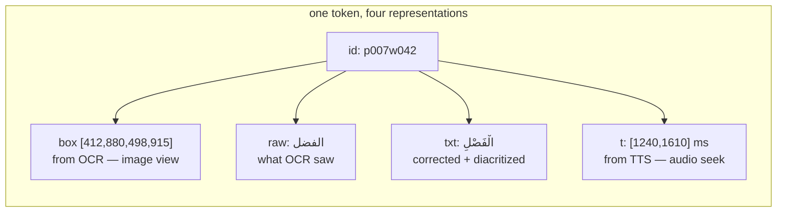
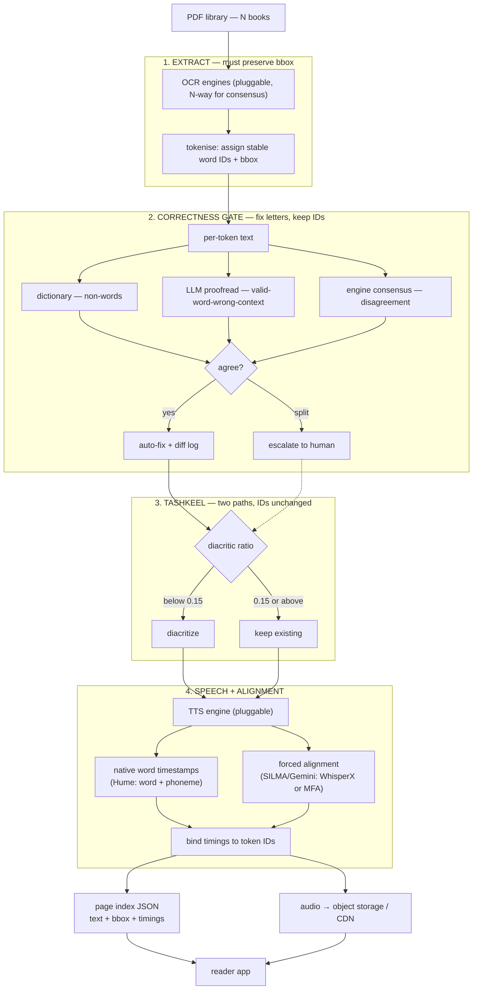
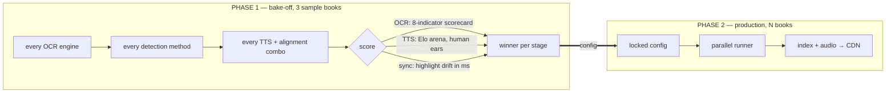

# ocr_review_models

Scanned Arabic children's books → an interactive read-along library.

A reader opens a book, sees the page, hovers or selects a passage, and hears it
read aloud in Arabic fuṣḥā — with the spoken word highlighted as it plays.

**Scale target: N books, templated. Currently N = 36; design point N ≥ 1,000.**

---

## The core problem

This is **not** an OCR problem and **not** a TTS problem. Both are solved
products you can buy. The two hard parts are:

1. **Arabic TTS pronounces the diacritics, not the letters.** An OCR error that
   looks harmless on the page becomes a confidently mispronounced word.
2. **Sync.** Text on screen and audio in the ear must be the *same object*,
   addressable at word granularity, in two different views (page image and
   reflowed text), across a catalogue too large to ever proofread by hand.

Everything below follows from those two.

---

## Evidence: why the naive pipeline fails

### Tashkeel coverage is bimodal, not "sometimes missing"

Diacritics per Arabic letter, measured across current OCR output:

| Book (OCR output) | ratio | needs |
|---|---:|---|
| `Ibn_Battuta_in_Egypt` (baseerocr) | 0.00 | full diacritization |
| `استكشاف العلوم` (lighton) | 0.01 | full diacritization |
| `المومياوات` (deepseek) | 0.02 | full diacritization |
| … | | |
| `القمر` (lighton) | 0.78 | already diacritized |
| `النجوم` (lighton) | 0.80 | already diacritized |
| `الكواكب` (lighton) | 0.81 | already diacritized |
| `الشمس` (lighton) | 0.82 | already diacritized |

No middle ground. Books are printed either with tashkeel (~0.8) or without
(~0.0). **Two paths are required**; "add tashkeel everywhere" would corrupt the
already-correct half.

### Where tashkeel exists, it can be confidently wrong

`الشمس` is 78% diacritized — and has **10 letter-substitution errors in 16 pages**:

| OCR produced | should be | why it matters |
|---|---|---|
| `الفضل` ×4 | `الفصل` | "grace/merit" vs **"classroom"** — changes the sentence |
| `فزح` ×2 | `قزح` | `قوس قزح` = rainbow; `فزح` is not a word |
| `رجاجيا` | `زجاجيا` | "glass" — ز→ر |
| `مغظم` | `معظم` | "most" — ع→غ |
| `النقطت` | `التقطت` | "picked up" |
| `مريي` | `مرئي` | "visible" — hamza lost |

`الفضل` is the dangerous class: a **valid Arabic word**, so a spellchecker passes
it, a diacritizer diacritizes it beautifully, and the reader hears *al-faḍl*
where the book says *al-faṣl*.

> **Corollary: correct before diacritizing.** Diacritizing a misspelled word
> produces fluent, confident, wrong audio — the hardest kind of bug to find,
> because it sounds fine.

---

## The architectural enhancement: token anchoring

This is the recommendation that makes the sync requirement tractable.

The pipeline mutates text at three stages — correction (`الفضل`→`الفصل`),
diacritization (`الفصل`→`الْفَصْلِ`), and chunking. Meanwhile the reader needs
to highlight a **box on a scanned image** and a **span of reflowed text** and
**seek into audio**, all for the same word. String offsets cannot survive that;
they shift at every stage.

**Solution: assign every word a stable ID at OCR time and never renumber it.**
Every later stage attaches to the ID, not the string.



Given that, all three surfaces are the same lookup:

| Reader action | Resolution |
|---|---|
| hover a word on the **page image** | box → `id` → `t.begin` → seek audio |
| select a span of **reflowed text** | `id` range → `t[first].begin … t[last].end` |
| audio playhead advances | `t` → `id` → highlight box *and* text |

Without stable IDs, correction changing `مريي`→`مرئي` (different length) silently
breaks every downstream offset — and the bug appears as a highlight drifting
one word off, three pages later.

---

## Pipeline



---

## Delivery: three modes, one index

All three are supported; the index is identical in each case — only *when*
synthesis happens changes.

| Mode | Synthesis | Storage at N=1,000 | Use for |
|---|---|---|---|
| **Pre-generated** | all up front | 12 GB MP3 | popular/curated titles, offline |
| **On-demand** | at selection, ~500 ms TTFT | grows with demand | long tail, arbitrary selections |
| **Hybrid** | pages pre-gen, selections live | demand-shaped | default |

> On-demand synthesis returns audio for exactly the selected string, so it needs
> no alignment map — but it *does* still need token IDs to know which string to
> send. Token anchoring is required in all three modes.

---

## Scale: everything is a function of N

Ratios measured from real artifacts in this repo
(31.4 pages/book, ~400 chars/page, 0.06 s/char, 5.7 chars/word).

| | N = 36 | N = 1,000 | N = 5,000 |
|---|---:|---:|---:|
| pages | 1,129 | 31,361 | 156,806 |
| characters | 452 K | 12.5 M | 62.7 M |
| audio | 8 h | **209 h** | 1,045 h |
| WAV | 1.3 GB | 36.1 GB | 180.6 GB |
| MP3 | 0.4 GB | **12.0 GB** | 60.2 GB |
| index JSON | 11 MB | **293 MB** | 1.5 GB |
| SILMA requests @250 chars | 1.8 K | 50 K | 251 K |
| wall-clock @1 req/s | 1 h | **14 h** | 70 h |
| OCR, 3-engine consensus | $38 | **$1,064** | $5,322 |

**Consequences that changed the design:**

- Audio never enters git. 12 GB vs. the 111 MB OCR commit that already strained
  the repo. → object storage + CDN, git holds text and timings only.
- At 293 MB the index is itself a dataset, not a side-file. → per-page files,
  shardable, lazily fetched by the reader.
- 14 h wall-clock at SILMA's observed 1 req/s makes serial production infeasible.
  → the runner must parallelise across books, or use an engine with a higher cap.
- OCR stops being free. GLM-OCR is $9 at N=1,000; Baseer is $836. → engine choice
  is now a budget decision, informed by the pricing dashboard already in this repo.

---

## Two phases

Brute-forcing every option across the full catalogue is impossible — the sweep
alone would be millions of characters, and SILMA credits were exhausted in
testing at ~1,500. So: **sweep on a sample, lock one path for production.**



### Sample set — exercises both tashkeel paths

| Book | pages | tashkeel | why |
|---|---:|---:|---|
| `Ibn_Battuta_in_Egypt` | 5 | 0.00 | reference transcript **already exists** (538 words, hand-read); 8 engines already scored |
| `الشمس` | 16 | 0.82 | already has SILMA per-page audio + Gemini draft |
| `استكشاف العلوم` | — | 0.01 | second undiacritized book, longer |

### What the sweep measures

| Stage | Metric | Harness |
|---|---|---|
| OCR | 8-indicator scorecard + bbox presence | ✅ built |
| Correction | errors caught / false edits introduced | ❌ to build |
| Tashkeel | diacritic error rate vs reference | ❌ to build |
| TTS voice | Elo from blind A/B | ✅ built |
| **Sync** | **highlight drift, ms** | ❌ to build |

---

## Data contract

One JSON per page. Audio and rendered text derive from it; it is the only
source of truth.

```jsonc
// index/<book>/p007.json
{
  "book": "الشمس", "page": 7,
  "engine": "lighton", "tts": "hume", "align": "native",
  "diac_ratio": 0.81, "path": "keep", "status": "tts_done",
  "audio": "https://cdn/…/الشمس/p007.mp3",
  "fixes": [
    { "id": "p007w042", "from": "الفضل", "to": "الفصل",
      "by": "consensus", "votes": "3/3" }
  ],
  "tokens": [
    { "id": "p007w042",
      "raw": "الفضل",              // what OCR saw
      "txt": "الْفَصْلِ",            // corrected + diacritized  → text view
      "box": [412, 880, 498, 915], // page-image coords         → image view
      "t":   [1240, 1610] }        // ms into audio             → playback
  ]
}
```

| Field | Enables |
|---|---|
| `tokens[].id` | the anchor — survives correction, diacritization, chunking |
| `tokens[].box` | image-view highlight |
| `tokens[].t` | audio seek + karaoke highlight |
| `fixes[]` | reviewable diff log — audit changes, not 31,361 pages |
| `diac_ratio` | routes to the correct tashkeel path |
| `status` | resume: skip anything already done |
| `engine`/`tts`/`align` | provenance, so sweep results stay comparable |

---

## The code

Everything below is real, runnable, and was used to produce the two books in
`work/`. Run from the repo root.

```
src/pipeline/
  extract.py        layer 01-03, text-layer path   — read PDF text + word boxes, clean by rule
  ocr.py            layer 01,    OCR path          — Gemini vision + response schema, line boxes
  ocr_lighton.py    layer 01,    OCR path (alt)    — LightOn, text only, no boxes (comparison run)
  tashkel.py        layer 04b                      — diacritise 'diacritise'-routed pages, ids unchanged
  speak.py          layer 05-06                    — bind TTS word timings onto token ids
  run_extract.py    driver, text-layer books       — النجوم
  run_ocr.py        driver, scanned books          — المومياوات  (resumable, BOOK=/PAGES= env)
  run_tashkel.py    driver, diacritisation         — resumable, skips 'keep' pages and pages already done
  run_speak.py      driver, TTS + alignment        — resumable, skips pages already spoken
  rebind.py         re-bind timings offline        — uses persisted hume_words, no API spend
  repair.py         fill gaps on legacy pages      — interpolates where raw timings were lost
  build_reader.py   layer 08                       — emits work/<book>/reader.html
```

### Running it

```bash
# text-layer book (no OCR needed — 25 of 36 PDFs qualify)
python3 src/pipeline/run_extract.py

# scanned book (OCR path)
BOOK="المومياوات ناشيونال جيوجرافيك " PAGES=5 python3 src/pipeline/run_ocr.py

# diacritise pages the router sent down 'diacritise' ('keep' pages untouched)
BOOK="المومياوات ناشيونال جيوجرافيك " python3 src/pipeline/run_tashkel.py

# synthesise + align, then build the reader
python3 src/pipeline/run_speak.py
python3 src/pipeline/build_reader.py
```

Every driver is resumable: a page already done is skipped, so hitting a quota
ceiling costs one page on retry, not the book. That was not theoretical — all
three providers (Hume, SILMA, Gemini) hit their limits during this build.

---

## Two extraction paths

The corpus splits, and the split matters more than the engine choice.

| | text-layer path | OCR path |
|---|---|---|
| books | **25 of 36** | 11 of 36 |
| module | `extract.py` | `ocr.py` |
| text source | embedded PDF text | Gemini vision |
| accuracy | exact — no recognition step | model-dependent |
| **box granularity** | **per word, measured** | **per line, subdivided** |
| tashkeel | already present (~0.80) | as printed (~0.24 measured) |
| cost | free, instant | per page, quota-limited |
| defects | kashida, stray marks, dropped hamza | recognition errors |

Both emit the identical page record, so everything downstream is shared. The
record carries `source` and `box_level` so the reader can tell the difference
instead of implying precision it doesn't have.

> Finding that reshaped this: OCR of `السماء` turned `الْفَصْلِ` ("classroom")
> into `الفضل` ("grace") four times. The same book's **text layer has it right**.
> For 69% of the corpus, the OCR error class is avoidable entirely.

---

## Stage → implementation mapping

| # | Stage | Module | State |
|---|---|---|---|
| 01 | Extract (text layer) | `extract.py` | ✅ built, run on النجوم |
| 01 | Extract (OCR) | `ocr.py` | ✅ built, run on المومياوات (17/33 pages, quota) |
| 02 | Tokenise + anchor | `extract.py` / `ocr.py` | ✅ stable ids + boxes |
| 03 | Clean by rule | `extract.py:clean_word` | ✅ 4 rules, unit-tested with controls |
| 04 | Tashkeel router | `run_extract.py` / `run_ocr.py` | ✅ routes on diacritic ratio |
| 04b | Diacritise | `tashkel.py` / `run_tashkel.py` | ✅ arabic-diacritizer, run on المومياوات (4 pages routed `diacritise`, ids unchanged) |
| 05 | TTS | `run_speak.py` | ✅ Hume, 15 pages of النجوم |
| 06 | Align | `speak.py:bind` | ✅ 93.7% anchored to real timestamps |
| 07 | Index | page JSON in `work/<book>/` | ✅ |
| 08 | Reader | `build_reader.py` | ✅ `work/النجوم/reader.html` |

---

## What was actually produced

| | النجوم | المومياوات |
|---|---|---|
| path | text layer | OCR (Gemini) |
| pages | 16 (15 narrated + front matter) | 17 of 33 |
| tokens | 816 | 788 |
| cleaned by rule | 563 (69%) | 21 |
| audio | **8.4 min, real** | — (quota) |
| timings anchored | **759 / 810 (93.7%)** | — |
| reader | ✅ `work/النجوم/reader.html` | index only |

---

## The HTML artifacts

Four standalone files, no build step, no CDN. Open any of them directly.

| File | What it is |
|---|---|
| `demo/pipeline_poc.html` | **The architecture + POC walkthrough.** Interactive SVG system chart (click any of 18 nodes for detail), token-anchoring diagram, two-phase chart, a 7-step trace of one line through every layer, and a working reader demo with **real Hume audio and real word timestamps**. Built on `السماء` page 5. |
| `work/النجوم/reader.html` | **The real product.** 15 pages, 8.4 min of real audio, text ↔ page-image views, click-to-seek, word highlight driven by measured timings. Reads only the page index — no pipeline logic. |
| `demo/OCR pricing dashboard.html` | 16 vendor configurations audited, with source-confidence ratings and the accuracy comparison. |
| `demo/ocr_benchmark.html` | The 8-engine OCR bake-off on Ibn Battuta, with malformed-Arabic samples per engine. |

### About `demo/pipeline_poc.html`

There is no `demo_pipeline.html` — this is the file. It answers "what happens to
a PDF, step by step, and what does the user finally see":

1. **Data-integrity finding** — `sam_2/الشمس.txt` is actually `السماء.pdf`,
   misfiled. Its cover was OCR'd as `لولو` and the ISBN digits disagree.
2. **System flow** — nine layers, PDFs in, reader out, with branch diamonds for
   the correctness vote and the tashkeel route. Click a node for what it emits.
3. **Token anchoring** — one `id`, four representations (`box`, `raw`, `txt`, `t`).
4. **Trace** — the same line at every stage, showing what each layer changes.
5. **Reader POC** — plays real audio; the highlight is driven by Hume's own word
   timestamps, not a timer.

Anything simulated in it is labelled as such — in that file, only the bounding
boxes are (it predates the text-layer discovery that made real boxes free).

---

## Decisions

| Decision | Chosen | Rejected because |
|---|---|---|
| Tashkeel | correct **then** diacritize | "add if missing" leaves `الفضل` mispronounced |
| Detection | all methods, brute-forced | dictionary alone misses 4 of 10 found errors |
| Sweep scope | sample only | full-catalogue sweep is millions of chars |
| Flagged pages | auto-fix + diff log + spot-check | flag-only stalls at ~700 flags per 1,129 pages |
| Anchoring | **stable token IDs** | string offsets break at every mutation |
| Reader | image **and** text views | illustrations matter; study needs text |
| Storage | CDN for audio, git for index | 12 GB cannot live in git |
| Delivery | all three modes | different titles have different economics |
| Engine choice | pluggable, decided by sweep | fuṣḥā quality and timestamp support are unverified and may conflict |

---

## Open items

**Resolved during the build**

- ~~Bbox survival~~ — solved twice. The text layer gives exact **word** boxes for
  25 of 36 books; Gemini + a response schema gives **line** boxes for the rest,
  verified by overlaying them on the rendered page.
- ~~Does any engine give fuṣḥā *and* word timestamps~~ — Hume does emit word
  timestamps (93.7% coverage measured). Its Arabic voice quality is still
  unjudged by ear.
- ~~No diacritiser exists~~ — built. `tashkel.py` wraps `arabic-diacritizer`
  (BiLSTM + sentence cache, MIT, CPU-only), chosen per the research note
  (`models/ibn_battuta/Tashkeel libraries and APIs - research.html`) over a
  general LLM, which the same note measures at 3× the error rate (GPT-5.3:
  20.9% DER vs. 6.6%). Diacritises full-sentence context, then re-attaches
  words to token ids by position rather than by re-tokenising the output — a
  page where the model returns a different word count than it was given is
  left untouched and reported, not silently misaligned. Run on المومياوات's
  4 `diacritise`-routed pages; word count matched on all 4.

**Blocking**

- [ ] **All three TTS/OCR providers are quota-exhausted** — Hume (mid-book on
      النجوم), SILMA (mid-book earlier), Gemini (page 18 of المومياوات). Every
      driver resumes, so this is a billing question, not an engineering one.

**Known limitations of what was built**

- [ ] **Hume's word timestamps are not one-per-word.** Page 14 returned 20 for 29
      tokens, and one interval was inverted (`كريم [12920, 5240]`). The binder
      anchors what it gets and interpolates the rest, recording `t_src` per token.
- [ ] **OCR boxes are line-level.** Word boxes on the OCR path are subdivided by
      letter count — approximations, flagged `box_level: "line"`.
- [ ] **Pages 12–16 of النجوم** were bound before raw timestamps were persisted,
      so their gaps were repaired from surviving anchors rather than re-bound
      from source. p014 is 19/29 anchored; the rest are 93–100%.
- [ ] **The correctness gate is rule-based only.** The dictionary/LLM/consensus
      design in this README is unbuilt — it wasn't needed for a text-layer book,
      but the OCR path has no error detection at all yet.

**Still open from the plan**

- [ ] Voice choice unvalidated — "Layla, Arabic Philosopher" is the only
      Arabic-designated voice in Hume's 160-voice library, chosen on that basis
      alone. Nobody has listened critically yet.
- [ ] Reference transcripts for the sample books (~1 h each, manual).
- [ ] TTS budget for N=1,000: 12.5 M characters, unpriced.
- [ ] Parallelism — 14 h serial at N=1,000; the runner must shard.
- [ ] Front matter: page 1 is title/ISBN/deposit number. Currently skipped for
      narration; confirm that's wanted.
- [ ] 7.9 MB of audio was committed in `702c803` before `.gitignore` covered it.
      Untracked now, but still in history.
