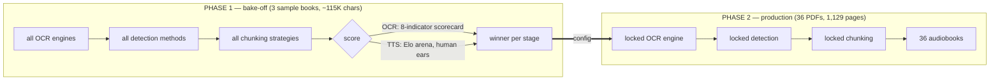
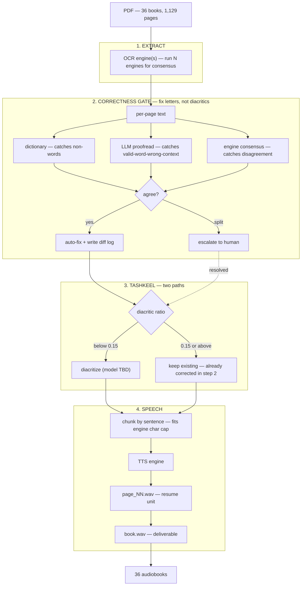

# ocr_review_models

Turning a shelf of scanned Arabic children's books into listenable audiobooks.

**36 PDFs · 1,129 pages · ~451,600 characters of narration.**

The hard part isn't OCR and it isn't TTS. It's the gap between them: Arabic
text-to-speech pronounces what the diacritics tell it to, so an OCR error that
looks harmless on the page becomes an audibly wrong word in the audiobook.

---

## The problem, measured

Two independent failure modes were found in the existing extractions. A single
fix addresses only one of them.

### 1. Tashkeel coverage is bimodal, not merely "sometimes missing"

Diacritics per Arabic letter, measured across current OCR output:

| Book (OCR output) | ratio | needs |
|---|---:|---|
| `Ibn_Battuta_in_Egypt` (baseerocr) | 0.00 | full diacritization |
| `استكشاف العلوم` (lighton) | 0.01 | full diacritization |
| `المومياوات` (deepseek) | 0.02 | full diacritization |
| … | | |
| `القمر` (lighton) | 0.78 | already diacritized |
| `النجوم` (lighton) | 0.80 | already diacritized |
| `الكواكب` (lighton) | 0.81 | already diacritized |
| `الشمس` (lighton) | 0.82 | already diacritized |

There is no middle. Books are either printed with tashkeel (~0.8) or without
(~0.0). **The pipeline therefore needs two paths, not one**, and a naive
"add tashkeel everywhere" step would re-diacritize already-correct text.

### 2. Where tashkeel exists, it can be confidently wrong

`الشمس.txt` is 78% diacritized — and contains at least **10 letter-substitution
errors in 16 pages**:

| OCR produced | should be | why it matters |
|---|---|---|
| `الفضل` ×4 | `الفصل` | "grace/merit" vs **"classroom"** — changes the sentence |
| `فزح` ×2 | `قزح` | `قوس قزح` = rainbow; `فزح` is not a word |
| `رجاجيا` | `زجاجيا` | "glass" — ز→ر |
| `مغظم` | `معظم` | "most" — ع→غ |
| `النقطت` | `التقطت` | "picked up" |
| `مريي` | `مرئي` | "visible" — hamza lost |

`الفضل` is the dangerous class: it is a **valid Arabic word**, so a spellchecker
passes it, a diacritizer diacritizes it cleanly, and the TTS says *al-fadl*
where the book says *al-fasl*. It is only detectable by reading for meaning.

> **This is why the pipeline corrects before it diacritizes.** Diacritizing a
> misspelled word produces fluent, confident, wrong audio.

---

## Architecture: two phases

Brute-forcing every option across all 36 PDFs would require ~4M characters of
TTS synthesis (3 chunking strategies × 3 engines × 451,600 chars). SILMA
credits were exhausted in testing at roughly 1,500 characters. So the sweep runs
on a **sample**, and production runs a **single locked path**.



### Phase 1 sample

Chosen to exercise **both tashkeel paths** and to reuse existing work:

| Book | pages | tashkeel | why this one |
|---|---:|---:|---|
| `Ibn_Battuta_in_Egypt` | 5 | 0.00 | reference transcript **already exists** (538 words, hand-read); 8 engines already scored |
| `الشمس` | 16 | 0.82 | already has SILMA per-page audio + a Gemini whole-book draft |
| `استكشاف العلوم` | — | 0.01 | second undiacritized book, longer than Ibn Battuta |

---

## The pipeline



### Why chunking has three layers

Each layer exists for a different reason — collapsing them breaks something:

| Layer | Exists because | Evidence |
|---|---|---|
| **sentence** | engines cap request size | SILMA rejects >250 chars: `HTTP 400 "Text too long."` |
| **page** | failures must be resumable | credit exhaustion killed a run mid-book; per-page files meant only 1 page was lost |
| **book** | it's the actual deliverable | nobody listens to `page_07.wav` |

---

## Stage → implementation mapping

| # | Stage | Input | Output | Current state |
|---|---|---|---|---|
| 1 | **Extract** | `assets/**/*.pdf` | `work/<book>/pNNN.json` | ✅ 8 engines exist in `src/` (`run_lighton_ocr.py`, `paddle_ocr.py`, `gemini.py`, …) — **no multi-engine runner yet** |
| 2 | **Correctness gate** | `pNNN.json.raw` | `.corrected` + `fixes[]` | ❌ **does not exist** |
| 3 | **Tashkeel** | `.corrected` | `.diacritized` | ❌ `src/tashkel.py` is **empty** |
| 4 | **Chunk + TTS** | `.diacritized` | `page_NN.wav` → `book.wav` | ⚠️ `src/salima.py` works per-page w/ resume; `src/huma_ai.py` works single-shot; `src/gemini.py` untested (has `ENTER_FILE_NAME` placeholder) |
| — | **Scoring (Phase 1)** | outputs | winner | ✅ OCR scorecard + Elo arena both built |

### Existing assets worth reusing

- **OCR scorecard** — 8 indicators (accuracy, bad-Arabic %, invented words,
  English-injected, mixed-script, numbers, layout), already run over 8 engines.
- **TTS Elo arena** — `assets/samples_tashkel/sam_1/arabic_tts_arena.html`,
  blind A/B → Elo, 7 clips loaded.
- **Pricing dashboard** — `OCR pricing dashboard.html`, 16 configurations
  audited with source-confidence ratings.

---

## Data contract

One JSON per page is the spine. Markdown and audio are *rendered from* it, never
the source of truth — this is what makes brute-force comparison and resume work.

```
work/<book>/p007.json
{
  "page": 7,
  "engine": "lighton",
  "raw":        "…وَأَوْضَحَتِ الْمُعَلِّمَةُ فِي الْفَضْلِ…",
  "corrected":  "…وَأَوْضَحَتِ الْمُعَلِّمَةُ فِي الْفَصْلِ…",
  "fixes": [
    { "from": "الفضل", "to": "الفصل", "by": "consensus", "votes": "3/3" }
  ],
  "diac_ratio": 0.81,
  "path": "keep",
  "status": "tts_done"
}
```

| Field | Enables |
|---|---|
| `engine` | comparing two engines' output for the same page |
| `fixes[]` | the reviewable diff log — you audit changes, not 1,129 pages |
| `diac_ratio` | routing to the correct tashkeel path |
| `status` | resume: skip anything already `tts_done` |

---

## Decisions and why

| Decision | Chosen | Rejected because |
|---|---|---|
| Goal | produce audiobooks | benchmarking alone yields no deliverable |
| Tashkeel step | **correct, then diacritize** | "add if missing" leaves `الفضل` silently mispronounced |
| Error detection | all three methods, brute-forced | dictionary alone misses 4 of 10 found errors |
| Scope of brute force | sample only | full-corpus sweep = ~4M chars; credits died at ~1,500 |
| Flagged pages | auto-fix + diff log + spot-check | flag-only stalls the pipeline (~700 expected flags) |
| Data contract | per-page JSON | markdown page-markers carry no provenance or status |
| Winner criteria | existing scorecard + Elo arena | TTS quality has no automatic metric — it needs ears |

---

## Costs (from the audited pricing table)

OCR over all 1,129 pages, one pass:

| Engine | Cost |
|---|---:|
| GLM-OCR | $0.34 |
| FastOCR | $2.26 |
| LightOnOCR-2-1B | $2.57 |
| MinerU | $5.65 |
| Surya 2 | $11.29 |
| Baseer OCR *(quality rank 1)* | $30.10 |
| **3-engine consensus** | **$38.32** |

OCR is not the constraint. **TTS is**: 451,600 characters, ~1,806 SILMA requests
at the 250-char cap, ~0.5h wall-clock at the observed 1 req/sec limit — and
subject to a character-credit ceiling that has already been hit once.

---

## Open items

- [ ] **Diacritization model unchosen.** `src/tashkel.py` is empty. Candidates
      to bake off in Phase 1; `models/ibn_battuta/Tashkeel libraries and APIs - research.html`
      has prior research.
- [ ] **Reference transcripts** needed for the 2 sample books that don't have
      one (Ibn Battuta's already exists). Manual, ~1h each — this is the real
      cost of the scorecard.
- [ ] **TTS credit budget** unresolved. Production needs ~451,600 characters;
      current plan has no confirmed allowance for that.
- [ ] `src/gemini.py` still has `ENTER_FILE_NAME_{i}` placeholders and has never
      been run.
- [ ] Page 1 of each book is front matter (title, ISBN, deposit number) — decide
      whether to narrate or skip it.
