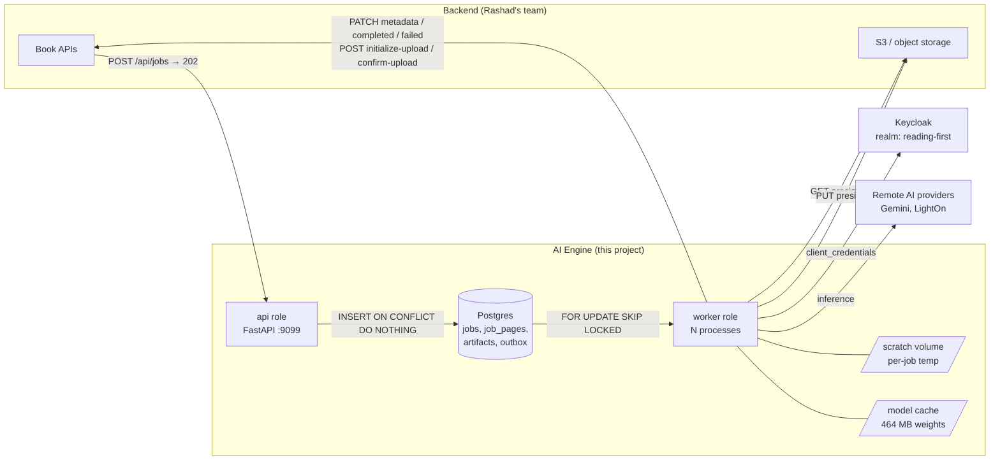

# Executive Architecture Summary

## What is being built

The **AI Engine** is a new HTTP service that wraps this repository's existing Arabic OCR and
text-to-speech capability so the Reading First Backend can drive it as a job queue.

The V1 contract (`assets/Backend & AI integration V1.pdf`) is narrow and precise. The Backend POSTs a
job; the AI Engine returns `202 Accepted` immediately, does the work in the background, uploads the
resulting files into the Backend's own storage through a three-step upload cycle, and reports progress
back page by page with `PATCH` callbacks. There are two job types:

| Job type | Input | Output per page |
|---|---|---|
| `PAGES_IMG_AND_TEXT_EXTRACTION` | one PDF | 1 image file + 1 text file |
| `PAGE_AUDIO_AND_TEXT_TIMING_GENERATION` | one page's text file | 1 audio file + 1 timing JSON |

Full extraction in [02-v1-requirements.md](02-v1-requirements.md).

## The three findings that shape everything

### 1. The entire integration layer is greenfield

There is no HTTP surface, no queue, no database, no authentication client, and no object-storage client
anywhere in this repository. This was verified by exhaustive search, not assumed:

- No `fastapi`, `flask`, `uvicorn`, `starlette`, `django`, `celery`, `redis`, `boto3`, `sqlalchemy`,
  `keycloak`, or JWT library is imported by any file. The only `Authorization` headers in the codebase
  are **outbound** static API keys to AI vendors (`walidapro/ocr_verifier/lighton_ocr.py:20`,
  `walidapro/ocr_verifier/reviewer.py:41`, `src/pipeline/ocr_lighton.py:67`).
- No `Dockerfile`, `docker-compose`, CI configuration, `Makefile`, `pyproject.toml`, or `setup.py` exists
  — and `git log --all --diff-filter=D` confirms none were ever deleted.
- There is no `jobId` concept, no idempotency mechanism, and no job state anywhere. Identity today is a
  **directory named after the PDF's filename stem** (`src/pipeline/main.py:62-63`), including Arabic
  text, spaces, `?` and `' - Copy'`.

So the estimate is not "adapt the existing service"; it is "build the service, and reuse the AI".

### 2. The AI capability exists and is good — but it is two disconnected pipelines, and only one can produce the mandated timing artifact

| | **Pipeline S** — `src/pipeline/` + `tools/` | **Pipeline W** — `walidapro/` |
|---|---|---|
| Maintained core? | Yes — `tools/` imports `pipeline`, never the reverse; all 56 tests cover this side | Self-contained drop-in; references neither `src/` nor `tools/`; **zero tests** |
| OCR | PyMuPDF text layer (free, per-word boxes), or Gemini `gemini-3.6-flash`, or LightOn `parse-v3` | LightOn + LLM suspicious-word review + PaddleOCR bbox + crop-variant re-reads + blind-crop vision arbitration + score fusion |
| Diacritization | Local CPU BiLSTM, **free** | **One vision-model call per word** |
| **Word timing** | **Yes** — faster-whisper forced alignment + `speak.bind` | **None. Zero.** |
| Paid calls per page | 1–2 | ~40–200 |

Verified: a repo-wide search for `timing`/`timestamp`/`word_time`/`srt`/`vtt` across all
`walidapro/**/*.py` returns **zero hits**. Pipeline W cannot satisfy the V1 `artifactType: "JSON"`
timing artifact at all.

Meanwhile Pipeline S's timing quality is real and measured across all 95 spoken pages on disk:
**3,873 tokens — 78.0% anchored to a real speech timestamp, 21.8% interpolated, 0.2% untimed, zero
non-monotonic pages.**

Pipeline W's correctness machinery is the long-term quality asset — the letters-never-change guard on
diacritization (`walidapro/ocr_verifier/diacritization/rebuild_text.py:494` and `:536`), the blind-crop
protocol where the vision model never sees the candidate answer
(`walidapro/ocr_verifier/visual_reviewer.py:133-150`), and `FinalContextReviewer`'s refuse-rather-than-
guess envelope. **None of it is being deleted.** It is wrapped behind an opt-in quality tier.

### 3. Two of the four mandated artifacts don't exist as files — but the data does

This is the best news in the analysis.

| Artifact | Status |
|---|---|
| `Image` | **Exists.** `work/<book>/pages/pNNN.jpg` (`src/pipeline/ocr_gemini.py:56-62`). Median 161 KB. |
| `Text` | **Computed and thrown away.** `text = " ".join(t["txt"] for t in tokens)` is a local variable at `src/pipeline/run_ocr_gemini.py:65` that is never written to disk. Median 643 B. |
| `Audio` | **Exists.** `work/<book>/audio/pNNN.wav`, 24 kHz mono 16-bit (`src/pipeline/run_speak_gemini.py:44-47`). Median 1.0 MB. |
| `JSON` (timing) | **Exists as data, not as a file.** Timings live as `tokens[].t` / `t_src` inside the mixed-purpose `pNNN.json`. A ~3.3 KB projection needs carving out of the 8.1 KB record. |

Two of the four gaps are *file-formatting* work, not AI work.

## The recommended architecture

**One modular codebase, two process roles, one Postgres, no GPU.**

Full comparison of the three candidate architectures — modular monolith, modular backend + AI workers,
microservices — is in [05-target-architecture.md](05-target-architecture.md). The short version:

- **A page of work is seconds to minutes of blocking CPU and network.** Forced alignment alone is
  **5.42 s of CPU for 27.5 s of audio (measured)**, holding 464 MB of model weights. That cannot live in
  the HTTP request path, so a worker role is mandatory.
- **V1 has exactly one consumer and two job types.** Splitting OCR, diacritization, TTS and alignment
  into separate network services would multiply deploy units and add hops between stages that share a
  scratch directory, for no scaling or ownership benefit. Microservices are rejected.
- **Postgres is not optional.** The PDF explicitly requires a durable store keyed by job GUID for
  idempotency ("verifies it has not any Prev one in db or any data store via GUID given"). Since we must
  have it, using `SELECT … FOR UPDATE SKIP LOCKED` as the V1 queue avoids introducing a *second*
  stateful dependency. Migration trigger to a real broker is recorded in [ADR-004](19-adrs.md).
- **No GPU is required.** Every local model is CPU-pinned: PaddleOCR `device="cpu"`
  (`walidapro/ocr_verifier/config.py:32`), faster-whisper hardcoded `device="cpu", compute_type="int8"`
  (`src/pipeline/align_whisper.py:22`), diacritizer documented CPU-only
  (`src/pipeline/tashkel.py:14-17`). The expensive AI is remote.

Exactly **one** new network API surface exists in V1: `POST /api/jobs`, plus health and metrics probes.
No internal AI function becomes an endpoint. See the decision matrix in
[08-ai-integration.md](08-ai-integration.md).

## The one invariant that dictates the design

> **INVARIANT-1 (Page Completion Totality).** For a job with `pagesCount = N`, the engine must deliver
> exactly one terminal `PATCH` — `/completed` or `/failed` — for every page in `1..N`, or escalate the
> whole job. The PDF is unambiguous: *"the backend will consider that you finish your process after you
> completed the 30 pages whether they fail or succeed, if 29, no, the backend will wait for number 30
> page."*

A dropped page callback stalls a book in the Backend **forever**.

The existing code violates this everywhere: every page loop aborts all remaining pages on the first
exception (`src/pipeline/run_ocr_gemini.py:59-62`, `run_speak_gemini.py:79-84`, `run_ocr_lighton.py:58`,
`run_speak_hume.py:63-65`), and `walidapro/ocr_verifier/pipeline.py:1846-1865` buries a page failure as
the literal string `<!-- PAGE FAILED: {exc} -->` inside otherwise-successful output. Per-page failure
isolation, a durable page ledger, a callback outbox and a reconciler are therefore core V1 scope, not
hardening. See [09-async-jobs.md](09-async-jobs.md).

## Effort shape

| Phase | Content | Shape |
|---|---|---|
| 0 — Baseline | Pin the real dependency set (`requirements.txt` declares 1 of 14 packages), get the 56 existing tests green in a clean environment, add the timing instrumentation the repo completely lacks | S |
| 1 — Foundation | Packaging, `pydantic-settings` config, structured logging, error taxonomy | M |
| 2 — Backend/API | `POST /api/jobs`, JWT validation, job store, idempotent accept, queue claim | M |
| 3 — AI integration | Port/adapter seams over Pipeline S; per-page execution replacing book loops; the two new artifact projections | L |
| 4 — Data & storage | Page ledger, artifact ledger, outbox, reconciler, scratch lifecycle | M |
| 5 — External integrations | Keycloak token provider, source fetch + URL refresh, 3-step upload, callbacks | L |
| 6 — Testing | Contract fakes for Backend/Keycloak/S3, the INVARIANT-1 test suite | M |
| 7 — Deployment | Docker image, compose, migrations, model-cache volume | M |
| 8 — Hardening | Verified tier, tracing, rate budgeting, dependency scanning | L |

Task-level detail in [21-implementation-roadmap.md](21-implementation-roadmap.md).

## Top five risks

| | Risk | Why it matters |
|---|---|---|
| **R-01** | INVARIANT-1 violation | One dropped page callback stalls a book in the Backend permanently. Highest-impact failure mode in the system. |
| **R-02** | Cost blowup if the verified tier ships by default | Pipeline W's diacritization is one vision call **per word**; measured Arabic words per page over 186 real pages: median 35, p90 69, max 137. |
| **R-03** | Timing quality judged inadequate | 21.8% of tokens are interpolated, not anchored (measured). `README.md:473,491` records only ~51% anchored on one Gemini+whisper book versus 93.7% on Hume's native timestamps. |
| **R-04** | Three retrying layers stacking | The Backend retries, the app retries, and provider SDKs retry. `walidapro/ocr_verifier/final_context_reviewer.py` already bills up to 9 completions for one page from app-3× × SDK-2×. |
| **R-05** | Environments irreproducible | No packaging, no pins, no container. `pip install -r requirements.txt` then running any entry point fails immediately on `from dotenv import load_dotenv`. |

Full register in [23-risks-and-tradeoffs.md](23-risks-and-tradeoffs.md).

## What blocks the start of implementation

Two questions, both for the Backend/product side, from
[22-open-questions.md](22-open-questions.md):

- **`Q-01`** — **How does the AI Engine validate the inbound bearer token?** The PDF gives us
  `client_id`/`client_secret` for calling *the Backend*, and says inbound requests carry
  `Authorization: Bearer {ai-engine-bearer-token}`, but never states the validation mechanism, the
  expected audience, or which Keycloak client the Backend presents. Our PROPOSAL is JWKS-based RS256
  validation with a client allowlist ([12-security.md](12-security.md)), but this is the single largest
  ambiguity in the spec.
- **`Q-04`** — **Is the `Text` artifact raw OCR text, or the final corrected + diacritized reading
  text?** The PDF says only *"this file will be only the free text no highlighting no timing"*. We
  proceed on the ASSUMPTION that it is the final reading text, because it is both what the reader UI
  displays and what Job B feeds to TTS — undiacritized Arabic is mispronounced. If that assumption is
  wrong, the scope of both job types changes.

## What we are explicitly not doing in V1

- **No Kubernetes, service mesh, message broker, vector database, or GPU nodes.** Nothing in the
  requirements justifies any of them.
- **No microservice per AI stage.** See [ADR-002](19-adrs.md).
- **No engine-owned artifact store.** Artifacts go to the Backend's S3; the engine keeps references
  only. See [ADR-006](19-adrs.md).
- **No human-in-the-loop correction path.** `tools/context_detector.py` +
  `tools/apply_context_suggestions.py` are *deliberately* human-gated —
  `context_decisions.json` defaults every entry to `"reject"` and
  `tools/run_full_pipeline.py:99-115` literally stops the chain and prints
  *"STOPPING HERE ON PURPOSE -- one manual step left"*. That quality path has no place inside an
  automated job and is absent from V1 by design, not by oversight. This is a real quality reduction and
  is recorded as a risk.
- **No HTML reader artifacts uploaded.** The PDF's `artifactType` enum has no slot for HTML, so
  `reader.html` stays a local development artifact. ASSUMPTION, flagged as `Q-11`.
- **No rewrite of any working AI pipeline.** Existing logic is wrapped, not reimplemented.
