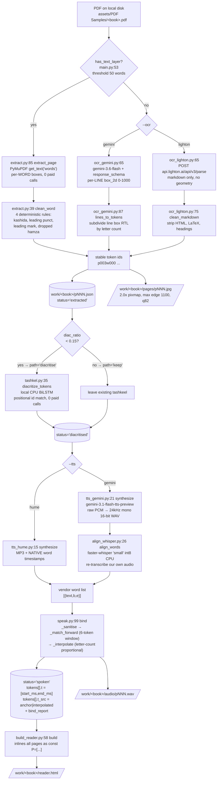
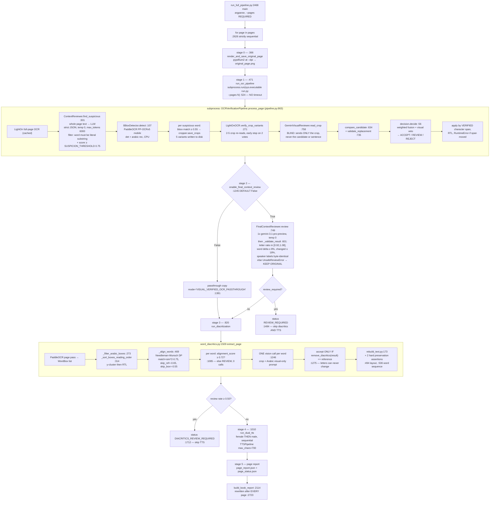

# Current Architecture Analysis

What exists today, verified against the source. Read this before
[04-gap-analysis.md](04-gap-analysis.md).

## 1. Repository inventory

22,018 lines of Python. There is no packaging file, so "the project" is four directory trees with
implicit relationships.

| Tree | LOC | What it is | Tests |
|---|---:|---|---|
| `src/pipeline/` | 1,633 | The PDF → page-JSON → diacritize → TTS → timing → `reader.html` pipeline. 17 modules. | Indirect (2 files) |
| `tools/` | 1,752 | 10 standalone CLIs implementing two-engine OCR ensemble correction on top of `src/pipeline`. | 5 of 10 modules |
| `walidapro/` | 16,155 | A self-contained, higher-assurance OCR verification + diacritization + dual-TTS pipeline. 29 modules. | **Zero** |
| `src/tests/` | 763 | 56 hermetic pytest tests. Pass in 1-2 s, zero network calls. | — |
| `tmp/` | ~1,400 | ~10 abandoned single-file spikes against other OCR vendors (DeepSeek, GLM, Mistral, Falcon, Paddle, Datalab, Docling, Infinity). Dead. | — |
| `demo/` | 212 | A self-contained HTML proof-of-concept build script. | — |

### Dependency direction

Verified by grep:

- `tools/` → `src/pipeline`: five files import it (`tools/ensemble_review.py:28`,
  `tools/build_review.py:38-41`, `tools/vlm_arbiter.py:33`, `tools/run_full_pipeline.py:42`, and
  `tools/apply_corrections.py:113` emits a shell line that imports it).
  `tools/run_full_pipeline.py:57,66` calls `main_pipeline.run_pipeline` twice as its first two steps.
- `src/pipeline` → `tools/`: never.
- `walidapro/` ↔ anything else: **never in either direction.** It is a closed system with its own
  `run_full_pipeline.py` (2,911 LOC) and its own `config.py`.

`walidapro/` entered the repository in a single commit, `add walid code` (2026-08-24). It is a drop-in
from a second author, not an evolution of `src/pipeline`.

**Conclusion: `src/pipeline` + `tools/` is the maintained core; `walidapro/` is a parallel
implementation.** This matters because the V1 architecture must pick a default path
([ADR-009](19-adrs.md)).

## 2. The two pipelines, side by side

| | **Pipeline S** (`src/pipeline/` + `tools/`) | **Pipeline W** (`walidapro/`) |
|---|---|---|
| Unit of work | one book → `work/<book>/` | one book → `<output>/page_NNN/` per page |
| Entry point | `src/pipeline/main.py:93` (argparse) | `walidapro/run_full_pipeline.py:2470` (argparse) |
| Page identity | `p{page:03d}`, 1-based | `page_{page:03d}`, 1-based |
| Text-layer fast path | **Yes** — PyMuPDF `get_text("words")`, per-word boxes, **0 paid calls** (`src/pipeline/run_extract.py:29`). Used by 25 of 36 sample books (`README.md:444-448`). | No — unconditionally rasterizes and OCRs every page |
| OCR engines | Gemini `gemini-3.6-flash` with forced `response_schema` (line boxes subdivided RTL by letter count, `src/pipeline/ocr_gemini.py:87`) or LightOn `parse-v3` (markdown only, `box_level:"none"`) | LightOn page OCR + adaptive crop-variant re-reads |
| Error detection | `tools/ensemble_review.py` difflib alignment of two engines' token lists + `tools/vlm_arbiter.py` vision arbitration + `tools/context_detector.py` reasoning-model pass — **but three of these require a human** | In-process: `ContextReviewer.find_suspicious` → PaddleOCR bbox → 5 crop variants → 2–5 LightOn re-reads → blind-crop Gemini vision → 2 reviewer scores → `decision.decide` fusion |
| Diacritization | Local CPU BiLSTM (`arabic-diacritizer`), free, routed on `diac_ratio < 0.15` (`src/pipeline/tashkel.py`) | **One vision-model call per Arabic word** (`walidapro/ocr_verifier/diacritization/word_diacritics.py:1246`) |
| Final text audit | none | `FinalContextReviewer` — 1 Gemini `gemini-3.1-pro-preview` call/page with a hard safety envelope. **OFF by default** (`walidapro/run_full_pipeline.py:1245`) |
| TTS | Gemini `gemini-3.1-flash-tts-preview` → 24 kHz mono WAV, or Hume → MP3 | Gemini TTS, chunked at 700 chars, **two narrators per page** (female + male) |
| **Word timing** | **Yes** — the only implementation in the repo | **None** — zero hits for `timing|timestamp|word_time|srt|vtt` across all `walidapro/**/*.py` |
| Paid calls/page | 1 (text-layer + TTS) to 2 (OCR + TTS) | ~40–200 |
| Resumability | `status` field state machine on each page JSON | Multi-layer disk caches (OCR fingerprint, visual, review, per-word diacritics, TTS chunk) |
| Failure semantics | `break`/`return` aborts all remaining pages | Per-page `try/except` → `error.txt` + `page_status.json`, loop continues |
| Tests | 56, all on this side | 0 |

Each pipeline is better than the other at something. Pipeline S has the timing capability, the fast
path, and the tests. Pipeline W has the correctness machinery and per-page failure isolation. Neither is
a superset. See [ADR-009](19-adrs.md) for how V1 resolves this.

## 3. Pipeline S — reconstructed data flow



The five layers, restated in the brief's required shape:

| Layer | Pipeline S implementation |
|---|---|
| **Input** | A local `.pdf` path. `read_bytes()` at `src/pipeline/run_extract.py:37`, `run_ocr_gemini.py:36`, `run_ocr_lighton.py:41`. |
| **Preprocessing** | Text-layer detection (`main.py:53`); page rasterization at 2.0× then thumbnail to max edge 1100 px, JPEG q82 (`ocr_gemini.py:57-61`); per-page PDF slicing for LightOn (`ocr_lighton.py:56`). |
| **Model / AI component** | Gemini vision OCR, or LightOn parse, or no model at all on the text-layer path; local BiLSTM diacritizer; Gemini or Hume TTS; faster-whisper forced alignment. |
| **Postprocessing** | Rule-based Arabic word cleaning (4 rules), RTL line-box subdivision, markdown/LaTeX de-noising, positional diacritic re-binding, timestamp→token binding with interpolation. |
| **Business logic** | The `diac_ratio` router; the `status` state machine gating every paid call; the `bind_report` quality record. |
| **Output** | `pNNN.json` (source of truth), `pages/pNNN.jpg`, `audio/pNNN.wav`, `reader.html`. |

## 4. Pipeline W — reconstructed data flow



| Layer | Pipeline W implementation |
|---|---|
| **Input** | A local `.pdf` path, `--pages` **required** (`walidapro/run_full_pipeline.py:2496-2504`). |
| **Preprocessing** | pypdfium2 render at `--dpi` (default 220, `config.py:20`); crop padding + 5 image-processing variants (upscale, contrast, sharpen, threshold) at `cropper.py:155`. |
| **Model / AI component** | LightOn Parse v3; an OpenAI-compatible reviewer LLM; Gemini vision (blind crop reads and per-word diacritics); `gemini-3.1-pro-preview` for final text audit; PaddleOCR for localization only; Gemini TTS ×2 narrators. |
| **Postprocessing** | Consensus selection across crop variants; local `SequenceMatcher` support scoring on Arabic-normalized strings; multi-gate "unclear" cascade; weighted score fusion; verified-character-span text application; layout-preserving text rebuild with two hard assertions. |
| **Business logic** | Two cost gates that short-circuit a page rather than spend more (`review_required`, diacritics review rate ≥ 0.50); the precision bias that an unclear visual read may never authorize a letter change. |
| **Output** | Per-page directory with `original_page.png`, `corrected_text.md`, `final_corrected_text.txt`, `final_audio.wav` ×2, `report.json`, `page_status.json`; plus `book_report.json`. |

## 5. AI component register

Every AI component in both pipelines. Latency figures are labelled `[measured]` only where they were
actually timed; everything else is derived from call structure.

| Component | Purpose | Model | Framework | Input | Output | Preprocessing | Postprocessing | Latency | CPU/GPU | Memory | Stateful? | Sync-capable? | Should be async? | Expose as API? | Verdict |
|---|---|---|---|---|---|---|---|---|---|---|---|---|---|---|---|
| Text-layer extraction<br/>`src/pipeline/extract.py:85` | Read embedded PDF text + word boxes | none | PyMuPDF | PDF page | tokens with per-word boxes | none | 4 cleaning rules | ~ms, no network | CPU | small | No | Yes | No | **No** | REUSE_AS_IS |
| Gemini OCR<br/>`src/pipeline/ocr_gemini.py:65` | Page → per-line text + boxes | `gemini-3.6-flash` | google-genai | JPEG bytes | `{lines:[{text,box_2d}]}` forced schema | 2.0× render, thumbnail 1100 px, q82 | RTL line subdivision by letter count | est. 2–6 s/page | CPU + network | image in RAM | No | Yes | Yes | **No** | WRAP |
| LightOn parse<br/>`src/pipeline/ocr_lighton.py:65` | Page → markdown text | `lighton/parse-v3` | requests | single-page PDF bytes | markdown | per-page PDF slice | strip HTML/LaTeX/headings/page-numbers | est. 2–8 s/page | network | small | No | Yes | Yes | **No** | WRAP |
| PaddleOCR bbox<br/>`walidapro/.../bbox_detector.py:107` | Word localization only (not recognition of record) | PP-OCRv5 mobile det + arabic mobile rec | PaddleOCR 3.x | PIL → numpy | `WordBox(text,score,bbox)` | none | Arabic-normalized fuzzy match, +0.05 confidence bonus | est. 1–4 s/page | **CPU** (`config.py:32`) | model weights in-process | **Yes — weights** | Yes | Yes | **No** | REUSE_AS_IS (needs shared instance) |
| Local diacritizer<br/>`src/pipeline/tashkel.py:35` | Add tashkeel | `arabic-diacritizer` BiLSTM+attention | torch | token list | diacritized token list | strip existing | positional re-bind, abandon page on count mismatch | est. <1 s/page | **CPU-only** (`tashkel.py:14-17`) | model weights in-process | **Yes — module global `_model`** | Yes | Yes | **No** | WRAP (kill the singleton) |
| Per-word visual diacritics<br/>`walidapro/.../word_diacritics.py:1246` | Add only *visually printed* tashkeel | Gemini vision via OpenAI-compat | requests | word crop + Arabic prompt | diacritized word string | bbox +18 px expansion, DP alignment, 0.72 gate | **accept only if `remove_diacritics(out) == ref`** | **one call per word**; est. 30 s–7 min/page | CPU + network | crop in RAM | Yes — JSON disk cache | No | **Yes, and must be parallelized** | **No** | REFACTOR |
| ContextReviewer<br/>`walidapro/.../reviewer.py:301` | Find OCR-corrupted words | configurable, OpenAI-compat `/chat/completions` | requests | whole page text | `{total_words,items:[{word,sentence,score,reason,candidate}]}` | none | word must be a literal substring of page AND sentence; `score ≥ 0.75` | est. 5–30 s/page | network | small | No | Yes | Yes | **No** | WRAP |
| GeminiVisualReviewer<br/>`walidapro/.../visual_reviewer.py:758` | Read a word crop blind | Gemini vision | requests | **crop only** | `{reading,confidence,unclear}` | base64 PNG | 4-gate unclear cascade; support scores computed locally | est. 1–4 s/word | network | small | No | Yes | Yes | **No** | WRAP |
| FinalContextReviewer<br/>`walidapro/.../final_context_reviewer.py:749` | Final conservative text audit | `gemini-3.1-pro-preview` | openai SDK | page text | corrected text + `review_required` + `rejection_reason` | `clean_ocr_noise` | 5 numeric safety validators → `UnsafeReviewError` → return original | est. 10–60 s/page | network | small | **No — genuinely pure** | Yes | Yes | **No** | WRAP |
| Decision fusion<br/>`walidapro/.../decision.py:56` | ACCEPT/REVIEW/REJECT | none | pure Python | scores | `(final_score, status)` | none | none | µs | CPU | none | No | Yes | No | **No** | REUSE_AS_IS |
| Gemini TTS<br/>`src/pipeline/tts_gemini.py:21` | Text → speech | `gemini-3.1-flash-tts-preview` | google-genai | text | raw PCM → 24 kHz mono 16-bit WAV | whitespace/punct clean | duration derived from PCM length, not returned by API | est. 5–40 s/page | network | PCM in RAM | No | No | **Yes** | **No** | WRAP |
| Hume TTS<br/>`src/pipeline/tts_hume.py:15` | Text → speech + native word timestamps | Hume TTS v2, voice "Layla, Arabic Philosopher" | hume SDK (async) | text | MP3 + `timestamps[]` | none | flatten snippets | est. 5–40 s/page | network | small | No | No (async-native) | **Yes** | **No** | WRAP |
| faster-whisper alignment<br/>`src/pipeline/align_whisper.py:26` | Recover word timings from our own audio | `faster-whisper small`, int8 | ctranslate2 | WAV/MP3 path | `[{text,b,e}]` ms | none | none | **5.42 s for 27.5 s audio; RTF ≈ 0.20 [measured]**; model load 1.54 s warm, 2.56 s with import [measured] | **CPU hardcoded** (`align_whisper.py:22`) | **464 MB weights [measured]** | **Yes — module global `_model`** | No | **Yes** | **No** | WRAP (kill the singleton) |
| `speak.bind`<br/>`src/pipeline/speak.py:99` | Bind timestamps to stable token ids | none | pure Python | tokens + word list + duration | `t`, `t_src`, `bind_report` | `_sanitise` drops inverted spans | 6-token-window greedy match, then letter-count-proportional interpolation with `min(prev_t,end_t)` clamp | µs | CPU | none | No | Yes | No | **No** | **REUSE_AS_IS — verbatim** |

**Not one of these should be exposed as an API.** The full reasoning and the formal decision matrix are
in [08-ai-integration.md](08-ai-integration.md).

## 6. The empirical output contract

Five artifact families, all keyed `p{page:03d}`, 1-based. Measured over 186 real page records, 119
JPEGs and 95 WAVs on disk:

```text
work/<book>/                       # <book> = PDF filename stem, verbatim (main.py:62-63)
  pNNN.json                        # source of truth. median 7,342 B, mean 8,819 B, p90 16,144 B, max 45,833 B
  pages/pNNN.jpg                   # median 160,854 B, p90 255,465 B, max 503,179 B. 1100x1033 verified
  audio/pNNN.wav                   # median 1,017,644 B, p90 1,824,044 B, max 8,870,444 B
                                   #   RIFF PCM 16-bit mono 24000 Hz; duration median 25.2 s, max 184.8 s
  audio/pNNN.mp3                   # legacy Hume path: MPEG layer III 128 kbps mono
  reader.html                      # inlines the whole book as `const P=[...]`; 66,894 B for 12 pages
work/<book>-lighton/               # second OCR engine, same layout, plus:
  ensemble_review.json             # KEEP/FLAG/VERIFIED per token, book-scoped, grows monotonically
  context_review.json              # correlated-error suggestions
  context_decisions.json           # HUMAN decision file — every entry defaults to "reject"
  context_review.html              # human triage page
  review_audio/pNNN_original.wav   # A/B audio for human review
```

A real page record, truncated (`work/فلفل المغرور-lighton/p003.json`):

```json
{
  "book": "فلفل المغرور", "source_pdf": "فلفل المغرور.pdf", "pdf_sha256_16": "b0490089797da05d",
  "page": 3, "source": "ocr", "ocr_engine": "lighton/parse-v3", "box_level": "none",
  "diac_ratio": 0.8, "path": "keep", "status": "spoken",
  "tokens": [
    { "id": "p003w000", "raw": "طَارُ", "txt": "طَارُ", "fixes": [], "t": [0, 560], "t_src": "anchor" },
    { "id": "p003w002", "raw": "صُوصُوقٌ", "txt": "صَوْصَوْ", "fixes": ["ensemble-vlm"],
      "ocr_txt": "صُوصُوقٌ", "t": [1240, 1820], "t_src": "interpolated" }
  ],
  "tts": "gemini:gemini-3.1-flash-tts-preview", "voice": "Kore",
  "align": "forced-whisper-small", "duration_ms": 27520, "audio": "audio/p003.wav",
  "bind_report": { "tokens": 45, "anchored": 40, "interpolated": 5, "untimed": 0, "monotonic": true }
}
```

Token key coverage across all 186 records: `id`/`raw`/`txt`/`fixes` on 7,295 tokens each; `box` on
4,749; `t` and `t_src` on 3,919; `ocr_txt` on only 299. **The schema has drifted** — text-layer records
have no `ocr_engine`/`box_level`, older records lack keys entirely, and `src/pipeline/extract.py` writes
`word` where OCR paths write `raw`. Any strict validator will reject real historical data. See
[10-data-contracts.md](10-data-contracts.md).

Alignment quality, measured across all 95 spoken pages: **3,873 tokens, 3,020 anchored (78.0%), 846
interpolated (21.8%), 7 untimed (0.2%), 0 non-monotonic pages, 0 vendor timestamps dropped as invalid.**
Per-book this varies sharply — `README.md:473,491` records **93.7% anchored** on the Hume native-timestamp
book versus **51.0% anchored + 47.8% interpolated** on the Gemini+whisper book.

## 7. Production-ready / prototype / dead

**Production-ready** (proven on real books, tested or structurally simple):

- `src/pipeline/extract.py` + `clean_word` — 4 rules, unit-tested with controls (`README.md:465`).
- `src/pipeline/speak.py:99 bind` — pure, engine-agnostic, exercised by a second caller
  (`tools/build_review.py:105`), self-describing via `bind_report`.
- `src/pipeline/align_whisper.py` — 33 lines, measured, works.
- `tools/ensemble_review.py:34 normalize_for_compare` and `:62 align_page` — pure, dependency-free,
  covered by `src/tests/test_ensemble_review.py`.
- `walidapro/ocr_verifier/decision.py`, `models.py`, `utils.py` — pure functions and DTOs.
  `utils.py:48 atomic_write_text` already implements the tmp-file + `os.replace` pattern the rest of the
  repo lacks.
- The 56-test suite.

**Prototype** (works, but not hardened, measured, or tested):

- Everything in `walidapro/` — zero tests across 16,155 LOC, no timing instrumentation, blocking
  `time.sleep` retries, per-page subprocess forking.
- `src/pipeline/run_*.py` drivers — correct on the happy path, fail-fast on any error.
- `tools/vlm_arbiter.py`, `tools/context_detector.py` — real paid calls, no tests
  (`TESTING.md` §6 lines 184-202 says so explicitly and correctly).
- `src/pipeline/run_speak_hume.py` — the only async code in the repo, untested, and
  `pytest.ini` has no `asyncio_mode` so it *cannot* be tested without adding a plugin.

**Dead**:

- `walidapro/ocr_verifier/pdf_type_detector.py` — 158 lines, nothing imports it (verified by repo-wide
  grep). A print-heavy standalone CLI whose function the real pipeline never calls; the pipeline
  unconditionally rasterizes every page.
- `tmp/` — ten abandoned vendor spikes. `tmp/dotocr/book.json` uses an entirely incompatible schema.
- `tools/export_session.py` — Claude Code transcript → Markdown. Unrelated developer tooling.
- `SESSION.md` — a 740 KB transcript.

**Deliberately human-gated, and therefore unusable inside an automated job**:

- `tools/context_detector.py` seeds `context_decisions.json` with every entry defaulting to `"reject"`
  (`tools/context_detector.py:148-160`).
- `tools/build_context_review.py` renders an HTML page for a human to click.
- `tools/apply_context_suggestions.py` applies only what a human changed to `"accept"`.
- `tools/run_full_pipeline.py:99-115` prints *"STOPPING HERE ON PURPOSE -- one manual step left"*.

This is a design choice by the original author, not an accident — and it means the correlated-error
correction quality path cannot be part of V1. Recorded as a risk in
[23-risks-and-tradeoffs.md](23-risks-and-tradeoffs.md).

## 8. Operational hostility: what actively resists running as a service

Every item here is a concrete blocker with a citation, and each maps to a task in
[21-implementation-roadmap.md](21-implementation-roadmap.md).

| # | Problem | Evidence | Why it breaks a service |
|---|---|---|---|
| 1 | **Module-global model singletons** | `src/pipeline/align_whisper.py:16-23`, `src/pipeline/tashkel.py:25-33` | Unguarded lazy globals. Concurrent first-touch builds the model twice; no way to inject a warmed instance or a test double. |
| 2 | **`load_dotenv()` at import** in 11 modules | `src/pipeline/run_ocr_gemini.py:20`, `run_ocr_lighton.py:25`, `tools/vlm_arbiter.py:28`, `walidapro/ocr_verifier/config.py:7`, `final_context_reviewer.py:14`, +6 | Mutates process-wide `os.environ` as an import side effect. In a container a mounted `.env` silently overrides injected secrets. |
| 3 | **Frozen import-time config singleton** | `walidapro/ocr_verifier/config.py:11-35` — `SETTINGS = Settings()` with `os.getenv` in field defaults | Evaluated once at class definition. A long-lived worker cannot vary model, thresholds, timeouts or credentials per job, and cannot pick up a rotated key without a restart. |
| 4 | **`SystemExit` from library functions** | 19 sites; e.g. `tools/ensemble_review.py:133` inside `run()`, not `main()`. Two tests *assert* it: `src/tests/test_ensemble_review.py:143`, `test_apply_context_suggestions.py:105` | `SystemExit` inherits `BaseException`, so it escapes `except Exception` handlers and kills a worker instead of failing a page. |
| 5 | **Per-page subprocess fork** | `walidapro/run_full_pipeline.py:503-529` — `subprocess.run(sys.executable run.py --pages N, cwd=PROJECT_ROOT)`, no timeout, no captured output | Pays interpreter startup *and* a full PaddleOCR model load for every page; gives the parent only an exit code. |
| 6 | **Fail-fast page loops** | `src/pipeline/run_ocr_gemini.py:59-62` (`break`), `run_speak_gemini.py:79-84` (`return`), `run_ocr_lighton.py:58`, `run_speak_hume.py:63-65` | Directly violates INVARIANT-1: pages after a failure never report at all, so the Backend waits forever. |
| 7 | **Failures buried as content** | `walidapro/ocr_verifier/pipeline.py:1846-1865` substitutes `<!-- PAGE FAILED: {exc} -->` as the page text, counts it in `report.json`, and `run.py` still exits 0 | There is no structured error object from which to build a `/failed {reason}` callback. |
| 8 | **Blanket `except Exception`** | `walidapro/.../word_diacritics.py:1296`, `lighton_ocr.py:180` | Turns a provider outage into a page of 100% `REVIEW` that still reports success. Retries auth failures identically to 429s. |
| 9 | **Zero timing instrumentation** | Repo-wide: no `perf_counter`, no elapsed logging, no report file with wall-clock numbers. `time` is imported only for `sleep`. | Every latency number in these documents is an estimate. Cannot set a page deadline you cannot measure. |
| 10 | **No atomic writes, no locking** | `grep -rn 'os.replace\|\.rename(\|fsync\|flock'` over `src/pipeline` and `tools` → **zero matches** | A crash mid-write corrupts the artifact. `tools/context_detector.py:17-20` records that `ensemble_review.json` "already nearly lost real `vlm_arbiter.py` work to a careless write once tonight". |
| 11 | **Absolute host paths persisted into artifacts** | `ensemble_review.json` stores `gemini_dir`/`lighton_dir`; `tools/vlm_arbiter.py:85-86` reads them back via `Path(review['gemini_dir'])` | Artifacts are not portable across containers. |
| 12 | **Identity is a filename stem** | `src/pipeline/main.py:62-63` — `work/{pdf_path.stem}` | Real folder names contain Arabic text, spaces, `?` and `' - Copy'`. No `jobId` exists anywhere to key on. |
| 13 | **All pages materialized in RAM** | `walidapro/ocr_verifier/pdf_render.py:41-107` returns a full `list[(page_no, PIL.Image)]`; `pipeline.py:1828` calls it for the whole selection | ~14 MB of RGB per page at 220 DPI → ~1.4 GB for a 100-page book, before any work starts. |
| 14 | **Retry/timeout semantics wrong for a worker** | `lighton_ocr.py:197` `time.sleep(2**attempt)` no jitter, no `Retry-After`, worst case 546 s blocking; `final_context_reviewer.py:825` passes no timeout so the OpenAI SDK's 600 s read default applies | Blocking sleeps pin a worker; a hung call pins it for ten minutes; and the app's 3× retry multiplies with the SDK's 2× to 9 billed calls. |
| 15 | **`LIGHTON_BASE_URL` misconfigured as shipped** | `walidapro/ocr_verifier/config.py:12` defaults to `http://localhost:8000/v1`; `lighton_ocr.py:23-26` appends `/api/v3/parse` → `http://localhost:8000/v1/api/v3/parse`. The variable is set in **no** `.env` or script in the repo. | The verified tier cannot work until deployment sets it correctly. |
| 16 | **Not installable** | No `pyproject.toml`/`setup.py`; no `__init__.py` in `src/`, `src/pipeline/`, `tools/`, `src/tests/`; imports resolve only via PEP-420 plus `sys.path.insert` hacks (`src/tests/conftest.py:18-21`) | There is no unit of deployment. |
| 17 | **Dependency manifest 1/14 correct** | `requirements.txt` is 15 bytes: `faster_whisper`. Actual third-party imports: `pypdfium2`, `fitz`/`pymupdf`, `pypdf`, `PIL`, `numpy`, `requests`, `dotenv`, `openai`, `google`, `hume`, `paddleocr`, `faster_whisper`, `diacritize`, `pytest` | `pip install -r requirements.txt` then any entry point fails on `from dotenv import load_dotenv`. Zero version pins. |
| 18 | **Live credentials in the repo root** | `.env` contains real values for `LIGHTON_API_KEY`, `HF_TOKEN`, `DATALAB_API_KEY`, `BIADU_API_KEY`, `GEMINI_API_KEY`, `HUME_API_KEY`, `SALIMA_API_KEY`, `OPENROUTER_API_KEY` | Combined with #2, a mounted `.env` overrides container-injected secrets. See [12-security.md](12-security.md). |
