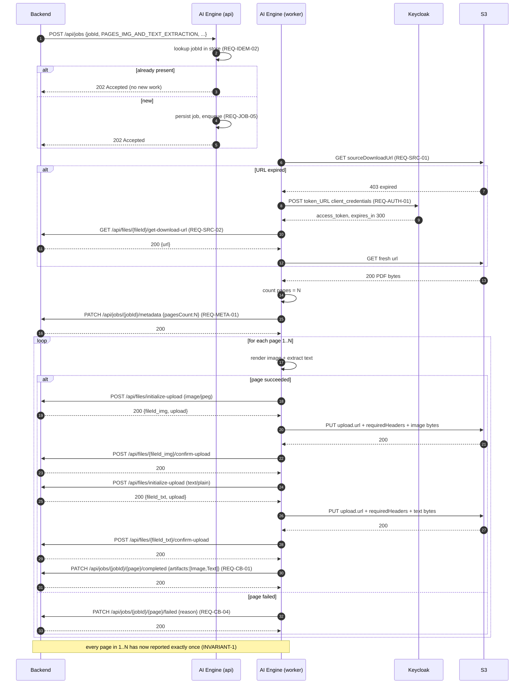
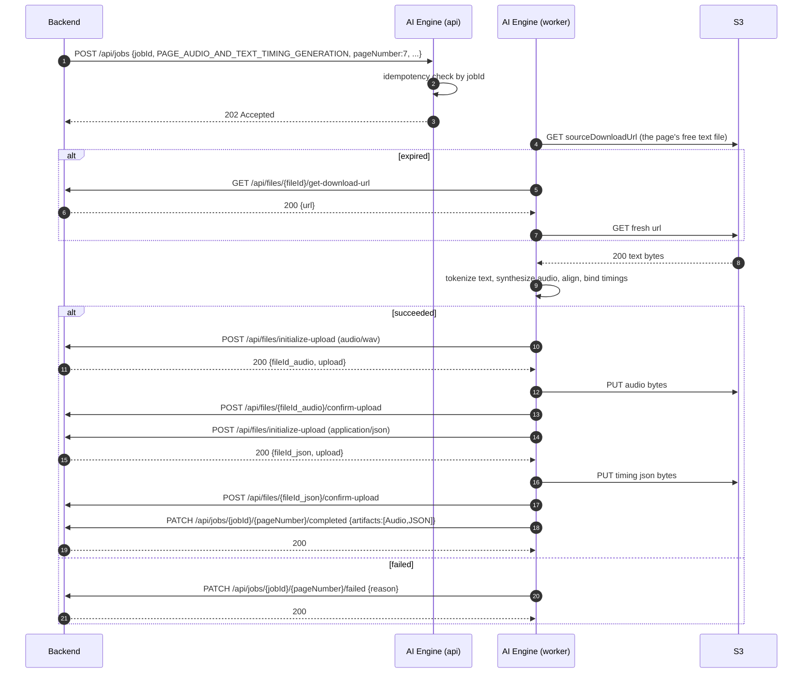

# V1 Requirements Extraction

Source: `assets/Backend & AI integration V1.pdf`, 6 pages. This document defines every `REQ-*` ID used
across the rest of the set. IDs are stable — do not renumber.

## 0. What this document is not

The PDF is an **integration contract between two teams**, not a product specification. It specifies the
wire protocol, the auth flow, the upload cycle and the callback semantics. It says **nothing** about OCR
accuracy, TTS voice, diacritization, model selection, latency, throughput, availability, retention, or
security beyond bearer tokens.

Therefore: everything in these documents about *AI behaviour* is **EXISTING BEHAVIOR** (what the code
does today) or **PROPOSAL** (our design choice). Only the items below are **REQUIREMENT**.

## 1. Actors and terminology (fixed by the PDF, page 1)

| Term | Meaning | Owner |
|---|---|---|
| **Backend** | "book apis that reading first UI and mobile will interact with" | Rashad's team |
| **ai-engine** | "the service that makes the ocr and audio generation" | AI team — Ahmed & Waleed |

Environment values given as examples on page 1:

| Env | Example value |
|---|---|
| `AI_Engine_BASE_URL` | `https://localhost:9099` |
| `backend_Base_URL` | `https://localhost:6060` |
| `token_URL` | `http://localhost:9090/realms/reading-first/protocol/openid-connect/token` |
| `client_id` | `reading-first-ocr-engine` |
| `client_secret` | `<secret>` |

Two bearer-token roles are named and must not be confused:

- **`{ai-engine-bearer-token}`** — presented by the Backend on **inbound** calls to the AI Engine.
- **`{backend-bearer-token}`** — obtained by the AI Engine and presented on **outbound** calls to the
  Backend. This is the one the given `client_id`/`client_secret` produce.

## 2. Requirements

### REQ-AUTH — Authentication

| ID | Statement | PDF page | Type | Acceptance criterion |
|---|---|---|---|---|
| **REQ-AUTH-01** | The AI Engine obtains a Backend bearer token from `token_URL` using OAuth2 `client_credentials` with the given `client_id` and `client_secret`, `Content-Type: application/x-www-form-urlencoded`. | 5 | Integration | A `POST` to `token_URL` with those three form fields returns 200 and `{access_token, expires_in, token_type}`. |
| **REQ-AUTH-02** | The token is cached "in some where i.e. app memory" and reused while still valid — specifically while it has not "exceed (5 minutes minus 30 sec)" of its life. | 5 | Integration | Given a token with `expires_in: 300`, a second call within 270 s reuses the cached token and makes no request to `token_URL`; at 271 s it refreshes. |
| **REQ-AUTH-03** | The token is **not** stored in a database or other durable store, and the token endpoint is **not** called before every request. | 5 | Non-functional | No token value is ever written to Postgres or disk. Token endpoint call count over N backend calls is far less than N. |
| **REQ-AUTH-04** | `401` means "unauthorized token or expired" and must be handled as such. | 5 | Integration | On a `401` from any Backend endpoint, the engine forces a token refresh and retries the call exactly once. |
| **REQ-AUTH-05** | Every outbound Backend call carries `Authorization: {backend-bearer-token}`. | 2, 3, 4, 5, 6 | Integration | All 5 Backend endpoints are called with the header present. |
| **REQ-AUTH-06** | Inbound `POST /api/jobs` carries `header authorization {ai-engine-bearer-token}`; the AI Engine must only act on trusted calls. | 1 | Integration | An unauthenticated or invalid-token request is rejected and does no work. **The PDF does not state how the token is to be validated — see `Q-01`.** |

### REQ-JOB — Job intake

| ID | Statement | PDF page | Type | Acceptance criterion |
|---|---|---|---|---|
| **REQ-JOB-01** | The AI Engine serves `POST {AI_Engine_BASE_URL}/api/jobs` and returns **`202 Accepted`**. | 1, 3 | Functional | A valid job POST returns HTTP 202. |
| **REQ-JOB-02** | Job type `PAGES_IMG_AND_TEXT_EXTRACTION` body: `{jobId, jobType, fileId, folderId, pathPrefix, sourceDownloadUrl}`. `jobId` is a GUID, `fileId` is the PDF's Backend file GUID, `folderId` is a logical folder id, `pathPrefix` is a physical folder id, `sourceDownloadUrl` is an S3 URL. | 1 | Functional | All six fields are accepted and persisted. |
| **REQ-JOB-03** | Job type `PAGE_AUDIO_AND_TEXT_TIMING_GENERATION` body: the same six fields plus `pageNumber`. Here `fileId`/`sourceDownloadUrl` refer to the **free text file** produced by the first job type, not the PDF. | 3 | Functional | All seven fields are accepted and persisted; the job operates on exactly one page. |
| **REQ-JOB-04** | Execution is asynchronous: "A background task will take the enqueued jobs and start with them in parallel or sequential." The choice of parallel vs sequential is explicitly left to the AI team ("It is a thing related to the AI team managing these jobs"). | 1, 3 | Functional | No AI work occurs inside the `POST /api/jobs` request. |
| **REQ-JOB-05** | On receipt the job is saved to "db or any store" so it can be worked on. | 6 | Functional | After a 202, the job is durably readable by `jobId` and survives a process restart. |

### REQ-IDEM — Idempotency

| ID | Statement | PDF page | Type | Acceptance criterion |
|---|---|---|---|---|
| **REQ-IDEM-01** | "ai engine should make jobs idempotent to guarantee not enqueue it multiple time via checking if you already have this job GUID or not, if already enqueued return 202 accepted". | 6 | Functional | Two POSTs with the same `jobId` both return 202; exactly one execution occurs. |
| **REQ-IDEM-02** | "Once an AI engine api receives the job request it verifies it has not any Prev one in db or any data store via GUID given and if it has it then it should return success, if it has not it should save it in db or any store this job to be work on." | 6 | Functional | The duplicate check is a store lookup by `jobId`, performed before any work is scheduled. |
| **REQ-IDEM-03** | The Backend retries failures with exponential backoff, and after a while treats the job as "stalled/dead letter". The AI Engine must therefore be safe under repeated delivery. | 6 | Non-functional | N identical POSTs produce one execution and one set of artifacts. |

### REQ-SRC — Source acquisition

| ID | Statement | PDF page | Type | Acceptance criterion |
|---|---|---|---|---|
| **REQ-SRC-01** | The AI Engine downloads the source by `GET <sourceDownloadUrl>`, expecting `200 OK` with the file. | 2 | Integration | The PDF (Job A) or the text file (Job B) is retrieved from the given URL. |
| **REQ-SRC-02** | "at some times download pdf via the link could be expired, so that the ai engine should request a new url from our backend to get a fresh url for download": `GET {backend_Base_URL}/api/files/{fileId}/get-download-url` with the Backend bearer token → `200 OK` `{ "url": "<s3 url>" }`. | 2, 4 | Integration | When the presigned GET fails as expired, the engine fetches a fresh URL and retries the download successfully. |

### REQ-META — Page count

| ID | Statement | PDF page | Type | Acceptance criterion |
|---|---|---|---|---|
| **REQ-META-01** | "before this step number 2, backend wants to know how many pages in pdf so ai engine should give the number of pages in the pdf before start text and image extraction": `PATCH {backend_Base_URL}/api/jobs/{jobId}/metadata` body `{pagesCount: N}` → `200 OK`. | 3 | Functional | The metadata PATCH is observed **before** any page artifact upload for that job. |
| **REQ-META-02** | "the backend will consider that you finish your process after you completed the 30 pages whether they fail or succeed, if 29, no, the backend will wait for number 30 page". | 3 | Functional | For every page in `1..pagesCount`, exactly one terminal callback is received. This is **INVARIANT-1**; see [09-async-jobs.md](09-async-jobs.md). |

### REQ-UPL — Upload cycle

| ID | Statement | PDF page | Type | Acceptance criterion |
|---|---|---|---|---|
| **REQ-UPL-01** | Step 1: `POST {backend_Base_URL}/api/files/initialize-upload` with body `{fileName, contentType, sizeInBytes, folderId, pathPrefix}` → `200 OK` `{fileId, upload: {url, requiredHeaders: {Content-Type, Content-Length}}}`. | 5, 6 | Integration | Returns a `fileId` and an upload ticket. |
| **REQ-UPL-02** | Step 2: `PUT <upload.url>` "with same headers in `<requiredHeaders>` and content as `<file>`" → `200 OK`. | 6 | Integration | The PUT carries exactly the returned headers and the file bytes. |
| **REQ-UPL-03** | Step 3: `POST {backend_Base_URL}/api/files/{fileId}/confirm-upload` with the Backend bearer token → `200 OK`. | 6 | Integration | The upload is confirmed before the file id is used in a callback. |
| **REQ-UPL-04** | `contentType` is one of `image/jpeg`, `application/json`, `audio/wav`, `text/plain`. | 5 | Integration | No other content type is sent. |
| **REQ-UPL-05** | One upload cycle **per file**, in a mandated order: Job A "call upload cycle per (image) then (text)"; Job B "per (audio) then (json)". | 2, 4 | Functional | Observed call order for a page is image-cycle-complete then text-cycle-complete (resp. audio then json). |

### REQ-ART — Artifacts

| ID | Statement | PDF page | Type | Acceptance criterion |
|---|---|---|---|---|
| **REQ-ART-01** | Job A produces exactly **one image file per page**. | 2 | Functional | One `image/jpeg` artifact per page. |
| **REQ-ART-02** | Job A produces exactly **one text file per page**: "this file will be only the free text no highlighting no timing needed at this step". | 2 | Functional | One `text/plain` artifact per page carrying page text only. **The PDF does not say whether this is raw OCR text or final corrected/diacritized text — see `Q-04`.** |
| **REQ-ART-03** | Job B produces exactly **one audio file per page**. | 4 | Functional | One `audio/wav` artifact for the given page. |
| **REQ-ART-04** | Job B produces exactly **one timing JSON per page** — "make audio generation and json timing generation … which result audio and timing json". | 4 | Functional | One `application/json` artifact carrying text timing for the given page. **The PDF does not specify its schema — see `Q-10`.** |

### REQ-CB — Callbacks

| ID | Statement | PDF page | Type | Acceptance criterion |
|---|---|---|---|---|
| **REQ-CB-01** | "And after both file success": `PATCH {backend_Base_URL}/api/jobs/{jobId}/{pageNumber}/completed` with body `{artifacts: [{fileId, artifactType}, {fileId, artifactType}]}` → `200 OK`. | 2, 4 | Functional | Sent only after both of the page's uploads are confirmed. |
| **REQ-CB-02** | Job A `artifactType` values are exactly `"Image"` and `"Text"`. | 2 | Functional | Exact string match, capitalized as shown. |
| **REQ-CB-03** | Job B `artifactType` values are exactly `"Audio"` and `"JSON"`. | 4 | Functional | Exact string match, capitalized as shown. |
| **REQ-CB-04** | "incase of error in extracting file image or text you want to tell backend you failed and here are the reason": `PATCH {backend_Base_URL}/api/jobs/{jobId}/{pageNumber}/failed` body `{reason: "..."}` → `200 OK`. The same applies to audio/json failures. | 2, 4 | Functional | A page that cannot produce both artifacts reports `/failed` with a non-empty reason. |
| **REQ-CB-05** | "at some time you want to mark whole job as failed i.e you cant parse or get the pdf": `PATCH {backend_Base_URL}/api/jobs/{jobId}/failed` body `{reason: "..."}` → `200 OK`. | 4, 5 | Functional | An unfetchable or unparseable source escalates to a whole-job failure. |

### REQ-CFG — Configuration

| ID | Statement | PDF page | Type | Acceptance criterion |
|---|---|---|---|---|
| **REQ-CFG-01** | The five named values are configuration, not constants: `AI_Engine_BASE_URL`, `backend_Base_URL`, `token_URL`, `client_id`, `client_secret`. | 1 | Non-functional | All five are read from environment; none is hardcoded. See [15-configuration.md](15-configuration.md). |

### REQ-ERR — Error reporting

| ID | Statement | PDF page | Type | Acceptance criterion |
|---|---|---|---|---|
| **REQ-ERR-01** | Failures are communicated to the Backend as a free-text `reason` string on the `/failed` callbacks. | 2, 4, 5 | Functional | Every `/failed` body has a `reason`. **Format unspecified — see `Q-14`.** |

## 3. The two job bodies

```json
// REQ-JOB-02 — Job A
{
  "jobId": "<GUID>",
  "jobType": "PAGES_IMG_AND_TEXT_EXTRACTION",
  "fileId": "<pdf file backend guid>",
  "folderId": "<logical folder id>",
  "pathPrefix": "<physical folder Id>",
  "sourceDownloadUrl": "<pdf s3 url>"
}
```

```json
// REQ-JOB-03 — Job B
{
  "jobId": "<GUID>",
  "jobType": "PAGE_AUDIO_AND_TEXT_TIMING_GENERATION",
  "fileId": "<free text file backend guid>",
  "folderId": "<logical folder id>",
  "pathPrefix": "<physical folder Id>",
  "sourceDownloadUrl": "<free text file s3 url>",
  "pageNumber": 7
}
```

Both return `202 Accepted`. The PDF gives no response body; see
[07-api-specification.md](07-api-specification.md) for our PROPOSAL.

## 4. Complete outbound call catalogue

Eight calls. Nothing else may be invented.

```http
POST {token_URL}
Content-Type: application/x-www-form-urlencoded

grant_type=client_credentials&client_id=<client_id>&client_secret=<client_secret>
--> 200 { "access_token": "<eyJhbGciO...>", "expires_in": 300, "token_type": "Bearer" }
```

```http
GET <sourceDownloadUrl>
--> 200 <file bytes>          # no auth header; the URL is presigned
```

```http
GET {backend_Base_URL}/api/files/{fileId}/get-download-url
Authorization: {backend-bearer-token}
--> 200 { "url": "<s3 url>" }
```

```http
POST {backend_Base_URL}/api/files/initialize-upload
Authorization: {backend-bearer-token}
Content-Type: application/json

{ "fileName": "<file name>", "contentType": "image/jpeg",
  "sizeInBytes": 164231, "folderId": "<folder id>", "pathPrefix": "<pathPrefix>" }
--> 200 { "fileId": "<file id guid in backend>",
          "upload": { "url": "<S3 Upload URL>",
                      "requiredHeaders": { "Content-Type": "image/jpeg",
                                           "Content-Length": "164231" } } }
```

```http
PUT <upload.url>
Content-Type: image/jpeg
Content-Length: 164231

<file bytes>
--> 200
```

```http
POST {backend_Base_URL}/api/files/{fileId}/confirm-upload
Authorization: {backend-bearer-token}
--> 200
```

```http
PATCH {backend_Base_URL}/api/jobs/{jobId}/metadata
Authorization: {backend-bearer-token}
Content-Type: application/json

{ "pagesCount": 30 }
--> 200
```

```http
PATCH {backend_Base_URL}/api/jobs/{jobId}/{pageNumber}/completed
Authorization: {backend-bearer-token}
Content-Type: application/json

{ "artifacts": [ { "fileId": "<image file id>", "artifactType": "Image" },
                 { "fileId": "<text file id>",  "artifactType": "Text"  } ] }
--> 200
```

```http
PATCH {backend_Base_URL}/api/jobs/{jobId}/{pageNumber}/failed
Authorization: {backend-bearer-token}
Content-Type: application/json

{ "reason": "..." }
--> 200
```

```http
PATCH {backend_Base_URL}/api/jobs/{jobId}/failed
Authorization: {backend-bearer-token}
Content-Type: application/json

{ "reason": "..." }
--> 200
```

## 5. Mandated sequencing rules

These are ordering constraints, and every one of them is testable:

1. **`metadata` before page work.** `PATCH /metadata {pagesCount}` precedes any page artifact upload
   for that job (REQ-META-01).
2. **Image then Text.** Job A: complete the image upload cycle, then the text upload cycle
   (REQ-UPL-05).
3. **Audio then JSON.** Job B: complete the audio upload cycle, then the json upload cycle
   (REQ-UPL-05).
4. **Both files before `completed`.** The `completed` PATCH is sent only "after both file success"
   (REQ-CB-01).
5. **Three steps per file, in order.** `initialize-upload` → `PUT` → `confirm-upload` (REQ-UPL-01..03).
6. **All N pages terminal before the job is done.** (REQ-META-02 / INVARIANT-1.)

## 6. Job A sequence



Whole-job failure branch (REQ-CB-05): if the PDF cannot be fetched or parsed at all, the worker sends
`PATCH /api/jobs/{jobId}/failed {reason}` and never sends `metadata` or any page callback.

## 7. Job B sequence



Note the asymmetry: **Job A is one job covering N pages; Job B is one job covering exactly one page.**
`pagesCount` and INVARIANT-1 therefore apply to Job A. For Job B the job and the page are the same unit
of work — its single page callback is also its completion signal. This is our reading of the spec and is
flagged as `Q-06`.

## 8. Non-functional requirements — and their absence

This section is deliberately blunt. The PDF specifies **no** non-functional requirements at all. Each
row below is an **OPEN QUESTION** with a PROPOSAL we will build to unless told otherwise.

| Concern | What the PDF says | PROPOSAL (default) | Question |
|---|---|---|---|
| Latency / SLA | nothing | Best-effort. No per-job deadline promised to the Backend. Internal page deadline 900 s, job deadline 24 h. | `Q-13` |
| Throughput | nothing | Sized for books, not requests/second. Design target: 4 concurrent jobs, 8 concurrent page tasks per worker host. | `Q-13` |
| Availability | nothing | Single API replica is acceptable for V1; jobs queue durably so a worker outage delays rather than loses work. | `Q-13` |
| Concurrency limits | "in parallel or sequential … related to the AI team" (pages 1, 3) — explicitly delegated to us | Bounded per-job page concurrency plus a global provider-rate budget. See [09-async-jobs.md](09-async-jobs.md). | — (delegated) |
| Max file size / page count | nothing | Reject sources over 200 MB or 500 pages with `SOURCE_INVALID`. | `Q-08` |
| Retention | nothing | The engine retains no artifacts. Job rows retained 90 days. | `Q-12` |
| PII / data classification | nothing | Content is children's book pages; treated as non-PII business content. | `Q-12` |
| Security beyond bearer auth | nothing | See [12-security.md](12-security.md). | `Q-01`, `Q-15` |
| Rate limiting (inbound) | nothing | None in V1; the only caller is a trusted first party. | `Q-13` |
| Monitoring / alerting expectations | nothing | Ours to define. See [13-observability.md](13-observability.md). | — |
| Model / quality expectations | nothing | See [ADR-009](19-adrs.md) and `Q-07`. | `Q-07` |

## 9. Assumptions and constraints

**ASSUMPTION A1** — `pageNumber` is 1-based. The PDF's own example (`pagesCount: 30` and "waiting for
number 30 page") implies pages `1..30`, and the existing pipeline is 1-based throughout
(`src/pipeline/pages.py:4-5`: "1-indexed, inclusive, matching the `p001.json` page numbering used
throughout `work/<book>/`"). Flagged as `Q-05`.

**ASSUMPTION A2** — `pagesCount` is the total page count of the delivered PDF, not a requested subrange.
The Backend supplies no page range in Job A, so the engine processes the whole document. Flagged as
`Q-06`.

**ASSUMPTION A3** — the `Text` artifact is the **final reading text** (corrected and diacritized), on the
grounds that it is what the reader UI displays and what Job B feeds to TTS. Flagged as `Q-04`.

**ASSUMPTION A4** — `fileName` in `initialize-upload` is chosen by the AI Engine and is not
semantically interpreted by the Backend. PROPOSAL: `p{page:03d}.{ext}`.

**ASSUMPTION A5** — the presigned `PUT` URL requires no `Authorization` header, only the returned
`requiredHeaders`. This follows from the PDF's "with same headers in `<requiredHeaders>`".

**CONSTRAINT C1** — the Backend is the sole consumer. There is no public or multi-tenant surface.

**CONSTRAINT C2** — the Backend owns all durable artifact storage. The AI Engine never serves artifacts.

**CONSTRAINT C3** — the Backend retries and dead-letters. The engine must be idempotent rather than
build its own delivery guarantees toward the Backend's queue.

## 10. What the PDF does **not** say

Arguably the most useful list in this document. Each of these is a real gap that someone must close, and
none of them can be resolved by reading the spec more carefully.

1. **How the AI Engine validates the inbound `{ai-engine-bearer-token}`.** No algorithm, no JWKS URL, no
   expected `aud`/`azp`, no scope or role. This is the single largest ambiguity. (`Q-01`)
2. **Whether the Backend's endpoints are idempotent.** Can `confirm-upload` be called twice? Can
   `/completed` be sent twice for the same page? Since the engine must retry, this determines whether
   retries are safe. (`Q-02`, `Q-03`)
3. **Whether the `Text` artifact is raw or final text.** (`Q-04`)
4. **The timing JSON schema.** The word "json" appears; nothing else. The consuming reader app's needs
   are unknown — in particular whether it also needs bounding boxes, which live in Job A's data and have
   no artifact slot. (`Q-10`)
5. **The presigned URL TTL**, so we cannot know how long a download or upload ticket stays valid, nor
   size the retry window. (`Q-08`)
6. **Maximum `sizeInBytes`.** A 8.9 MB WAV was observed on disk; nothing says whether that is fine.
   (`Q-08`)
7. **Behaviour for a 0-page, encrypted or corrupt PDF.** Presumably whole-job `/failed`, but unstated.
   (`Q-08`)
8. **Whether one page yields one audio file.** The existing pipeline produces **two** (female and male
   narrators, `walidapro/run_full_pipeline.py:1057-1130`) while the callback carries a single `Audio`
   artifact. (`Q-08b`)
9. **The audio codec trade-off.** `audio/wav` is enumerated, and WAV is ~1.0 MB/page median — 36 GB at
   1,000 books by `README.md:186-190`'s own scale table. MP3 would be ~12 GB. Nothing says WAV is
   required rather than merely allowed. (`Q-09`)
10. **Whether HTML reader artifacts are deliverables.** No `artifactType` exists for them. (`Q-11`)
11. **Re-run and duplicate-book semantics.** What should happen when the same book is submitted under a
    new `jobId`? (`Q-12`)
12. **The `reason` string format.** Free text, or something the Backend parses? (`Q-14`)
13. **TLS expectations.** The example URLs are `https://localhost:9099` and `https://localhost:6060`
    but the token endpoint is `http://localhost:9090`. Production posture and any mTLS requirement are
    unstated. (`Q-15`)
14. **Any latency, throughput, availability, retention or concurrency target.** (`Q-13`)
15. **How V1 is accepted** — protocol conformance, or AI output quality? This changes which pipeline
    ships. (`Q-07`)

Full register with owners and proposed defaults: [22-open-questions.md](22-open-questions.md).
