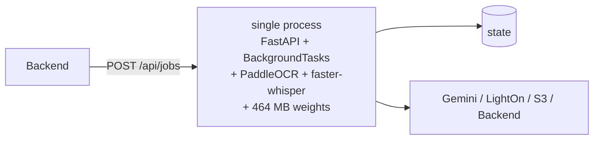
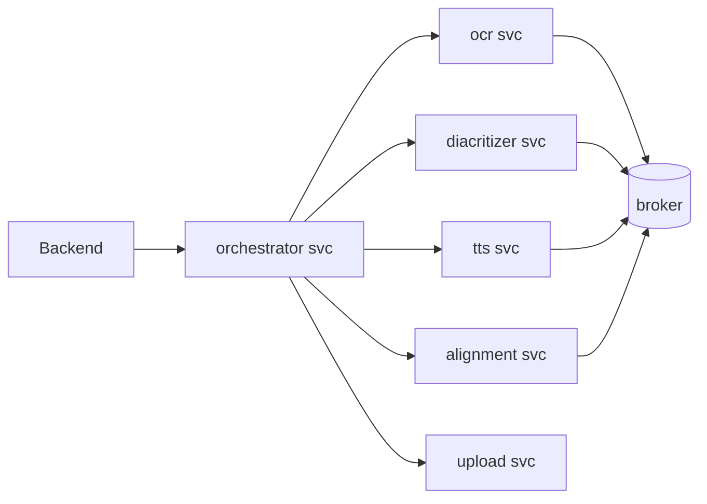
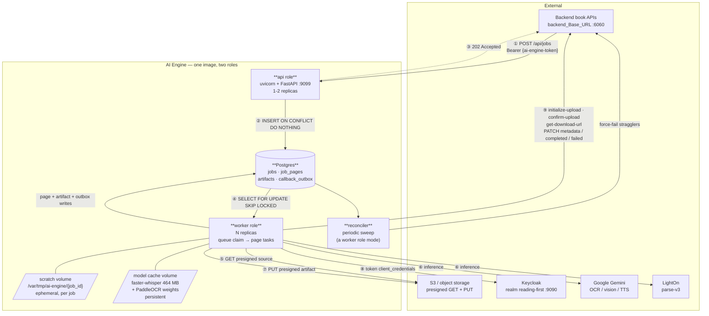
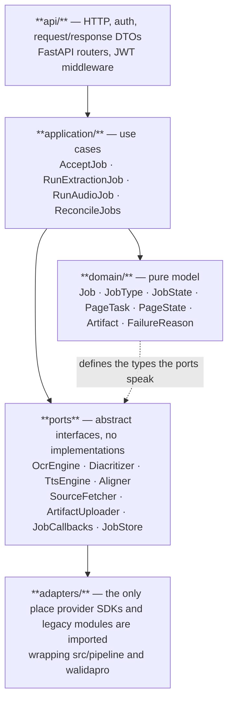

# Target Architecture

## 1. Design goals, derived from requirements

Each goal traces to a requirement or a measured property of the existing system — none is a preference.

| Goal | Driver |
|---|---|
| `POST /api/jobs` returns 202 without doing AI work | REQ-JOB-01, REQ-JOB-04 |
| A duplicate `jobId` never causes a second execution | REQ-IDEM-01/02/03 |
| Every page reaches exactly one terminal callback (**INVARIANT-1**) | REQ-META-02 |
| Job state survives process death | REQ-JOB-05; and the Backend retries, so a lost job is re-delivered into an inconsistent world |
| A page's work is isolated from every other page's failure | REQ-META-02; and the existing code violates this at `src/pipeline/run_ocr_gemini.py:59-62` |
| Long, blocking, CPU-heavy work never occupies an HTTP worker | faster-whisper is **5.42 s of CPU per 27.5 s of audio (measured)** and holds **464 MB (measured)** of weights |
| Paid provider calls are counted, budgeted and retried once, not three times over | Pipeline W is 40–200 calls/page; `final_context_reviewer.py` already bills up to 9 completions per page |
| One deployable unit, reproducibly built | Bucket E of [04-gap-analysis.md](04-gap-analysis.md): no packaging, no pins, no container |
| The existing AI logic is wrapped, not rewritten | Rule 2 of the parent brief; 71% of production LOC is salvageable domain logic |

## 2. Three options, compared

### Option A — Modular monolith, single process

FastAPI + a background task pool inside the same process. Job state in Postgres or SQLite.

**Strongest case for it:** it is the smallest possible thing that could work. One process, one deploy,
trivial local development, no queue semantics to get wrong, and the shared scratch directory that the
existing stage functions already assume comes for free. For a system whose real volume is *books per
day*, not requests per second, this is a genuinely serious contender and should not be dismissed
reflexively.

**Why it loses here:**

- A single page occupies a thread for seconds to minutes of *blocking* work. Every provider call in the
  repo is a synchronous `requests.post` and every retry is `time.sleep`
  (`walidapro/ocr_verifier/lighton_ocr.py:197`, worst case 546 s). With a bounded thread pool, a handful
  of concurrent books starves the HTTP handler and `POST /api/jobs` stops answering promptly — breaking
  REQ-JOB-01 in practice even though it is satisfied in code.
- Any deploy or crash kills in-flight books. With N pages mid-flight and no separate durable claim,
  recovery is guesswork.
- The model weights (464 MB faster-whisper + PaddleOCR) are loaded in the same process that must stay
  responsive and restart quickly. API rollouts become 30-second model-load events.
- It cannot scale the two very different workloads independently: the API is idle-cheap, the compute is
  CPU-saturating.

### Option C — Microservices per AI stage

Separate deployables for OCR, diacritization, TTS, alignment, upload, and an orchestrator.

**Strongest case for it:** the stages have genuinely different resource profiles. Alignment is CPU-bound
and holds 464 MB resident; OCR and TTS are network-bound and nearly stateless; the verified tier's
per-word diacritics loop is embarrassingly parallel and could scale to hundreds of workers independently
of everything else. If diacritization ever moved to a GPU model, or if a second consumer appeared that
wanted only TTS, this shape would be right. It also isolates a memory leak or a crash in one stage.

**Why it loses here:**

- **V1 has exactly one consumer and two job types.** No stage is ever invoked independently. Splitting
  them creates six deploy units to satisfy zero independent callers.
- The stages **share a scratch directory by construction** — alignment needs the audio bytes TTS just
  produced; diacritization needs the page image OCR just rendered. Crossing a network boundary between
  them means shipping 1–14 MB per hop for no benefit. `walidapro/run_full_pipeline.py:503-529` already
  demonstrates the cost of a *process* boundary between stages: it reloads the interpreter and the whole
  PaddleOCR model set for every single page.
- Six services multiply the auth surface, the token caches, the deploy pipelines, the dashboards and
  the failure modes — against a team of two engineers, neither of whom has built the integration layer
  yet.
- Rule 3 of the parent brief is explicit: a Python module does not deserve its own service.

### Option B — Modular backend + AI workers (**recommended**)

One codebase, one image, two process roles, one stateful dependency.

**Scoring.** 5 = best fit for *this* system's requirements.

| Criterion | A: single process | **B: workers** | C: microservices |
|---|---:|---:|---:|
| Satisfies REQ-JOB-01 (prompt 202) under load | 2 | **5** | 5 |
| Satisfies INVARIANT-1 (durable per-page state) | 3 | **5** | 4 |
| AI inference fit (blocking, CPU-heavy, 464 MB resident) | 1 | **5** | 5 |
| Deployment simplicity | 5 | **4** | 1 |
| Operability with 2 engineers | 5 | **4** | 1 |
| Observability (one correlation model, one log stream) | 4 | **5** | 2 |
| Independent scaling of API vs compute | 1 | **5** | 5 |
| Maintainability (one test suite, shared DTOs) | 4 | **5** | 2 |
| Extensibility to a GPU or a second consumer | 2 | **4** | 5 |
| V1 delivery risk | 3 | **4** | 1 |
| **Total** | **30** | **46** | **31** |

Option B wins because it takes the one thing A gets wrong (the compute must not live in the request
path) and the one thing C gets wrong (the stages must not be separated) and does neither.

Recorded as [ADR-002](19-adrs.md).

## 3. The recommended architecture

| Element | Role |
|---|---|
| **api role** | Validates the inbound token, validates the body, performs the idempotent insert, returns 202. Does no AI work, holds no model weights, restarts in a second. |
| **worker role** | Claims jobs, fans out page tasks, runs the AI adapters, uploads artifacts, writes callbacks to the outbox and drains it. Holds the model weights. Scales horizontally. |
| **reconciler** | A worker-role mode on a timer. Enforces INVARIANT-1 by finding jobs past deadline with non-terminal pages and force-failing them. |
| **Postgres** | The single stateful dependency. Job store (REQ-JOB-05), idempotency key (REQ-IDEM), page ledger, artifact ledger, callback outbox, and the queue itself via `FOR UPDATE SKIP LOCKED`. |
| **scratch volume** | Per-job ephemeral directory, deleted on every terminal path. Sized for one page image + one page of PCM per concurrent task, not a whole book. |
| **model cache volume** | Persistent. Without it, every cold container downloads 464 MB before it can serve. |

**No GPU.** Every local model is CPU-pinned: PaddleOCR `device` defaults to `"cpu"`
(`walidapro/ocr_verifier/config.py:32`), faster-whisper is hardcoded `device="cpu",
compute_type="int8"` with no override parameter exposed (`src/pipeline/align_whisper.py:22`), and the
diacritizer is documented "CPU-only … no extra infrastructure" (`src/pipeline/tashkel.py:14-17`). The
expensive models are remote.

## 4. Internal layering

This is Rule 4 of the parent brief made concrete: the API must never reach a model implementation
directly.

Import rules, enforceable by a lint check (`T-1.6`):

| Layer | May import | Must **not** import |
|---|---|---|
| `api/` | `application/`, `domain/`, `schemas/` | any adapter, any provider SDK, `src.pipeline`, `walidapro` |
| `application/` | `domain/`, ports | concrete adapters (they arrive by injection), FastAPI, provider SDKs |
| `domain/` | stdlib only | everything else — this layer must be importable with zero third-party packages |
| ports | `domain/` | any implementation |
| `adapters/` | ports, `domain/`, provider SDKs, `src.pipeline`, `walidapro` | `api/`, `application/` |

The eight ports:

| Port | Contract | V1 adapter |
|---|---|---|
| `SourceFetcher` | presigned URL (+ `fileId` for refresh) → local path | `httpx` + `BackendClient.get_download_url` |
| `PageRenderer` | PDF + page number → JPEG bytes | wraps `src/pipeline/ocr_gemini.py:56 render_page` / `walidapro/.../pdf_render.py:41` |
| `OcrEngine` | page image or PDF page → tokens | wraps `src/pipeline/extract.py`, `ocr_gemini.py`, `ocr_lighton.py` |
| `Diacritizer` | tokens → diacritized tokens | wraps `src/pipeline/tashkel.py` (fast tier) / `walidapro/.../word_diacritics.py` (verified tier) |
| `TtsEngine` | text → audio bytes + format metadata | wraps `src/pipeline/tts_gemini.py`, `tts_hume.py` |
| `Aligner` | audio + tokens → `t`/`t_src`/`bind_report` | wraps `src/pipeline/align_whisper.py` + `speak.py:99 bind` |
| `ArtifactUploader` | bytes + content type + names → Backend `fileId` | the three-step cycle |
| `JobCallbacks` | domain event → Backend PATCH | outbox-backed |

Detailed signatures in [08-ai-integration.md](08-ai-integration.md).

## 5. Runtime walkthrough — Job A

| # | Component | Action | State change |
|---|---|---|---|
| 1 | api / `AcceptJob` | Validate JWT, validate body, `INSERT … ON CONFLICT (job_id) DO NOTHING` | `jobs` row created with `state=QUEUED`, or nothing (duplicate) |
| 2 | api | Return `202` | — |
| 3 | worker | Claim via `FOR UPDATE SKIP LOCKED` | `state=RUNNING`, `claimed_by`, `claimed_at` |
| 4 | `SourceFetcher` | `GET sourceDownloadUrl`; on expiry `GET /api/files/{fileId}/get-download-url` then retry | PDF in `scratch/{job_id}/source.pdf` |
| 5 | `PageRenderer` | `page_count(path)` | `jobs.pages_count = N` |
| 6 | `JobCallbacks` | `PATCH /metadata {pagesCount:N}` via outbox | `metadata_sent_at` set; `job_pages` rows `1..N` created with `state=PENDING` |
| 7 | worker | Fan out bounded-concurrency page tasks | per-page `state=RUNNING` |
| 8 | `PageRenderer` + `OcrEngine` + `Diacritizer` | Render JPEG; extract tokens; diacritize if `diac_ratio < 0.15` | page artifacts in scratch |
| 9 | `TextArtifactBuilder` | Project tokens → `text/plain` bytes | — |
| 10 | `ArtifactUploader` | image cycle, then text cycle (REQ-UPL-05) | `artifacts` rows with backend `fileId` after each `confirm-upload` |
| 11 | `JobCallbacks` | `PATCH /{page}/completed {artifacts:[Image,Text]}` | page `state=REPORTED_COMPLETED` |
| 12 | worker | On any page error at 8–11, capture an error code + safe reason and `PATCH /{page}/failed` | page `state=REPORTED_FAILED` |
| 13 | worker | When all `1..N` are terminal, delete scratch | `jobs.state=COMPLETED` |
| 14 | reconciler | If any page is non-terminal past deadline, force-fail it; if the job cannot start at all, `PATCH /api/jobs/{jobId}/failed` | `state=FAILED` or `DEAD_LETTER` |

## 6. Runtime walkthrough — Job B

Same 1–4. Then:

| # | Component | Action |
|---|---|---|
| 5 | Tokenizer | Deterministically tokenize the downloaded free text using `pageNumber` as the id prefix, reproducing `p{page:03d}w{index:03d}` |
| 6 | `TtsEngine` | Synthesize → 24 kHz mono 16-bit WAV bytes |
| 7 | `Aligner` | `align_whisper.align_words` on the audio we just produced, then `speak.bind` onto the token ids → `t`, `t_src`, `bind_report` |
| 8 | `TimingArtifactBuilder` | Project → the versioned timing JSON ([10-data-contracts.md](10-data-contracts.md)) |
| 9 | `ArtifactUploader` | audio cycle, then json cycle |
| 10 | `JobCallbacks` | `PATCH /{pageNumber}/completed {artifacts:[Audio,JSON]}` |

Job B is one job covering one page, so its page callback is also its completion signal. The timing
artifact is made **self-contained** (it carries `txt` per token) so the reader never has to correlate it
back to Job A's output — belt and braces, and it removes a whole class of cross-job coupling bugs. See
`Q-10`.

## 7. Scaling model

| Stage | First bottleneck | Second | What to do |
|---|---|---|---|
| Now → a few books/day | Nothing. One worker suffices. | | Ship it. |
| Steady V1 load | **Remote provider rate limits.** This is not speculation: `README.md:491` records "Gemini free-tier capped at 10 req/day per model; 2 models used across 2 days-worth of quota" and Hume quota exhausted mid-book. | Worker CPU for alignment | A global provider-rate budget shared by all workers, enforced in Postgres. Scale workers only after the budget is raised. |
| 2× V1 | **Worker CPU for forced alignment.** RTF ≈ 0.20 measured, so 1 CPU-second per 5 audio-seconds, single-threaded per page. | Postgres connection count | Add worker replicas; alignment is embarrassingly parallel across pages. |
| Verified tier enabled | **The per-word diacritics loop** — one VLM call per word, median 35 and p90 69 words/page, strictly serial (`walidapro/.../word_diacritics.py:1611-1660`). | Provider spend | Parallelize the loop *before* enabling the tier. This is the single largest latency item in the system. |
| 10× V1 | Postgres as a queue | | Migrate to a broker per [ADR-004](19-adrs.md). |

The API role is not on any of these paths. It should not need more than two replicas for V1.

## 8. Explicitly rejected

| Rejected | One-line reason |
|---|---|
| **Kubernetes** | Two process roles and one database. Compose is sufficient and reviewable; K8s adds a platform to learn before the first integration test. |
| **Service mesh** | Three internal network edges, all first-party. mTLS between two containers does not need Istio. |
| **Message broker (Redis/RabbitMQ/SQS)** | The durable job store is already required by REQ-IDEM-02. A broker would be a *second* stateful dependency for a queue Postgres handles at book-scale volumes. Migration trigger in [ADR-004](19-adrs.md). |
| **Vector database** | Nothing in the system does retrieval or similarity search over embeddings. |
| **GPU nodes** | Every local model is CPU-pinned by hardcoded choice; see §3. |
| **A service per AI stage** | Option C above. Zero independent callers, shared scratch, and `walidapro/run_full_pipeline.py:503-529` already shows what a mere process boundary per page costs. |
| **Public or multi-tenant API** | Exactly one first-party consumer (CONSTRAINT C1). No tenancy, no per-tenant quota, no API-key management. |
| **Exposing any AI stage as an endpoint** | The decision matrix in [08-ai-integration.md](08-ai-integration.md) says No for all ~20 components. V1 has one API surface. |
| **An engine-owned artifact store** | The Backend owns storage (CONSTRAINT C2); two copies would diverge. [ADR-006](19-adrs.md). |
