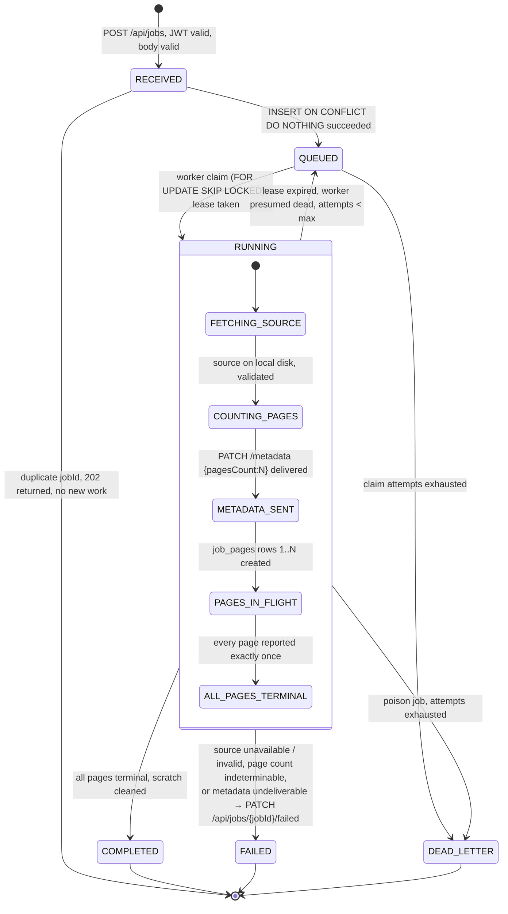
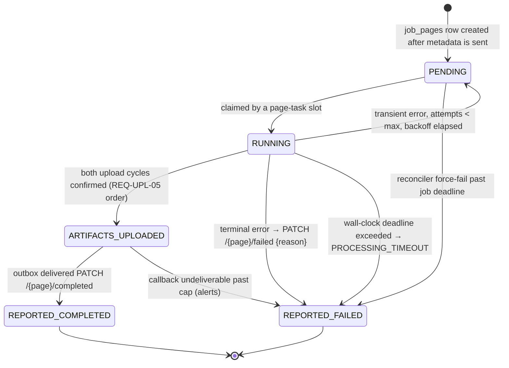
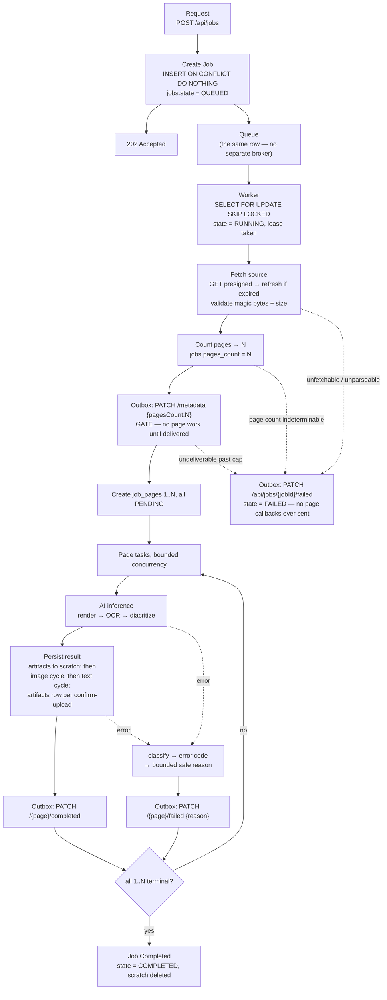
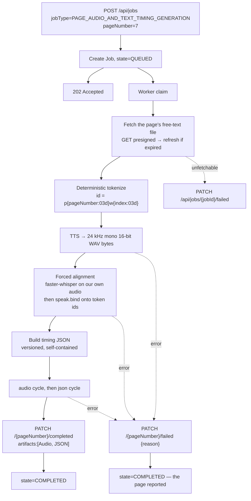

# Sync vs Async, Job Lifecycle, and INVARIANT-1

## 1. The decision table

The general rule being applied: **anything whose duration is bounded by our own CPU and a database round
trip is synchronous; anything whose duration is bounded by a third party or by model inference is
asynchronous.**

| Operation | Mode | Why this, and why not the other way |
|---|---|---|
| `POST /api/jobs` | **Sync accept, async execute.** Return 202. | **REQUIREMENT** (REQ-JOB-01, REQ-JOB-04). Doing the work inline would make the response time equal to a whole book's processing time. Not the other way — a fully async accept (queue the *acceptance* itself) would mean we cannot honestly tell the Backend whether the job was persisted, and REQ-IDEM-02 requires the duplicate check to happen on receipt. |
| Idempotency check | **Sync**, inside the accept | REQ-IDEM-02 says it happens "once an AI engine api receives the job request". It is one indexed lookup, folded into the insert. Not async — a deferred check cannot inform the response. |
| PDF page count | **Sync**, first worker action | REQ-META-01 requires `pagesCount` *before* page work, so it gates everything and cannot be parallel. `pypdfium2`'s `len(doc)` is sub-millisecond. Not in the API process — it needs the downloaded file. |
| Source download | **Async** (worker) | Bounded by S3 and file size, not by us. p90 source PDFs in `assets/PDF Samples` are hundreds of KB, but nothing in the spec caps them (`Q-08`). |
| Per-page extraction (render + OCR + diacritize) | **Async**, one task per page | Seconds to minutes, dominated by a remote OCR call. One task per page is what makes per-page failure isolation possible, which is what INVARIANT-1 requires. Not one task per book — a book-level task cannot report page 7 failed and page 8 succeeded. |
| TTS synthesis | **Async** | One remote call per chunk with no timeout in the existing code (`src/pipeline/tts_gemini.py` passes none). Unbounded by construction. |
| Forced alignment | **Async, in the same task as TTS** | It consumes the audio bytes TTS just produced. Splitting them means persisting and re-fetching ~1 MB per page across a boundary for zero benefit. CPU-bound at RTF ≈ 0.20 measured, so it must not be in the request path either. |
| Artifact upload | **Async**, sequential per artifact | REQ-UPL-05 mandates image-then-text and audio-then-json ordering, so the two cycles for a page cannot be parallelized with each other. Different pages upload concurrently. |
| Callbacks to the Backend | **Async, via a durable outbox** | Must survive worker death. A bare in-line PATCH loses the page permanently if the process dies after upload and before send. See §5. |
| Reconciliation | **Async, scheduled** | Inherently a periodic sweep over state. |
| `GET /health`, `/ready`, `/metrics` | **Sync** | Milliseconds. `/ready` does one `SELECT 1` with a 2 s timeout. |

## 2. Job state machine



| State | Meaning | Exit trigger |
|---|---|---|
| `RECEIVED` | Transient, inside the accept handler | Insert result |
| `QUEUED` | Durable, awaiting a worker | A worker claim |
| `RUNNING` | Claimed, lease held | All pages terminal, or a job-level failure, or lease expiry |
| `COMPLETED` | Every page in `1..pagesCount` reported exactly once. **Note: "completed" means every page reported, not every page succeeded** — a job with 3 failed pages is `COMPLETED`, matching REQ-META-02's "whether they fail or succeed". | terminal |
| `FAILED` | The job could not proceed; `PATCH /api/jobs/{jobId}/failed` sent | terminal |
| `DEAD_LETTER` | Attempts exhausted; a human must look. An alert fires. | terminal |

**`COMPLETED` deliberately does not mean "all pages succeeded".** That is the spec's own semantics and
getting it wrong in either direction is a bug: treating a partly-failed job as `FAILED` would send a
whole-job `/failed` the Backend does not expect, and treating an incomplete job as `COMPLETED` would
strand it.

## 3. Page task state machine



| Transition | Trigger | Side effects |
|---|---|---|
| `PENDING → RUNNING` | Free concurrency slot and provider budget available | `attempt += 1`, `started_at`, `lease_until` |
| `RUNNING → ARTIFACTS_UPLOADED` | Both `artifacts` rows exist with backend `fileId`s | — |
| `ARTIFACTS_UPLOADED → REPORTED_COMPLETED` | Outbox row for `/completed` acknowledged 200 | scratch subdirectory deleted |
| `RUNNING → PENDING` | Retryable error, `attempt < PAGE_MAX_ATTEMPTS` | backoff computed with full jitter |
| `RUNNING → REPORTED_FAILED` | Non-retryable error, attempts exhausted, or deadline | outbox row for `/failed` with a bounded safe reason |
| `PENDING → REPORTED_FAILED` | Reconciler sweep | `ai_engine_pages_total{outcome="force_failed"}` increments — **this should always be zero; any value is an alert** |

`REPORTED_COMPLETED` and `REPORTED_FAILED` are the only terminal states, and every page must reach
exactly one of them. That sentence *is* INVARIANT-1.

## 4. Job A end to end



Numbered, with the exact writes:

1. `AcceptJob`: one statement — `INSERT INTO jobs (...) VALUES (...) ON CONFLICT (job_id) DO NOTHING`.
2. Return `202`.
3. Worker claims: `UPDATE jobs SET state='RUNNING', claimed_by=$1, lease_until=now()+interval '5 min'
   WHERE job_id = (SELECT job_id FROM jobs WHERE state='QUEUED' ORDER BY created_at FOR UPDATE SKIP
   LOCKED LIMIT 1) RETURNING *`.
4. `SourceFetcher` → `scratch/{job_id}/source.pdf`. Failure → step 12.
5. `page_count()` → `UPDATE jobs SET pages_count=$1`.
6. `INSERT INTO callback_outbox (kind='metadata', ...)`. The drainer sends it. **Gate:** no page work
   starts until `jobs.metadata_sent_at IS NOT NULL`.
7. `INSERT INTO job_pages (job_id, page_number, state) SELECT $1, g, 'PENDING' FROM
   generate_series(1, $2) g`.
8. Page tasks run: `UPDATE job_pages SET state='RUNNING', attempt=attempt+1, lease_until=...`.
9. Per artifact, after `confirm-upload` returns 200: `INSERT INTO artifacts (job_id, page_number,
   artifact_type, backend_file_id) ON CONFLICT DO NOTHING`.
10. `INSERT INTO callback_outbox (kind='page_completed', ...)`; on ack `UPDATE job_pages SET
    state='REPORTED_COMPLETED'`.
11. On page error: classify, then `INSERT INTO callback_outbox (kind='page_failed', reason=...)`; on ack
    `state='REPORTED_FAILED'`.
12. On job error: `INSERT INTO callback_outbox (kind='job_failed', reason=...)`, `jobs.state='FAILED'`.
13. When `COUNT(*) FILTER (WHERE state NOT IN ('REPORTED_COMPLETED','REPORTED_FAILED')) = 0`:
    `jobs.state='COMPLETED'`, delete `scratch/{job_id}`.

## 5. Job B end to end



**Job B has no `metadata` step and exactly one page.** Its single page callback is also its completion
signal, so INVARIANT-1 degenerates to "send exactly one callback". This reading is flagged as `Q-06`.

## 6. Page fan-out

**PROPOSAL: pages within a job run concurrently, bounded by two independent limits.**

| Limit | Config key | Default | Why |
|---|---|---|---|
| Page tasks per worker process | `WORKER_PAGE_CONCURRENCY` | 4 | Bounds CPU and RAM. Alignment is single-threaded per page at RTF 0.20 measured, and a page image is ~14 MB of RGB at 220 DPI. |
| Page tasks per job | `JOB_PAGE_CONCURRENCY` | 4 | Stops one 200-page book from monopolizing every slot. |
| Concurrent jobs per worker | `WORKER_JOB_CONCURRENCY` | 2 | — |
| Provider calls in flight, per provider, **fleet-wide** | `PROVIDER_RATE_BUDGET_<NAME>` | conservative | The real bottleneck. `README.md:491` records a genuine free-tier wall of 10 requests/day per model and Hume quota exhausted mid-book. Enforced in Postgres so it holds across replicas, not per process. |

Why concurrent at all: a 30-page book at ~60 s/page is 30 minutes serially. Nothing in the spec forbids
parallelism — the PDF explicitly delegates it ("in parallel or sequential … It is a team cause depending
on their resources").

The mandated ordering constraints survive concurrency, because they are all *intra*-page or
*pre*-page: `metadata` before any page (a gate on the whole fan-out), image before text and audio before
json (within one page task), and both files before `completed` (within one page task). Nothing requires
page 4 to precede page 5.

## 7. INVARIANT-1 enforcement

> For a Job A with `pagesCount = N`, deliver exactly one terminal PATCH for every page in `1..N`, or
> escalate the whole job.

Four mechanisms, each covering a failure the others cannot.

### 7.1 The page ledger is the source of truth

Not the filesystem, not in-memory state, not the artifact list. `job_pages` has one row per
`(job_id, page_number)` with a uniqueness constraint, created transactionally at fan-out time from
`generate_series(1, pages_count)`. Every page that must report **exists as a row before any page starts
work**, so nothing can be forgotten by omission — the question is only whether each row reaches a
terminal state.

This is the direct fix for the existing code's failure mode: `src/pipeline/run_ocr_gemini.py:59-62`
`break`s out of the page loop, so pages after a failure are not merely unreported, they are *unknown*.

### 7.2 The callback outbox

Callbacks are **written to Postgres in the same transaction as the state change that caused them**, then
delivered by a drainer.

Why this is not over-engineering for V1: consider the sequence *upload image → upload text → send
`completed`*. If the callback is a bare in-line HTTP call and the worker is SIGKILLed between the last
`confirm-upload` and the PATCH, then the artifacts exist in the Backend's storage, the page is done, and
**nothing will ever tell the Backend so.** The lease expires, the job is re-claimed, and a naive retry
re-uploads everything — or worse, sees the artifacts already recorded and considers the page done
without ever sending the callback. The outbox removes the window entirely: the intent to call is durable
before the process can die.

```sql
-- inside one transaction
UPDATE job_pages SET state='ARTIFACTS_UPLOADED' WHERE job_id=$1 AND page_number=$2;
INSERT INTO callback_outbox (job_id, page_number, kind, payload) VALUES ($1, $2, 'page_completed', $3);
COMMIT;
-- the drainer, separately and repeatedly, sends and acks
```

Delivery is **at-least-once**, which means the Backend may see a duplicate `completed`. Whether that is
safe is `Q-03`. Until it is answered, the drainer never re-sends a row it has already seen acked, so a
duplicate requires the specific case of "the Backend processed it but we never saw the 200".

### 7.3 Leases, not locks

A claim sets `lease_until = now() + WORKER_LEASE_SECONDS` and the worker heartbeats it. An expired lease
means the worker is presumed dead and the job or page returns to `PENDING`, `attempt` already
incremented. No distributed lock, no coordination service — just a timestamp and a sweep.

### 7.4 The reconciler

Every `RECONCILE_INTERVAL_SECONDS` (default 60), for jobs in `RUNNING` past `JOB_DEADLINE_SECONDS`:

1. Find `job_pages` rows that are non-terminal and out of attempts, or whose job is past deadline.
2. Force each to `REPORTED_FAILED` with `reason = "PROCESSING_TIMEOUT: page did not complete within the
   job deadline"`, via the outbox.
3. If the job never reached `METADATA_SENT`, escalate instead with
   `PATCH /api/jobs/{jobId}/failed` and mark the job `FAILED`.
4. Increment `ai_engine_pages_total{outcome="force_failed"}` — **this metric should be zero in normal
   operation and any non-zero value is an alert**, because it means a worker died mid-page.
5. Delete orphaned scratch directories whose job is terminal.

The reconciler is idempotent: it only ever moves non-terminal to terminal.

### 7.5 Worked failure scenario

**A worker is SIGKILLed after PUTting page 7's image but before `confirm-upload`.**

| Time | Reality | Ledger | Recovery |
|---|---|---|---|
| t0 | `initialize-upload` returns `fileId_img` | nothing written — the `artifacts` row is written only after `confirm-upload` | — |
| t1 | `PUT` to S3 succeeds | still nothing | — |
| t2 | **SIGKILL** | `job_pages[7].state='RUNNING'`, `lease_until = t0+5min` | — |
| t2+5min | lease expires | reconciler/claimer resets page 7 to `PENDING`, `attempt=1` | — |
| t3 | Page 7 re-runs from the top | no `artifacts` row for `(job,7,'Image')`, so the image cycle runs again | A **second** `fileId_img'` is minted; the first is orphaned in the Backend. This is `Q-02`. It costs storage, not correctness. |
| t4 | Both cycles confirm, `artifacts` rows written, outbox row created | `REPORTED_COMPLETED` | Page 7 reported exactly once. ✅ |

The invariant holds. The cost is one orphaned Backend file, which is why `Q-02` matters: if
`initialize-upload` were idempotent on `(folderId, pathPrefix, fileName)`, or if a re-PUT to the same
ticket were allowed, the orphan would disappear. We flag it rather than assume it.

Note what does **not** happen: page 8 through N are unaffected, because each page is its own row and its
own task. Under the current code, this same SIGKILL would lose the whole book.

## 8. Retry, timeout, backoff, dead-letter

| Operation | Max attempts | Backoff | Deadline | Terminal action |
|---|---:|---|---|---|
| Job claim | `JOB_MAX_ATTEMPTS` = 3 | lease expiry (5 min) | `JOB_DEADLINE_SECONDS` = 86400 | `DEAD_LETTER` + alert |
| Page task | `PAGE_MAX_ATTEMPTS` = 3 | exp + full jitter, base 5 s, cap 120 s | `PAGE_TASK_TIMEOUT_SECONDS` = 900 | `/failed` with `PROCESSING_TIMEOUT` |
| Provider inference | 3 (2 for TTS) | exp + full jitter, honour `Retry-After` | per-call read timeout | page `/failed` with `AI_INFERENCE_ERROR` |
| Source download | 2, plus **one** URL refresh | exp + jitter | 300 s | job `/failed` with `SOURCE_UNAVAILABLE` |
| Artifact upload (each step) | 5 | exp + jitter | 120 s read | page `/failed` with `UPLOAD_FAILED` |
| Callback delivery | `CALLBACK_MAX_ATTEMPTS` = 10 | exp + jitter, cap 600 s | none | park the row + **page an operator** |
| Token fetch | 3 | exp + jitter, **never on 401** | 5 s read | `AUTHENTICATION_ERROR` + alert |

**Three retrying layers exist and they multiply.** The Backend retries the job (REQ-IDEM-03), we retry
the operation, and provider SDKs retry the HTTP call. The current code already demonstrates the
pathology: `walidapro/ocr_verifier/final_context_reviewer.py` retries 3× at the application level
(`:807`, clamped 1..3 at `:251`) while never overriding the OpenAI SDK's default `max_retries=2`
(`:267`, `:825`), for **up to 9 billed completions and ~30 minutes of worst-case latency for one page**.
Add the Backend's retry and it is 27.

The rules that follow:

1. **Set every SDK's retry count explicitly**, usually to 0, and own retries at one layer.
2. **Prefer idempotency over aggression.** Because the Backend re-delivers, our job is to be safe to
   re-run, not to exhaust every possibility ourselves.
3. **Never retry a non-retryable status.** `walidapro/ocr_verifier/lighton_ocr.py:180` retries auth
   failures identically to 429s; that is the anti-pattern.
4. **Always jitter.** `lighton_ocr.py:197` is `time.sleep(2 ** attempt)` with no jitter — worst case
   546 s of blocked worker, and N workers failing together retry in lockstep.
5. **Never sleep on a shared thread.** Blocking backoff inside a page task is acceptable (the task owns
   its slot); blocking backoff inside the API process is not.

Poison messages: a job that fails identically on every attempt reaches `DEAD_LETTER` after
`JOB_MAX_ATTEMPTS`. Before that, any page-level failure has already been reported, so the Backend is
never left waiting even for a poison job.

## 9. Idempotency at four levels

| Level | Key | Mechanism | Residual risk |
|---|---|---|---|
| **Job accept** | `jobs.job_id` PRIMARY KEY | `INSERT … ON CONFLICT (job_id) DO NOTHING`, single statement | A same-`jobId`-different-body request → `409` ([07-api-specification.md](07-api-specification.md) §1.1) |
| **Page execution** | `(job_id, page_number)` UNIQUE | The row's state gates work; only `PENDING` is claimable | A re-run repeats AI work and re-pays. Mitigated by the existing content-hash caches (`walidapro/ocr_verifier/pipeline.py:71-108`) once they are re-keyed on content rather than output directory. |
| **Artifact upload** | `(job_id, page_number, artifact_type)` UNIQUE | Row written only after `confirm-upload`; a retried page skips confirmed artifacts | Orphaned Backend `fileId` from a mid-cycle crash — `Q-02` |
| **Callback** | `callback_outbox.id` + delivered flag | Sent once per row; a row is never re-sent after an observed ack | Backend may see a duplicate if our ack was lost — `Q-03` |

## 10. Cancellation

The PDF defines no cancellation. **PROPOSAL:** none in V1. If a job must be stopped, an operator sets
`jobs.state='DEAD_LETTER'`; page tasks check for it at each stage boundary and stop claiming new pages.
In-flight provider calls are not interrupted — a blocking `requests.post` cannot be cancelled cleanly,
which is itself an argument for the per-page deadline. Recorded as future work.

## 11. Async-specific observability

Beyond the general catalogue in [13-observability.md](13-observability.md), these exist specifically to
make the async machinery legible:

| Signal | Metric | Alert condition |
|---|---|---|
| Work is being picked up | `ai_engine_queue_depth{job_type}` | Sustained growth with idle workers |
| Nothing is starving | `ai_engine_queue_oldest_age_seconds` | > 1 h |
| Pages are completing | `ai_engine_pages_total{job_type,outcome}` | — |
| **A worker died mid-page** | `ai_engine_pages_total{outcome="force_failed"}` | **> 0, ever** |
| Callbacks are landing | `ai_engine_callback_attempts_total{endpoint,outcome}` | failure ratio > 1% |
| **The Backend is being stranded** | `ai_engine_outbox_pending` | > 0 for more than 5 min |
| Stuck pages | `job_pages` in `RUNNING` past `lease_until` | > 0 |
| Timing quality | `ai_engine_alignment_anchor_ratio` (baseline **0.78 measured**) | fleet p50 below 0.6 |

The two bolded rows are the INVARIANT-1 alarms. If both are zero, no book is stranded.
