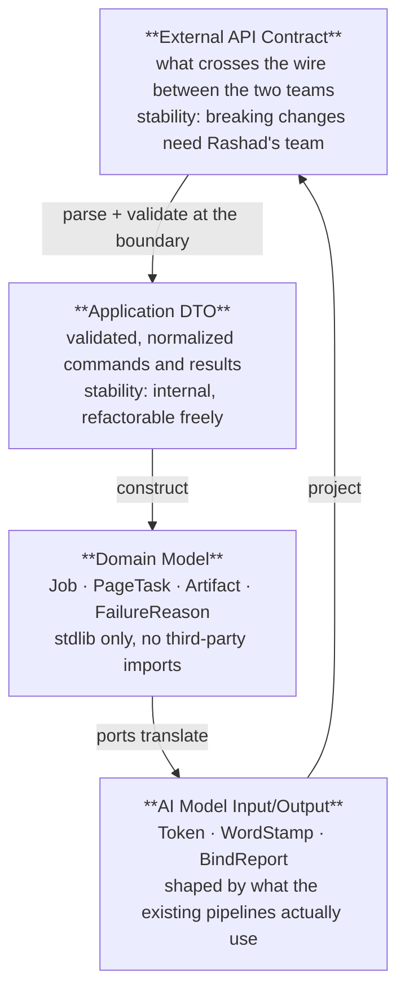

# Data Contracts

## 1. The four layers



**The rule:** an internal model structure never leaks into a public API unless the requirement demands
it. Concretely — the existing `pNNN.json` page record carries `pdf_sha256_16`, `ocr_txt`, `box_level`,
the raw `whisper_words` array (21% of the record by bytes, measured) and a `status` state machine. **None
of that belongs in an artifact we hand the Backend.** The timing artifact is a *projection*, not the
record.

### One field's journey: a word's start time

| Layer | Representation | Where it lives |
|---|---|---|
| **AI output** | `WordStamp(text="العصفور", b=560, e=1240)` — ms, from `faster_whisper` word timestamps or Hume's native ones | `src/pipeline/align_whisper.py:26`, `tts_hume.py:15` |
| **AI output, bound** | `token.t = [560, 1240]`, `token.t_src = "anchor"` after greedy match; `"interpolated"` if it was filled from neighbours | `src/pipeline/speak.py:99 bind` |
| **Domain** | `TimedToken(id="p003w001", text="الْعُصْفُورُ", start_ms=560, end_ms=1240, source=ANCHOR)` | `ai_engine/domain/timing.py` |
| **Application DTO** | `AudioResult.timed_tokens[1]` | `ai_engine/application/dto.py` |
| **External artifact** | `{"id":"p003w001","txt":"الْعُصْفُورُ","t":[560,1240],"t_src":"anchor"}` inside the timing JSON | uploaded as `artifactType: "JSON"` |

Note what is dropped on the way out: the raw `WordStamp.text` (`"العصفور"`, undiacritized, as Whisper
heard it) never reaches the artifact. It exists in the current on-disk record as `whisper_words` and is
pure debugging data.

---

## 2. External API contracts

### 2.1 Inbound — `POST /api/jobs`

Full field tables in [07-api-specification.md](07-api-specification.md) §1.1. Summary:

| Field | Type | Job A | Job B |
|---|---|:---:|:---:|
| `jobId` | GUID string | ✔ | ✔ |
| `jobType` | enum | `PAGES_IMG_AND_TEXT_EXTRACTION` | `PAGE_AUDIO_AND_TEXT_TIMING_GENERATION` |
| `fileId` | string | the PDF | the page's free-text file |
| `folderId` | string | ✔ | ✔ |
| `pathPrefix` | string | ✔ | ✔ |
| `sourceDownloadUrl` | https URL | ✔ | ✔ |
| `pageNumber` | int ≥ 1 | ✘ (rejected) | ✔ (required) |
| `qualityTier` | enum, **PROPOSAL** | optional, default `fast` | optional, default `fast` |

### 2.2 Outbound bodies

```json
// POST /api/files/initialize-upload
{ "fileName": "p007.jpg", "contentType": "image/jpeg", "sizeInBytes": 164231,
  "folderId": "books/reading-first/grade-1", "pathPrefix": "s3-prefix/2026/09" }
```

```json
// PATCH /api/jobs/{jobId}/metadata
{ "pagesCount": 30 }
```

```json
// PATCH /api/jobs/{jobId}/{pageNumber}/completed
{ "artifacts": [ { "fileId": "e5f6a7b8-1111-4222-8333-444455556666", "artifactType": "Image" },
                 { "fileId": "f6a7b8c9-2222-4333-8444-555566667777", "artifactType": "Text"  } ] }
```

```json
// PATCH /api/jobs/{jobId}/{pageNumber}/failed  and  PATCH /api/jobs/{jobId}/failed
{ "reason": "AI_INFERENCE_ERROR: OCR provider returned 429 after 5 attempts" }
```

`artifactType` is exactly one of `Image`, `Text`, `Audio`, `JSON` — capitalized as shown (REQ-CB-02/03).

---

## 3. Application DTOs

| DTO | Fields | Purpose |
|---|---|---|
| `AcceptJobCommand` | `job_id: UUID`, `job_type: JobType`, `file_id: str`, `folder_id: str`, `path_prefix: str`, `source_download_url: HttpUrl`, `page_number: int \| None`, `quality_tier: QualityTier` | The validated, normalized inbound request. `job_id` is canonical-lowercase. |
| `PageTaskSpec` | `job_id`, `page_number`, `job_type`, `quality_tier`, `scratch_dir: Path`, `folder_id`, `path_prefix`, `deadline_at: datetime` | Everything a page task needs. Deliberately carries no HTTP objects and no DB session. |
| `ExtractionResult` | `page_number`, `image_bytes: bytes`, `image_format: ImageFormat`, `text_bytes: bytes`, `tokens: list[Token]`, `provenance: PageProvenance`, `diac_ratio: float`, `diacritization_report` | Job A's per-page output, in memory. |
| `AudioResult` | `page_number`, `audio_bytes: bytes`, `audio_format: AudioFormat`, `timed_tokens: list[TimedToken]`, `bind_report: BindReport`, `provenance` | Job B's per-page output. |
| `ArtifactDescriptor` | `artifact_type: ArtifactType`, `content_type: str`, `file_name: str`, `size_in_bytes: int`, `payload: bytes \| Path` | What the uploader consumes. `content_type` is constrained to the REQ-UPL-04 enum. |
| `UploadTicket` | `backend_file_id: str`, `url: HttpUrl`, `required_headers: dict[str, str]` | The `initialize-upload` response, parsed. `required_headers` is passed to the PUT **verbatim** — never re-cased or reordered, because a presigned signature covers them. |
| `CallbackEnvelope` | `job_id`, `page_number: int \| None`, `kind: CallbackKind`, `payload: dict`, `attempt: int`, `next_attempt_at` | One outbox row. |

```json
// ArtifactDescriptor, as it would be logged (payload elided)
{ "artifact_type": "Text", "content_type": "text/plain",
  "file_name": "p007.txt", "size_in_bytes": 643, "payload": "<643 bytes>" }
```

---

## 4. Domain models

`ai_engine/domain/` imports nothing but the standard library. That constraint is what makes the domain
testable without a database, a network, or 464 MB of model weights.

```python
class JobType(StrEnum):
    PAGES_IMG_AND_TEXT_EXTRACTION = "PAGES_IMG_AND_TEXT_EXTRACTION"
    PAGE_AUDIO_AND_TEXT_TIMING_GENERATION = "PAGE_AUDIO_AND_TEXT_TIMING_GENERATION"

class JobState(StrEnum):
    QUEUED = "QUEUED"; RUNNING = "RUNNING"
    COMPLETED = "COMPLETED"; FAILED = "FAILED"; DEAD_LETTER = "DEAD_LETTER"

class PageState(StrEnum):
    PENDING = "PENDING"; RUNNING = "RUNNING"; ARTIFACTS_UPLOADED = "ARTIFACTS_UPLOADED"
    REPORTED_COMPLETED = "REPORTED_COMPLETED"; REPORTED_FAILED = "REPORTED_FAILED"

class ArtifactType(StrEnum):          # REQ-CB-02/03 — exact wire values
    IMAGE = "Image"; TEXT = "Text"; AUDIO = "Audio"; JSON = "JSON"

class QualityTier(StrEnum):           # PROPOSAL
    FAST = "fast"; VERIFIED = "verified"

class TimingSource(StrEnum):
    ANCHOR = "anchor"; INTERPOLATED = "interpolated"

class CallbackKind(StrEnum):
    METADATA = "metadata"; PAGE_COMPLETED = "page_completed"
    PAGE_FAILED = "page_failed"; JOB_FAILED = "job_failed"
```

`JobState` and `PageState` values are identical to the state machines in
[09-async-jobs.md](09-async-jobs.md) and to the DB enums in
[11-data-and-storage.md](11-data-and-storage.md). If those three ever disagree, the DB is wrong.

| Entity | Key fields |
|---|---|
| `Job` | `job_id`, `job_type`, `state`, `file_id`, `folder_id`, `path_prefix`, `page_number`, `quality_tier`, `pages_count`, `metadata_sent_at`, `attempt`, `lease_until`, `payload_hash`, timestamps |
| `PageTask` | `job_id`, `page_number`, `state`, `attempt`, `lease_until`, `failure_code`, `failure_reason`, timestamps |
| `Artifact` | `job_id`, `page_number`, `artifact_type`, `backend_file_id`, `content_type`, `size_in_bytes`, `confirmed_at` |
| `FailureReason` | `code: ErrorCode`, `message: str` (≤512 chars, redacted), `retryable: bool` |

`FailureReason.message` is redacted at construction, not at send time. Putting the redaction in the
constructor means there is no code path that can build an un-redacted reason and accidentally ship it.

---

## 5. AI input/output schemas

### 5.1 The existing page record — documented as-is

`work/<book>/pNNN.json`. This is **EXISTING BEHAVIOR**, not a contract we are designing. It is documented
because the adapters read and write it and because the two new artifacts are projections of it.

| Field | Type | Written by | Optional? |
|---|---|---|---|
| `book` | string | `src/pipeline/run_extract.py:63`, `run_ocr_*.py` | no |
| `source_pdf` | string | same | no |
| `pdf_sha256_16` | string (16 hex) | same | no |
| `page` | int, 1-based | same | no |
| `source` | `"pdf-text-layer"` \| `"ocr"` | same | no |
| `ocr_engine` | string, e.g. `"lighton/parse-v3"` | OCR drivers only | **absent on the text-layer path** |
| `box_level` | `"word"` \| `"line"` \| `"none"` | OCR drivers only | **absent on the text-layer path** |
| `diac_ratio` | float | `src/pipeline/extract.py:80` | no |
| `path` | `"keep"` \| `"diacritise"` | routed on `DIAC_THRESHOLD = 0.15` | no |
| `status` | `"extracted"` \| `"diacritised"` \| `"spoken"` \| `"skipped-empty"` | every stage | no — **this is the resumability state machine** |
| `tokens[]` | array | see below | no |
| `tts` | string, e.g. `"gemini:gemini-3.1-flash-tts-preview"` | `run_speak_*.py:52-57` | absent until spoken |
| `voice` | string | same | absent until spoken |
| `whisper_words` | array of `{text,b,e}` | same | absent until spoken. **21% of a spoken record by bytes (median 1,738 B of 8,093 B, measured).** Debug data. |
| `align` | string, e.g. `"forced-whisper-small"` | same | absent until spoken |
| `duration_ms` | int | same | absent until spoken |
| `audio` | relative path string, e.g. `"audio/p003.wav"` | same | absent until spoken |
| `bind_report` | object | `src/pipeline/speak.py:99` | absent until spoken |

Token fields, with real measured coverage across all 186 records on disk:

| Field | Type | Coverage | Notes |
|---|---|---:|---|
| `id` | string `p{page:03d}w{index:03d}` | 7,295 | **The anchor.** `src/pipeline/tashkel.py:19-22` calls it load-bearing: boxes, timings, `ensemble_review` rows and `context_decisions` keys all reference it. |
| `raw` | string | 7,295 | what the engine saw |
| `txt` | string | 7,295 | corrected + diacritized — **this is the reading text** |
| `fixes` | string array | 7,295 | e.g. `["kashida"]`, `["ensemble-vlm"]`, `["leading-punct","dropped-hamza"]` |
| `box` | `[x,y,w,h]` | 4,749 | percent coordinates; absent when the engine gives no geometry (`box_level:"none"`) |
| `t` | `[start_ms,end_ms]` | 3,919 | absent until spoken |
| `t_src` | `"anchor"` \| `"interpolated"` | 3,919 | always present when `t` is |
| `ocr_txt` | string | **299** | the pre-correction reading, preserved by the correction tools |

**Schema drift is real and must be handled, not validated away.** `src/pipeline/extract.py` writes
`word` where the OCR paths write `raw`; older records lack keys entirely; text-layer records have no
`ocr_engine`/`box_level`; `ocr_txt` appears on 4% of tokens. A strict validator will reject genuine
historical data. The adapters must read tolerantly (missing key → `None`) and write strictly.

### 5.2 `BindReport`

```json
{ "hume_timestamps": 45, "hume_dropped_invalid": 0, "tokens": 45,
  "anchored": 40, "interpolated": 5, "untimed": 0, "monotonic": true }
```

Real values from `work/فلفل المغرور-lighton/p003.json`. The field name `hume_timestamps` is a historical
misnomer — it counts stamps from *whichever* engine supplied them, including faster-whisper. Do not
rename it in the page record (it would break existing data); do rename it in the artifact projection.

---

## 6. The two new artifact schemas

The most consequential part of this document, because these are the only two things in the entire
delivery that do not exist yet.

### 6.1 The `Text` artifact

| Property | Value | Rationale |
|---|---|---|
| `artifactType` | `Text` | REQ-CB-02 |
| `contentType` | `text/plain` | REQ-UPL-04 |
| Encoding | **UTF-8, no BOM** | Arabic text; a BOM would appear as a stray character in naive consumers |
| Content | The page's reading text, space-joined tokens | Exactly `" ".join(t["txt"] for t in tokens)` — which already exists as a local variable at `src/pipeline/run_ocr_gemini.py:65` and is discarded |
| Diacritics | **Present** | **ASSUMPTION A3 / `Q-04`.** The `txt` field is the corrected *and diacritized* text. Job B feeds this to TTS, and undiacritized Arabic is mispronounced. |
| Line structure | One line per page, no hard wrapping | The tokens are a flat sequence; the pipeline does not preserve paragraph structure in `tokens[]`. **This is a real limitation** — if the reader needs paragraphs, `Q-10` must cover it. |
| Trailing newline | Exactly one `\n` | POSIX text convention; makes the file `diff`-able and `cat`-able |
| Empty pages | A file containing only `\n` | An illustration-only page is a legitimate `completed` page, not a failure. `walidapro/.../word_diacritics.py:1580` currently raises `RuntimeError("No Arabic word boxes were detected.")` on such a page — that must become an empty result. |
| Byte stability | **Required.** Two runs over the same page must produce identical bytes. | Job B re-tokenizes this file. If the bytes drift, the token ids drift, and the timing artifact stops correlating. Tested by `T-6.5`. |
| Measured size | median **643 B** | across 186 real pages |

```text
طَارُ الْعُصْفُورُ صَوْصَوْ وَرَاءَ فُلْفُل وَهُوَ يُغَنِّي بِفَرَحٍ كَبِيرٍ
```

### 6.2 The `JSON` timing artifact

The PDF says only "timing json" (REQ-ART-04). Everything below is **PROPOSAL**, pending `Q-10`.

Design principles:

1. **Self-contained.** It carries `txt` per token, so the reader never has to correlate it back to Job
   A's text file. This costs ~1.5 KB per page and removes an entire class of cross-job coupling bugs.
2. **Versioned.** `schema_version` from day one. Adding it later is a breaking change; having it is free.
3. **A projection, not a dump.** It excludes `whisper_words` (21% of the source record, pure debug),
   `pdf_sha256_16`, `ocr_txt`, `status`, `box_level` and `fixes`.
4. **Honest about quality.** `provenance.anchor_ratio` is in the artifact, so a consumer can tell a
   93.7%-anchored page from a 51%-anchored one — a distinction `README.md:473,491` shows is real.

```json
{
  "schema_version": "1.0",
  "page": 3,
  "duration_ms": 27520,
  "audio": {
    "codec": "pcm_s16le",
    "container": "wav",
    "sample_rate_hz": 24000,
    "channels": 1,
    "bit_depth": 16
  },
  "provenance": {
    "tts_model": "gemini-3.1-flash-tts-preview",
    "voice": "Kore",
    "align_method": "forced-whisper-small",
    "anchor_ratio": 0.889,
    "tokens": 45,
    "anchored": 40,
    "interpolated": 5,
    "untimed": 0
  },
  "tokens": [
    { "id": "p003w000", "txt": "طَارُ",        "t": [0, 560],     "t_src": "anchor" },
    { "id": "p003w001", "txt": "الْعُصْفُورُ",   "t": [560, 1240],  "t_src": "anchor" },
    { "id": "p003w002", "txt": "صَوْصَوْ",       "t": [1240, 1820], "t_src": "interpolated" }
  ]
}
```

Real values, taken from `work/فلفل المغرور-lighton/p003.json` (45 tokens, 40 anchored, 5 interpolated,
`duration_ms` 27520, `tts` `gemini:gemini-3.1-flash-tts-preview`, `voice` `Kore`, `align`
`forced-whisper-small`). `anchor_ratio` is `40/45 = 0.889`.

Field contract:

| Field | Type | Required | Meaning |
|---|---|:---:|---|
| `schema_version` | string `"MAJOR.MINOR"` | ✔ | `1.0` for V1 |
| `page` | int ≥ 1 | ✔ | 1-based, equals the job's `pageNumber` |
| `duration_ms` | int ≥ 0 | ✔ | **Measured from the audio bytes**, never estimated from character count. `src/pipeline/tts_gemini.py:37` derives it from PCM length — correct. |
| `audio.*` | object | ✔ | Describes the sibling `Audio` artifact so a consumer can validate it without decoding |
| `provenance.*` | object | ✔ | Model ids, alignment method, and the quality counters |
| `provenance.anchor_ratio` | float `[0,1]` | ✔ | `anchored / tokens`. Corpus baseline **0.78 measured** over 95 pages. |
| `tokens[].id` | string | ✔ | `p{page:03d}w{index:03d}`, reproducible from the text artifact |
| `tokens[].txt` | string | ✔ | The reading text of this token, diacritized — makes the artifact self-contained |
| `tokens[].t` | `[int,int]` | **optional** | `[start_ms, end_ms]`. **Absent means "no timing available for this token"** — the reader should show it unhighlighted rather than guess. 7 of 3,873 real tokens are in this state (0.2%, measured). |
| `tokens[].t_src` | enum | present iff `t` is | `anchor` = matched a real speech timestamp; `interpolated` = filled proportionally between anchors |

**Invariants a consumer may rely on:**

1. `tokens` is in reading order and `id` indices are contiguous from `w000`.
2. Where `t` is present it is monotonic non-decreasing across the array, and non-overlapping. Enforced by
   `speak.py:_interpolate`'s `start = min(prev_t, end_t)` clamp; 0 non-monotonic pages across all 95 real
   pages (measured).
3. `0 <= t[0] <= t[1] <= duration_ms`.
4. `t_src` is present on every token that has `t`, and absent on every token that does not.
5. A token with no `t` never breaks playback — it is simply not highlightable. `README.md:473` describes
   exactly this degradation: "degrades to unhighlightable text, doesn't break".

**What is deliberately absent: bounding boxes.** They exist in Job A's data (`tokens[].box`, present on
4,749 of 7,295 real tokens) but the V1 contract has **no `artifactType` slot for them at all**. If the
reader needs image-view highlighting, that is a contract gap, not an implementation gap — `Q-10`.

---

## 7. Internal queue message

There is no separate broker, so the "message" is the `jobs` row itself
([ADR-004](19-adrs.md)). The page-task payload passed between components in-process is `PageTaskSpec`
(§3). Nothing is serialized to a wire format internally, which removes a serialization contract we would
otherwise have to version.

## 8. Error schema

Shared with [14-error-model.md](14-error-model.md) — see there for the taxonomy, the HTTP mapping and
the `reason`-string rules. Shape only, for reference:

```json
{ "error": { "code": "VALIDATION_ERROR", "message": "…", "details": { }, "requestId": "…" } }
```

## 9. Versioning policy

| Contract | Owner | Change process |
|---|---|---|
| `POST /api/jobs` request/response | Joint | Additive optional fields freely. Anything else needs agreement with the Backend team and a `/api/v2/jobs` path. |
| Outbound Backend calls | Backend team | We follow. A change breaks us, so it needs notice. |
| `Text` artifact | Joint | Content changes (e.g. `Q-04` resolving the other way) are breaking for the reader and for Job B's tokenization. |
| **`JSON` timing artifact** | Us, with reader-app agreement | `schema_version` MINOR bump for additive optional fields; MAJOR for anything a consumer could break on. Consumers must ignore unknown fields. |
| Application DTOs, domain models | Us | Refactor freely — they never cross a team boundary. |
| `pNNN.json` page record | Us | **Append-only in practice.** 186 real records exist with drifted schemas; readers must tolerate missing keys. Never repurpose an existing key's meaning. |
