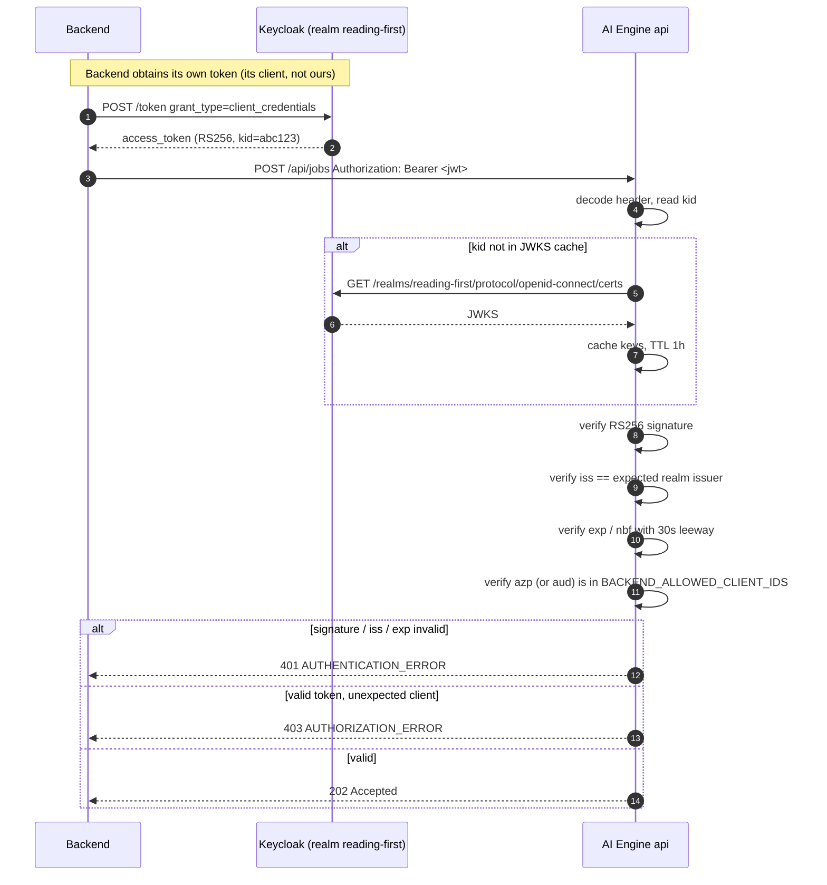

# Security Architecture

## 1. Threat model

| | |
|---|---|
| **Who can reach the engine** | In V1, exactly one caller: the Backend (CONSTRAINT C1). No browser, no mobile client, no third party. The engine should not be internet-reachable at all. |
| **What an attacker gains from the engine** | The Backend `client_secret` (which lets them impersonate the AI Engine to the Backend, uploading arbitrary files into the Backend's storage and marking arbitrary pages completed); eight live AI-vendor API keys with real spend attached; and the ability to make the engine fetch arbitrary URLs server-side. |
| **Assets, in priority order** | 1. `AI_ENGINE_CLIENT_SECRET`. 2. The vendor API keys (`GEMINI_API_KEY`, `LIGHTON_API_KEY`, `HUME_API_KEY`, `OPENROUTER_API_KEY`, …). 3. The Backend bearer token in memory. 4. Presigned URLs (they are bearer credentials for a specific object). 5. Source PDFs and generated artifacts (published book content — low sensitivity). |
| **What is not an asset** | The book content itself. It is published children's material, not personal data. Saying so explicitly prevents over-engineering the data-handling story. |
| **Primary attack surfaces** | `POST /api/jobs` (the only inbound HTTP); `sourceDownloadUrl` (attacker-influenced input we fetch server-side); the downloaded PDF (untrusted input parsed by native code); the dependency supply chain. |

---

## 2. Inbound authentication — the largest ambiguity in the spec

### The problem, stated exactly

The PDF gives us `client_id = reading-first-ocr-engine` and `client_secret` **for calling the Backend**,
and says inbound calls carry `header authorization {ai-engine-bearer-token}` (REQ-AUTH-06). It never
says:

- how the AI Engine should **validate** that token,
- which Keycloak client the Backend presents,
- what `aud`, `azp`, `scope` or realm role to expect,
- or where the JWKS endpoint is.

**`Q-01` — this blocks implementation of authentication entirely.** It must be answered by the Backend
team before `T-2.2` starts.

### Note the asymmetry

The engine's own `client_secret` is an **outbound** credential. It is not, and must never be treated as,
an inbound shared secret. If someone proposes "just check the incoming token against our client_secret",
that is a category error: it would mean the two services share a symmetric secret, that either can
impersonate the other, and that rotating it requires a synchronized deploy. Do not do it, and do not
propose it as a fallback.

### PROPOSAL for V1: JWKS-based Keycloak JWT validation



| Aspect | Decision |
|---|---|
| Algorithm | **RS256 only.** Reject `alg: none` and reject HS256 outright — accepting a symmetric algorithm from a JWKS-based verifier is the classic algorithm-confusion vulnerability. |
| Key source | The realm JWKS at `{realm}/protocol/openid-connect/certs`, derivable from `TOKEN_URL` by replacing the `/token` suffix. Configurable as `JWKS_URL` so it need not be derived. |
| Key caching | In-memory, TTL 1 h, plus an immediate re-fetch on an unknown `kid` (rate-limited to once per minute so an attacker cannot use bogus `kid`s to hammer Keycloak). |
| Claim checks | `iss` exact match; `exp`/`nbf` with 30 s clock leeway; `azp` or `aud` ∈ `BACKEND_ALLOWED_CLIENT_IDS`. |
| `401` vs `403` | `401` = we cannot establish who you are (missing, malformed, bad signature, expired). `403` = we know who you are and you are not allowed. This distinction matters because REQ-AUTH-04 tells the *caller* that 401 means "refresh and retry" — returning 401 for an authorization failure would send the Backend into a pointless refresh loop. |
| Startup behaviour | Fetch JWKS at startup, but **do not** fail startup if Keycloak is briefly unavailable — fail `/ready` instead, and retry. A Keycloak blip should not crash-loop the API. |
| Offline fallback | None. If JWKS cannot be fetched and no key is cached, every request gets `401`. **Never** fall back to unverified decoding. |

---

## 3. Outbound authentication

Exactly as REQ-AUTH-01/02/03/04 specify, with the implementation details the spec leaves open.

```http
POST {TOKEN_URL}
Content-Type: application/x-www-form-urlencoded

grant_type=client_credentials&client_id={AI_ENGINE_CLIENT_ID}&client_secret={AI_ENGINE_CLIENT_SECRET}
```

| Rule | Detail |
|---|---|
| Cache location | **Process memory only.** REQ-AUTH-03 forbids a database or other store. Each worker replica holds its own. |
| Refresh trigger | When fewer than **30 s** of the token's `expires_in` (300 s) remain — REQ-AUTH-02's "5 minutes minus 30 sec". |
| **Single-flight** | Under `WORKER_PAGE_CONCURRENCY` concurrent page tasks, an expiry must trigger **one** token request, not N. Implemented with a per-process lock around the refresh. Without this, every expiry becomes a small thundering herd against Keycloak. |
| 401 handling | Force a refresh and retry the Backend call **exactly once** (REQ-AUTH-04). A second 401 is terminal `AUTHENTICATION_ERROR`. |
| 401 from Keycloak itself | **Never retried.** It means the credentials are wrong, which is a configuration failure that must page a human, not a transient error to back off from. |
| Never | Log the token (not even truncated or hashed); persist it; send it to any host other than `BACKEND_BASE_URL`; or attach it to a presigned S3 request — doing that last one would hand our Backend credential to the storage provider. |

---

## 4. Secrets

| Secret | Purpose | Consumer | Rotation story |
|---|---|---|---|
| `AI_ENGINE_CLIENT_SECRET` | Obtain the Backend token | worker | **Highest value.** Rotate in Keycloak, then roll worker replicas. In-memory token cache means the old token stays valid for ≤300 s — no coordinated cutover needed. |
| `DATABASE_URL` (password) | Postgres | api + worker | Rotate + roll both roles. |
| `GEMINI_API_KEY` | Gemini OCR / vision / TTS | worker | Vendor console; roll workers. |
| `LIGHTON_API_KEY` | LightOn parse | worker | ditto |
| `REVIEWER_API_KEY`, `FINAL_REVIEWER_API_KEY` | Verified tier LLM calls | worker | ditto |
| `HUME_API_KEY` | Hume TTS | worker | ditto |
| `OPENROUTER_API_KEY` | Reasoning model (correction tools, not in V1) | dev only | ditto |
| `HF_TOKEN` | HuggingFace model download | worker (first run) | ditto |
| `DATALAB_API_KEY`, `BIADU_API_KEY`, `SALIMA_API_KEY` | Abandoned `tmp/` spikes | **nobody** | **Revoke.** They are dead keys sitting in a live `.env`. |

### The existing anti-pattern, which must be removed from the service path

Two facts combine badly:

1. **A real `.env` with eight live credentials sits in the repository root.** It contains actual values
   for `LIGHTON_API_KEY`, `HF_TOKEN`, `DATALAB_API_KEY`, `BIADU_API_KEY`, `GEMINI_API_KEY`,
   `HUME_API_KEY`, `SALIMA_API_KEY` and `OPENROUTER_API_KEY`.
2. **`load_dotenv()` runs at import time in 11 modules** — `src/pipeline/run_ocr_gemini.py:20`,
   `run_ocr_lighton.py:25`, `tools/vlm_arbiter.py:28`, `walidapro/ocr_verifier/config.py:7`,
   `walidapro/ocr_verifier/final_context_reviewer.py:14`, and six more.

Together they mean: **if a `.env` file is present in a container's working directory, importing the
pipeline silently overrides the secrets the orchestrator injected.** A rotated key in the environment
would be shadowed by a stale key in a file, with no log line and no error.

Required for V1 (`T-1.2`):

- `.env` is in `.gitignore` and **the committed copy is deleted from the working tree and its keys
  rotated**. Note that `git rm` does not remove it from history — the keys must be treated as
  compromised and rotated regardless.
- **No `load_dotenv()` anywhere in `ai_engine/`.** Config comes from the process environment only.
- Where the service imports legacy modules that call `load_dotenv()` at import, the container must
  simply have no `.env` on disk — and a startup assertion checks that.
- `.env.example` ships with placeholders only ([15-configuration.md](15-configuration.md)).
- Secrets are injected by the orchestrator (Compose `env_file` from a host path outside the image, or a
  secrets manager). They are never baked into the image and never appear in `docker history`.

---

## 5. Input validation

Every field of `POST /api/jobs`, validated at the boundary by pydantic before anything else happens.
Full table in [07-api-specification.md](07-api-specification.md) §1.1. The security-relevant ones:

| Field | Rule | Threat |
|---|---|---|
| `jobId` | Must parse as an RFC 4122 UUID; stored canonical-lowercase | Injection via a free-text id; and a non-canonical id would defeat the idempotency key |
| `jobType` | Exact enum match; unknown → `422` | An unknown type accepted with 202 would never run, silently stranding the book |
| `pageNumber` | `int >= 1`, and required-XOR-forbidden by job type | Negative or zero page numbers reaching the renderer |
| `folderId`, `pathPrefix` | Length-capped; **no path traversal** — reject any value containing `..`, a leading `/`, a backslash or a NUL | These are passed through to `initialize-upload`. They must never be used to build a **local** path — the scratch path is derived from `job_id` alone ([11-data-and-storage.md](11-data-and-storage.md) §5), which structurally removes the traversal risk. |
| `sourceDownloadUrl` | Absolute, scheme **`https` only**, and **host must be in `SOURCE_URL_ALLOWED_HOSTS`** | **SSRF.** See below. |
| Body size | ≤16 KB | Trivial DoS |

### SSRF is the real one

`sourceDownloadUrl` is caller-supplied and **we fetch it server-side** (REQ-SRC-01). If the engine is
willing to `GET` an arbitrary URL, then anyone who can call `POST /api/jobs` can use the engine as a
proxy into whatever network the worker sits in — cloud metadata endpoints, internal admin panels,
Postgres on `localhost`.

The Backend is trusted, but "trusted" is not "incapable of being compromised or misconfigured", and this
is a two-line mitigation:

| Control | Detail |
|---|---|
| Scheme allowlist | `https` only. Reject `http`, `file`, `gopher`, `ftp`, `data`. |
| **Host allowlist** | `SOURCE_URL_ALLOWED_HOSTS` — the storage hostnames the Backend actually uses. **Required for V1, not future hardening.** |
| Resolve-then-check | Resolve the hostname and reject if it maps to a loopback, link-local (`169.254.0.0/16`), or RFC 1918 address, then connect to the **validated IP** to close the DNS-rebinding window. |
| No redirect following | Or follow at most one, re-validating the target host. An open redirect on an allowlisted host otherwise defeats the allowlist. |
| No credential forwarding | Never attach the Backend token or any vendor key to a presigned fetch. |

## 6. File and upload security

The downloaded PDF is untrusted input handed to native parsers (`pypdfium2`, PyMuPDF). Those are C
libraries; a malformed file is a code-execution surface, and a well-formed but hostile file is a
resource-exhaustion surface.

| Control | Detail |
|---|---|
| Streamed download with a hard cap | Abort at `MAX_SOURCE_BYTES` (**PROPOSAL** 200 MB — `Q-08`). Never buffer an unbounded response in memory. |
| Magic-byte verification | The bytes must begin `%PDF-` for Job A; Job B's input must decode as UTF-8. A `Content-Type` header is a claim, not evidence. |
| Page-count ceiling | Reject over `MAX_SOURCE_PAGES` (**PROPOSAL** 500) with `SOURCE_INVALID`. Prevents a 100,000-page document from creating 100,000 ledger rows and 100,000 page tasks. |
| Decompression-bomb defence | The page-count ceiling plus the per-page render deadline plus the streaming renderer. Note the current code would materialize every page as ~14 MB of RGB in one list (`walidapro/ocr_verifier/pdf_render.py:41-107`) — an OOM waiting for a large document. |
| Parse failure is data, not a crash | A `pypdfium2`/PyMuPDF exception → `SOURCE_INVALID` → whole-job `/failed` with a safe reason. Never a worker crash, never an unhandled traceback. |
| Encrypted / password-protected PDFs | `SOURCE_INVALID`. Do not attempt to crack or bypass. |
| Scratch files are inert | Never executed, never served over HTTP, never placed inside a static directory. The engine serves no files at all. |
| Download timeout | connect 5 s, read 60 s, total 300 s — a slowloris source cannot pin a worker forever. |
| Upload side | We compute `sizeInBytes` from the bytes we hold; `Content-Length` must match exactly. We send only the four permitted content types (REQ-UPL-04). |

## 7. Other controls

| Control | V1 position |
|---|---|
| **Model-endpoint protection** | No AI stage is reachable over HTTP. The API process must not import any adapter — enforced by the import rules in [05-target-architecture.md](05-target-architecture.md) §4 and a lint check (`T-1.6`). This is the strongest possible protection: the attack surface does not exist. |
| **Rate limiting (inbound)** | **None in V1.** One trusted first-party caller. Deliberate: a limiter would most likely fire during a Backend retry storm — exactly when we least want to reject work. `Q-13`. |
| **Rate limiting (outbound)** | **Required**, but for cost not security: a fleet-wide provider budget in Postgres ([09-async-jobs.md](09-async-jobs.md) §6). `README.md:491` records a real 10-requests/day free-tier wall. |
| **CORS** | **Irrelevant, and that is a finding rather than an omission.** There is no browser client — the only caller is a server. Adding CORS headers would be cargo-culting. If a browser ever needs to call this, that is a new requirement with its own auth story. |
| **Audit logging** | Every job accept (with `jobId`, `jobType`, caller `azp`, decision new/duplicate/rejected) and every terminal callback is logged at INFO with a stable event name. These are the two events someone will ask about in an incident. |
| **HTTPS / TLS** | The PDF's examples are `https://localhost:9099` and `https://localhost:6060`, but `token_URL` is `http://localhost:9090`. **`Q-15`:** production must be TLS end to end — sending `client_secret` over plain HTTP would expose it to anything on the path. TLS termination point and any mTLS requirement between the two services are unresolved. |
| **Least privilege** | The DB user needs `SELECT`/`INSERT`/`UPDATE`/`DELETE` on four tables and nothing else — no `CREATE`, no superuser. Migrations run as a separate, more-privileged user in a one-shot container. Containers run as a non-root user with a read-only root filesystem apart from the scratch and cache volumes. |
| **Network posture** | The engine is not internet-facing. Ingress: only the Backend to `:9099`. Egress: Keycloak, Backend, the storage host, and the AI vendors. Everything else denied — which also happens to be a second layer of SSRF defence. |

## 8. Dependency and supply-chain security

Current state is poor and must improve for V1:

- `requirements.txt` is **15 bytes** containing only `faster_whisper`, while the code imports 13 other
  third-party packages. **Zero version pins.**
- No `pyproject.toml`, no lock file, no vulnerability scanning, no SBOM.
- `.ruff_cache/0.12.7/` exists but there is no ruff config and ruff is not installed — lint is ad-hoc,
  not a gate.
- The engine loads model weights from HuggingFace and PaddleOCR's fetcher **at first use, over the
  network, unpinned**.

| Control | V1? |
|---|---|
| A complete, **version-pinned** dependency set with a lock file | **Required** (`T-1.1`) |
| Model weights pre-baked into the image or pinned by revision in the cache volume | **Required** (`T-7.3`) — otherwise the model can change under us between deploys, which is both a security and a reproducibility problem |
| Non-root container, read-only root filesystem | **Required** (`T-7.1`) |
| `pip-audit` / `safety` in CI | Future hardening |
| Base-image scanning, SBOM generation | Future hardening |
| Signed images | Future hardening |

---

## 9. Required for V1 vs future hardening

| Required for V1 | Future hardening |
|---|---|
| Inbound JWT validation: RS256 only, JWKS-cached, `iss`/`exp`/`nbf`, `azp` allowlist | mTLS between Backend and AI Engine |
| Outbound `client_credentials` with in-memory single-flight cache and the 30 s margin | Short-lived DB credentials from a secrets manager |
| Remove `load_dotenv()` from the service path; delete the committed `.env`; **rotate all eight keys** | Automated secret rotation |
| Revoke the three dead vendor keys | Per-vendor spend alerts |
| Full request validation, incl. UUID and enum strictness | Inbound rate limiting / quotas |
| **`sourceDownloadUrl` scheme + host allowlist, resolve-then-check, no redirects** | Egress proxy with per-destination policy |
| PDF magic-byte check, size cap, page-count ceiling, parse-failure-as-data | Sandboxed PDF parsing in a separate process or seccomp profile |
| Never log tokens, secrets, or presigned URLs; `reason` redacted at construction | Automated log-scanning for leaked secrets |
| Version-pinned dependencies + lock file; pinned model weights | `pip-audit`, SBOM, image signing, base-image scanning |
| Non-root container, read-only rootfs, least-privilege DB user | Network policies, service mesh |
| Audit log for job accept and terminal callbacks | Tamper-evident audit storage |
| TLS between all services (`Q-15`) | Certificate pinning |
