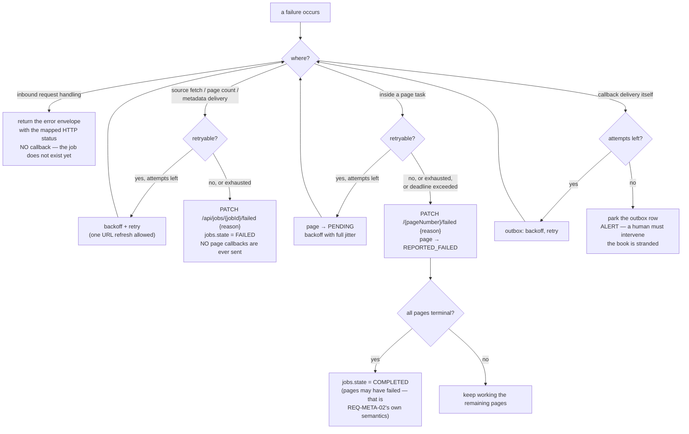

# Error Model

One taxonomy, used identically in the API responses, the log records, the metric labels and the `reason`
strings sent to the Backend. A code appearing in one place and not another is a bug.

## 1. Taxonomy

| Code | HTTP (inbound) | Retryable | Who retries | User-safe message | Internal detail captured | Log level | Spec callback |
|---|---|:---:|---|---|---|---|---|
| `VALIDATION_ERROR` | `422` (or `400` for bad JSON) | No | nobody | "Request body failed validation" + the field | full field errors | `WARN` | — |
| `AUTHENTICATION_ERROR` | `401` | No inbound / **Yes** outbound (refresh once) | Backend inbound; us outbound | "Authentication failed" | claim that failed, `kid`, never the token | `WARN` | — |
| `AUTHORIZATION_ERROR` | `403` | No | nobody | "Not authorized for this operation" | caller `azp`, allowlist | `WARN` | — |
| `NOT_FOUND` | `404` | No | nobody | "Resource not found" | `jobId` | `INFO` | — |
| `CONFLICT` | `409` | No | nobody | "jobId already exists with a different payload" | both payload hashes | `WARN` | — |
| `RATE_LIMITED` | `429` (not emitted inbound in V1) | **Yes**, honour `Retry-After` | us | "Upstream rate limit reached" | provider, `Retry-After`, budget state | `WARN` | page `/failed` after cap |
| `SOURCE_UNAVAILABLE` | — | **Yes** (2 attempts + 1 URL refresh) | us | "Could not download the source file" | HTTP status, attempt count, **never the URL** | `ERROR` | **job** `/failed` |
| `SOURCE_INVALID` | — | **No** | nobody | "Source file is not a valid PDF" | magic bytes seen, byte size, page count | `ERROR` | **job** `/failed` |
| `AI_INFERENCE_ERROR` | — | **Yes** (3) | us | "AI processing failed for this page" | provider, model, status, response excerpt | `ERROR` | page `/failed` |
| `MODEL_UNAVAILABLE` | — | **Yes** | us | "AI model is temporarily unavailable" | provider, model, whether local weights are missing | `ERROR` | page `/failed` |
| `PROCESSING_TIMEOUT` | — | **Yes** once, then No | us | "Page processing exceeded the time limit" | stage reached, elapsed ms, deadline | `ERROR` | page `/failed` |
| `UPLOAD_FAILED` | — | **Yes** (5) | us | "Could not upload the generated artifact" | which of the 3 steps, artifact type, status | `ERROR` | page `/failed` |
| `CALLBACK_FAILED` | — | **Yes** (10) | us | n/a — the Backend never sees this | endpoint, status, attempt | `ERROR` | **none — park + alert** |
| `EXTERNAL_SERVICE_ERROR` | `503` | **Yes** | Backend inbound; us outbound | "A dependency is unavailable" | target, operation, status | `ERROR` | context-dependent |
| `INTERNAL_ERROR` | `500` | **Yes** once | Backend | "An unexpected error occurred" | exception type, **stack trace to logs only** | `ERROR` | page or job `/failed` |

Two rows deserve emphasis:

- **`CALLBACK_FAILED` is the one failure the engine cannot paper over.** Every other failure has a way to
  tell the Backend. This one *is* the failure to tell the Backend, so its only remedy is to park the
  outbox row and page a human ([13-observability.md](13-observability.md) alert #2).
- **`SOURCE_*` failures are job-level, not page-level.** REQ-CB-05 names exactly this case: *"you cant
  parse or get the pdf"*. Sending page callbacks for a job whose source never loaded would be incoherent,
  since we do not even know `pagesCount`.

## 2. Inbound error envelope

```json
{
  "error": {
    "code": "VALIDATION_ERROR",
    "message": "pageNumber is required for PAGE_AUDIO_AND_TEXT_TIMING_GENERATION",
    "details": { "field": "pageNumber" },
    "requestId": "01J8Z3K7QF2E9V0S6M4B1TX7YD"
  }
}
```

`message` is always safe to log, display and forward. `details` carries structured context and **never** a
token, a presigned URL or a stack trace.

## 3. The `reason` string sent to the Backend

The PDF says only `reason : "..."` and never specifies a format (`Q-14`). **PROPOSAL**, chosen so the
string is useful to a human today and parseable later if the Backend ever wants that:

```text
<ERROR_CODE>: <short human explanation>
```

| Rule | Reason |
|---|---|
| ≤ **512** characters | Bounded so it cannot blow up the Backend's storage or logs |
| Starts with a taxonomy code, then `": "` | Stable machine-readable prefix; the human tail can be reworded without breaking a parser |
| **No presigned URL** | It is a bearer credential |
| **No token, no API key** | Obvious, and enforced by construction-time redaction ([10-data-contracts.md](10-data-contracts.md) §4) |
| **No stack trace, no file paths** | Traces go to our logs, keyed by `job_id`; leaking our internals into the Backend's UI is neither useful nor safe |
| No provider response bodies verbatim | They can contain quoted request data, including URLs |
| Stable wording per code | So the Backend can group failures even without parsing |

Real examples, covering every failure family:

```text
SOURCE_UNAVAILABLE: could not download the source file after 2 attempts and 1 URL refresh (last HTTP 403)
SOURCE_INVALID: downloaded file is not a parseable PDF (magic bytes 'PK\x03\x04', 18342 bytes)
SOURCE_INVALID: PDF has 1204 pages, exceeding the 500-page limit
RATE_LIMITED: OCR provider rate limit not cleared after 5 attempts over 60s
AI_INFERENCE_ERROR: OCR provider returned HTTP 500 after 3 attempts
AI_INFERENCE_ERROR: TTS returned audio of 224.1s for 47 words, which failed the duration sanity check
MODEL_UNAVAILABLE: local alignment model could not be loaded
PROCESSING_TIMEOUT: page did not complete within 900s (reached stage 'align')
UPLOAD_FAILED: artifact 'Audio' failed at confirm-upload after 5 attempts (last HTTP 502)
INTERNAL_ERROR: unexpected failure while building the timing artifact
```

Note the second `AI_INFERENCE_ERROR` example: it comes from a real observed failure mode. The TTS
duration sanity gate at `walidapro/ocr_verifier/tts/pipeline.py:195` exists because a degenerate
~224-second output for ~50 words was actually seen, and it is called out in the code at `:493-495`. The
error model should surface such quality rejections as failures with a specific reason, not as generic
errors.

## 4. Error → callback decision tree



The single most important property of this tree: **a page-level failure never fails the job, and a
job-level failure never emits page callbacks.** Mixing those two would either strand pages (the Backend
waiting for reports that will never come) or send reports for a job the Backend cannot associate with a
page count.

## 5. Retryable classification

| Signal | Classification | Notes |
|---|---|---|
| Connection error, DNS failure, read timeout | **Retryable** | |
| `408`, `429`, `500`, `502`, `503`, `504` | **Retryable** | Honour `Retry-After` when present |
| `429` specifically | **Retryable, but budget-aware** | If the fleet provider budget is exhausted, park the page rather than burning attempts. `README.md:491` documents a real 10-req/day free-tier wall. |
| `401` | **Refresh the token, retry exactly once**, then terminal | REQ-AUTH-04. A second 401 means the credentials are wrong, not stale. |
| `401` from Keycloak itself | **Never retryable** | Bad `client_secret` is a configuration failure. Page a human. |
| `403` on a presigned URL | **Special: treat as expired** | For presigned URLs a 403 almost always means expiry, so it triggers `get-download-url` (REQ-SRC-02) or a fresh upload ticket — at most once, guarded against loops. |
| `400`, `403` (non-presigned), `404`, `409`, `415`, `422` | **Never retryable** | Retrying a deterministic rejection just burns budget. |
| Local model load failure | Retryable once, then terminal | Usually a missing cache volume |
| A validator rejection (duration sanity, letters-changed, `UnsafeReviewError`) | **Not an error at all — a degradation** | Keep the original, mark for review, continue. Only escalate if the page cannot produce its artifacts. |

## 6. Exception-handling standards

Four rules for `ai_engine/`, each written against a specific existing anti-pattern.

### 6.1 Never swallow with a blanket `except Exception`

```python
# WRONG — the existing pattern
except Exception:
    return _missing_word_result(word)      # walidapro/.../word_diacritics.py:1296
```

**The concrete harm:** a provider outage becomes a page of 100% `REVIEW` that still *reports success*.
The page uploads, the callback says `completed`, and the book silently ships with no diacritics. Nobody
finds out. `walidapro/ocr_verifier/lighton_ocr.py:180` has the same shape and additionally retries auth
failures identically to 429s.

```python
# RIGHT
except (ProviderTimeout, ProviderHttpError) as exc:
    raise AiInferenceError(code=ErrorCode.AI_INFERENCE_ERROR, provider=..., cause=exc) from exc
except AmbiguousResultError:
    return unshaped_result(word)           # a genuine degradation, recorded in review_ratio
```

The rule: **distinguish "the model is uncertain" from "the provider is broken".** The first is data; the
second is an error. Conflating them is the single most damaging habit in the existing code.

### 6.2 Never raise `SystemExit` from a library function

There are **19** `sys.exit` / `raise SystemExit` sites across `tools/` and `src/pipeline/`, and several
are inside library functions rather than `main()` — `tools/ensemble_review.py:133` raises from inside
`run()`. `SystemExit` inherits `BaseException`, so it **escapes `except Exception` handlers** and takes
the worker down instead of failing a page.

Two existing tests actively assert this behaviour (`src/tests/test_ensemble_review.py:143`,
`src/tests/test_apply_context_suggestions.py:105`), so changing it is a deliberate, test-updating change
(`T-1.5`), not a silent refactor. In `ai_engine/`, library code raises typed domain errors; only the CLI
entrypoint may exit.

### 6.3 Always attach context before re-raising

Every raised error carries `error_code`, `job_id`, `page_number` and `stage`. This is what makes the
log-filter-by-`job_id` workflow in [13-observability.md](13-observability.md) §7 actually work.

### 6.4 Never let an error escape a page task

The Page Task Executor wraps everything. Any exception — including one we failed to anticipate — is
classified, converted to a bounded safe reason, and reported as `/failed`. An unhandled exception in a
page task would violate INVARIANT-1, which makes this wrapper the most safety-critical `try` block in
the system.

```python
try:
    run_page(spec)
except BaseException as exc:                     # yes, BaseException — see 6.2
    code, reason = classify(exc)
    ledger.report_failed(spec, code, reason)     # writes the outbox row in the same transaction
    raise                                        # after the ledger write, let the worker see it
```

## 7. Timeouts

Every outbound call gets an explicit connect and read timeout; every page task gets a wall-clock
deadline. Two existing defects this closes:

- `walidapro/ocr_verifier/final_context_reviewer.py:825` passes no timeout, so the OpenAI SDK's default
  600-second read timeout applies — one hung call pins a worker for ten minutes.
- No page or job deadline exists anywhere in the repository, so a stuck page holds a worker indefinitely
  while the Backend's retries re-enqueue the same expensive work.

| Operation | Connect | Read | Deadline |
|---|---:|---:|---:|
| Keycloak token | 3 s | 5 s | — |
| Backend API calls | 3 s | 15 s | — |
| Presigned GET (source) | 5 s | 60 s | 300 s total |
| Presigned PUT (artifact) | 5 s | 120 s | — |
| Provider OCR / vision | 5 s | 60 s | — |
| Provider TTS | 5 s | 180 s | — |
| Local alignment | — | — | bounded by the page deadline |
| **Page task** | — | — | **900 s** (`PAGE_TASK_TIMEOUT_SECONDS`) |
| **Job** | — | — | **86400 s** (`JOB_DEADLINE_SECONDS`) |
