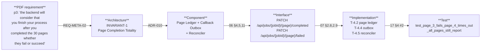

# Requirements Traceability Matrix

The intended source of truth for implementation tracking.

**Every row's status is `NOT STARTED`, because nothing has been built.** That is the honest state: this
document set is the design that precedes implementation, per Rule 7 of the parent brief ("do not code
until the architecture is understood"). Status values will become meaningful once
[21-implementation-roadmap.md](21-implementation-roadmap.md) begins.

Requirement IDs: [02-v1-requirements.md](02-v1-requirements.md).
Component names: [06-service-boundaries.md](06-service-boundaries.md).
Task IDs: [21-implementation-roadmap.md](21-implementation-roadmap.md).
Test names: [17-testing-strategy.md](17-testing-strategy.md).

## The traceability chain

That is one requirement traced end to end. The tables below do the same for all thirty.

---

## REQ-AUTH — Authentication

Nothing in the repository authenticates anything inbound, and outbound auth is a static vendor API key
placed in a `requests.Session` header at construction time.

| Requirement | Source in PDF | Existing Code | Target Component | API | Task | Test | Status |
|---|---|---|---|---|---|---|---|
| REQ-AUTH-01 | p5 *"Post &lt;Token_URL&gt; … grant_type=client_credentials"* | none | Keycloak Token Provider | out: `POST {TOKEN_URL}` | `T-5.1` | `test_token_never_persisted` | NOT STARTED |
| REQ-AUTH-02 | p5 *"check if it is still valid and not exceed (5 minutes minus 30 sec)"* | none | Keycloak Token Provider | — | `T-5.1` | `test_token_reused_above_30s_remaining`, `test_token_refreshed_below_30s_remaining` | NOT STARTED |
| REQ-AUTH-03 | p5 *"no need to store such a token in db or other place"* | none | Keycloak Token Provider | — | `T-5.1` | `test_token_never_persisted` | NOT STARTED |
| REQ-AUTH-04 | p5 *"401 means unauthorized token or expired"* | `walidapro/ocr_verifier/lighton_ocr.py:180` retries all statuses identically | Backend Callbacks, Artifact Upload | all outbound | `T-5.1`, `T-5.2` | `test_401_retried_once_after_forced_refresh` | NOT STARTED |
| REQ-AUTH-05 | p2 *"header authorization {backend-bearer-token}"* | static vendor keys at `walidapro/.../lighton_ocr.py:19-21`, `reviewer.py:40-43`, `src/pipeline/ocr_lighton.py:67` — a different mechanism | Backend HTTP client | all outbound | `T-5.2` | `test_403_and_404_never_retried` | NOT STARTED |
| REQ-AUTH-06 | p1 *"header authorization {ai-engine-bearer-token}"* | none | Job Intake API | in: `POST /api/jobs` | `T-2.2` **(blocked on `Q-01`)** | `test_missing_token_returns_401`, `test_hs256_token_rejected`, `test_alg_none_rejected`, `test_valid_token_wrong_client_returns_403` | NOT STARTED |

## REQ-JOB — Job intake

| Requirement | Source in PDF | Existing Code | Target Component | API | Task | Test | Status |
|---|---|---|---|---|---|---|---|
| REQ-JOB-01 | p1 *"make post request to {AI_Engine_BASE_URL}/api/jobs … return 202 accepted"* | none — only `argparse` CLIs (`src/pipeline/main.py:93`, `walidapro/run.py:9`) | Job Intake API | in: `POST /api/jobs` | `T-2.1`, `T-2.4` | `test_valid_job_a_returns_202` | NOT STARTED |
| REQ-JOB-02 | p1 job body | none | Job Intake API | in: `POST /api/jobs` | `T-2.3` | `test_unknown_jobtype_returns_422`, `test_source_url_must_be_https` | NOT STARTED |
| REQ-JOB-03 | p3 job body + `pageNumber` | `src/pipeline/pages.py:14` parses a 1-based page **spec**, not a single number | Job Intake API | in: `POST /api/jobs` | `T-2.3` | `test_valid_job_b_returns_202`, `test_page_number_required_for_job_b`, `test_page_number_forbidden_for_job_a` | NOT STARTED |
| REQ-JOB-04 | p1, p3 *"A background task will take the enqueued jobs and start with them in parallel or sequential"* | fully synchronous; the one async module `src/pipeline/run_speak_hume.py:77` wraps itself in `asyncio.run()` and raises inside a running loop | Worker Runtime | — | `T-2.5` | `test_two_workers_claim_different_jobs` | NOT STARTED |
| REQ-JOB-05 | p6 *"it should save it in db or any store this job to be work on"* | filesystem only — `work/{pdf.stem}` at `src/pipeline/main.py:62-63` | Job Store | — | `T-4.1` | `test_duplicate_jobid_inserts_once` | NOT STARTED |

## REQ-IDEM — Idempotency

| Requirement | Source in PDF | Existing Code | Target Component | API | Task | Test | Status |
|---|---|---|---|---|---|---|---|
| REQ-IDEM-01 | p6 *"make jobs idempotent … if already enqueued return 202 accepted"* | resumability by page `status` at `src/pipeline/run_ocr_gemini.py:50-53`, tested at `src/tests/test_ocr_resumability.py:40` — **right idea, wrong key** | Job Store | in: `POST /api/jobs` | `T-2.4` | `test_duplicate_jobid_inserts_once`, `test_concurrent_identical_posts_create_one_job` | NOT STARTED |
| REQ-IDEM-02 | p6 *"verifies it has not any Prev one in db or any data store via GUID given"* | none | Job Store | in: `POST /api/jobs` | `T-2.4`, `T-4.1` | `test_duplicate_jobid_returns_202_and_duplicate_true` | NOT STARTED |
| REQ-IDEM-03 | p6 *"any fail means exponential backoff retrying from backend and after a while stalled/dead letter"* | content-hash caches at `walidapro/ocr_verifier/pipeline.py:71-108`, `:164-263`, `:265-333` — but keyed on the output directory, so useless across replicas | Job Store, Artifact Ledger | all | `T-2.4`, `T-4.3`, `T-3.6` | `test_confirmed_artifact_not_reuploaded_on_retry` | NOT STARTED |

## REQ-SRC — Source acquisition

| Requirement | Source in PDF | Existing Code | Target Component | API | Task | Test | Status |
|---|---|---|---|---|---|---|---|
| REQ-SRC-01 | p2 *"call GET &lt;s3 url&gt; … return the &lt;file&gt; with 200 OK"* | none — local paths only (`src/pipeline/run_extract.py:37`, `run_ocr_gemini.py:36`, `run_ocr_lighton.py:41`); `walidapro/run.py:20` `SystemExit`s on a non-`.pdf` | Source Acquisition | out: `GET <presigned>` | `T-5.3` | `test_source_over_size_cap_rejected` | NOT STARTED |
| REQ-SRC-02 | p2 *"the ai engine should request a new url from our backend to get a fresh url"* | none | Source Acquisition | out: `GET /api/files/{fileId}/get-download-url` | `T-5.3` | `test_expired_source_url_recovers` | NOT STARTED |

## REQ-META — Page count and completion totality

| Requirement | Source in PDF | Existing Code | Target Component | API | Task | Test | Status |
|---|---|---|---|---|---|---|---|
| REQ-META-01 | p3 *"ai engine should give the number of pages in the pdf before start text and image extraction"* | `len(doc)` computed then **printed or discarded** at `src/pipeline/run_ocr_gemini.py:38-40`, `walidapro/ocr_verifier/pdf_render.py:58`; `walidapro` makes `--pages` `required=True` so the count is an *input* (`run_full_pipeline.py:2496-2504`) | Page Renderer, Backend Callbacks | out: `PATCH /api/jobs/{jobId}/metadata` | `T-3.2`, `T-5.4` | `test_metadata_patched_before_any_page_upload`, `test_page_count_ceiling_enforced` | NOT STARTED |
| REQ-META-02 | p3 *"the backend will consider that you finish your process after you completed the 30 pages whether they fail or succeed, if 29, no, the backend will wait for number 30 page"* | **actively violated** — `break`/`return` at `src/pipeline/run_ocr_gemini.py:59-62`, `run_speak_gemini.py:79-84`, `run_ocr_lighton.py:58`, `run_speak_hume.py:63-65`; failure buried as page text at `walidapro/ocr_verifier/pipeline.py:1846-1865` | **Page Ledger + Callback Outbox + Reconciler** | out: both page callbacks | `T-4.2`, `T-4.4`, `T-4.5` | **`test_page_3_fails_page_4_times_out_all_pages_still_report`**, **`test_worker_sigkill_mid_page_recovers`**, `test_100_page_job_completes_all_callbacks` | NOT STARTED |

## REQ-UPL — Upload cycle

Nothing in the repository uploads anything.

| Requirement | Source in PDF | Existing Code | Target Component | API | Task | Test | Status |
|---|---|---|---|---|---|---|---|
| REQ-UPL-01 | p5 *"Post {backend_Base_URL}/api/files/initialize-upload"* | none | Artifact Upload | out: `POST /api/files/initialize-upload` | `T-5.5` | `test_content_type_is_one_of_four_allowed` | NOT STARTED |
| REQ-UPL-02 | p6 *"make PUT request to the &lt;S3 Upload URL&gt; with same headers in &lt;requiredHeaders&gt;"* | none | Artifact Upload | out: presigned `PUT` | `T-5.5` | `test_required_headers_passed_verbatim` | NOT STARTED |
| REQ-UPL-03 | p6 *"Post {backend_Base_URL}/api/files/&lt;file id&gt;/confirm-upload"* | none | Artifact Upload, Artifact Ledger | out: `POST /api/files/{fileId}/confirm-upload` | `T-5.5`, `T-4.3` | `test_artifact_row_written_only_after_confirm_upload` | NOT STARTED |
| REQ-UPL-04 | p5 content-type list | right bytes produced, but MP3 on the Hume path (`src/pipeline/run_speak_hume.py:23`) is **not** in the enum | Artifact Upload | out | `T-3.5`, `T-5.5` | `test_content_type_is_one_of_four_allowed` | NOT STARTED |
| REQ-UPL-05 | p2, p4 *"call upload cycle per (image) then (text)"* / *"per (audio) then (json)"* | none | Artifact Upload | out | `T-5.5` | `test_upload_order_image_then_text`, `test_upload_order_audio_then_json` | NOT STARTED |

## REQ-ART — Artifacts

| Requirement | Source in PDF | Existing Code | Target Component | API | Task | Test | Status |
|---|---|---|---|---|---|---|---|
| REQ-ART-01 | p2 *"one page should result one image file"* | **EXISTS** — `src/pipeline/ocr_gemini.py:56-62`, written at `run_ocr_gemini.py:56`; 119 real JPEGs, median 161 KB. But `run_ocr_lighton.py` never creates `pages/` | Extraction Adapter | — | `T-3.3` | `test_every_path_produces_page_image` | NOT STARTED |
| REQ-ART-02 | p2 *"one text file … only the free text no highlighting no timing"* | **computed then discarded** — `src/pipeline/run_ocr_gemini.py:65` | `TextArtifactBuilder` | — | `T-3.4` | **`test_text_artifact_byte_stable_across_runs`**, `test_text_artifact_is_utf8_without_bom`, `test_empty_page_yields_newline_only` | NOT STARTED |
| REQ-ART-03 | p4 *"one page should result one audio file"* | **EXISTS** — `src/pipeline/run_speak_gemini.py:30,44-47`; 95 real WAVs, median 1.0 MB. But `walidapro/run_full_pipeline.py:1057-1130` produces **two** (female + male) | Audio Adapter | — | `T-3.5` | `test_tts_duration_sanity_gate_rejects_degenerate_audio` | NOT STARTED |
| REQ-ART-04 | p4 *"audio generation and json timing generation … which result audio and timing json"* | **data exists, file does not** — `src/pipeline/speak.py:99` → `run_speak_gemini.py:52-57` writes `t`/`t_src` **inside** `pNNN.json`. **Zero timing capability in `walidapro/`** | `TimingArtifactBuilder` | — | `T-3.7` | `test_timing_json_matches_schema`, `test_timing_monotonic_and_non_overlapping`, `test_zero_anchors_still_produces_valid_timing_json` | NOT STARTED |

## REQ-CB — Callbacks

| Requirement | Source in PDF | Existing Code | Target Component | API | Task | Test | Status |
|---|---|---|---|---|---|---|---|
| REQ-CB-01 | p2 *"And after both file success … PATCH …/completed"* | none — progress is a local `page_status.json` rewrite (`walidapro/run_full_pipeline.py:1301`, `:2723`) | Backend Callbacks | out: `PATCH /{page}/completed` | `T-5.6`, `T-4.4` | `test_completed_sent_only_after_both_confirm_uploads` | NOT STARTED |
| REQ-CB-02 | p2 `artifactType: "Image"` / `"Text"` | none | Backend Callbacks | out | `T-4.3`, `T-5.6` | `test_artifact_type_values_are_exact` | NOT STARTED |
| REQ-CB-03 | p4 `artifactType: "Audio"` / `"JSON"` | none | Backend Callbacks | out | `T-4.3`, `T-5.6` | `test_artifact_type_values_are_exact` | NOT STARTED |
| REQ-CB-04 | p2, p4 *"tell backend you failed and here are the reason"* | failures printed and discarded — `src/pipeline/run_speak_gemini.py:82`, `tools/vlm_arbiter.py:101-109`, `walidapro/.../word_diacritics.py:1296` | Backend Callbacks | out: `PATCH /{page}/failed` | `T-1.4`, `T-5.6` | `test_reason_never_contains_url_or_token`, `test_reason_string_is_bounded_to_512` | NOT STARTED |
| REQ-CB-05 | p4 *"at some time you want to mark whole job as failed i.e you cant parse or get the pdf"* | none | Backend Callbacks, Reconciler | out: `PATCH /api/jobs/{jobId}/failed` | `T-5.3`, `T-5.6`, `T-4.5` | `test_malformed_pdf_fails_whole_job` | NOT STARTED |

## REQ-CFG / REQ-ERR

| Requirement | Source in PDF | Existing Code | Target Component | API | Task | Test | Status |
|---|---|---|---|---|---|---|---|
| REQ-CFG-01 | p1 ENV list | `walidapro/ocr_verifier/config.py:11-35` frozen import-time singleton; `load_dotenv()` at import in 11 modules; none of the five V1 envs exists; `LIGHTON_BASE_URL` misconfigured (`config.py:12` + `lighton_ocr.py:23-26` → `http://localhost:8000/v1/api/v3/parse`) | Configuration | — | `T-1.2` | `test_missing_required_secret_aborts_startup`, `test_startup_refuses_when_dotenv_present` | NOT STARTED |
| REQ-ERR-01 | p2, p4, p5 `reason : "..."` | none | Error model | out: both `/failed` | `T-1.4` | `test_every_error_code_has_http_mapping` | NOT STARTED |

---

## Coverage summary

| | Count | Requirements |
|---|---:|---|
| **Zero existing code** | 20 | REQ-AUTH-01/02/03/04/05/06, REQ-JOB-01/02/04, REQ-IDEM-02, REQ-SRC-01/02, REQ-META-02, REQ-UPL-01/02/03/05, REQ-CB-01/02/03/04/05, REQ-ERR-01 |
| **Partially covered** | 7 | REQ-JOB-03, REQ-JOB-05, REQ-IDEM-01, REQ-IDEM-03, REQ-META-01, REQ-UPL-04, REQ-ART-02, REQ-ART-04 |
| **Substantially exists** | 2 | REQ-ART-01, REQ-ART-03 |
| **Needs refactor** | 1 | REQ-CFG-01 |

Two of the thirty requirements are essentially satisfied by existing code, and both are artifact
requirements. Every integration requirement is greenfield.

## Reverse traceability

For each target component, the requirement(s) that justify its existence. **A component with no
justifying requirement is a PROPOSAL and is labelled as one.**

| Component | Justified by | Verdict |
|---|---|---|
| Job Intake API | REQ-JOB-01/02/03, REQ-AUTH-06 | **REQUIREMENT** |
| Worker Runtime | REQ-JOB-04 (*"A background task will take the enqueued jobs"*) | **REQUIREMENT** |
| Page Task Executor | REQ-META-02 (per-page terminal reporting is only possible with a per-page unit of work) | **REQUIREMENT** |
| Job Store & Page Ledger | REQ-JOB-05, REQ-IDEM-01/02, REQ-META-02 | **REQUIREMENT** |
| Keycloak Token Provider | REQ-AUTH-01/02/03/04 | **REQUIREMENT** |
| Source Acquisition | REQ-SRC-01/02 | **REQUIREMENT** |
| Artifact Upload | REQ-UPL-01..05 | **REQUIREMENT** |
| Backend Callbacks | REQ-META-01, REQ-CB-01..05 | **REQUIREMENT** |
| Extraction Pipeline Adapter | REQ-ART-01/02 | **REQUIREMENT** |
| Audio & Timing Pipeline Adapter | REQ-ART-03/04 | **REQUIREMENT** |
| **Reconciler** | REQ-META-02 — the spec's own *"the backend will wait for number 30 page"* means a page that never reports stalls the book **permanently**. A worker killed mid-page cannot report from inside itself, so an external sweep is the only mechanism that can satisfy this requirement under process failure. | **REQUIREMENT** (traced, not proposed) |
| **Callback Outbox** | REQ-META-02 + REQ-CB-01 — the same argument at a finer grain: the window between "artifacts confirmed" and "callback sent" is unrecoverable without durable intent. | **REQUIREMENT** (traced) |
| Configuration | REQ-CFG-01 | **REQUIREMENT** |
| Error model | REQ-ERR-01, REQ-CB-04/05 | **REQUIREMENT** |
| **Observability** | **No requirement.** The PDF specifies no monitoring, logging or metrics at all. | **PROPOSAL** — but a non-negotiable one: without it, an INVARIANT-1 violation is undetectable from our side, and the repository currently has **zero** timing instrumentation. |
| **`GET /health`, `/ready`** | **No requirement.** | **PROPOSAL** — operational necessity for any containerized deployment. |
| **`GET /metrics`** | **No requirement.** | **PROPOSAL** |
| **`GET /api/jobs/{jobId}`** | **No requirement.** | **PROPOSAL, explicitly optional for V1.** Justified only as the fastest answer to "which pages have not reported?" during an INVARIANT-1 incident. |
| **Verification Tier Adapter** | **No requirement.** The PDF says nothing about OCR quality. | **PROPOSAL** — exists so 5,539 LOC of correctness machinery is preserved and reachable, off by default. [ADR-009](19-adrs.md) |
| **`qualityTier` request field** | **No requirement.** | **PROPOSAL** — makes the tier a per-job choice rather than a redeploy. |
| **Fleet-wide provider rate budget** | **No requirement.** | **PROPOSAL** — but grounded in a measured fact: `README.md:491` records a real free-tier wall of 10 requests/day per model. |

Six of the twenty-one components are PROPOSALs. Every one is labelled as such here and in its own
document, and none of them changes the wire contract.
