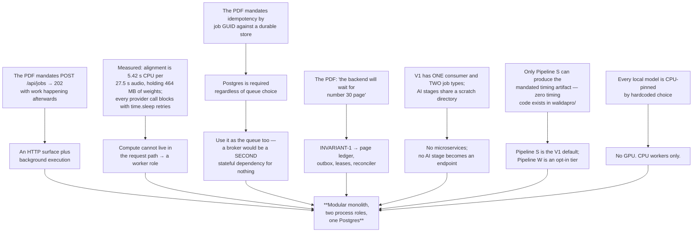

# Final Recommended Architecture

The document someone approves.

## 1. The recommendation, in one paragraph

Build the AI Engine as **one installable Python package, deployed as three entrypoints of a single
container image — `api`, `worker`, `reconciler` — backed by a single Postgres instance and no GPU.**
The `api` role serves exactly one functional endpoint, `POST /api/jobs`, whose only job is to validate a
Keycloak-issued token, validate the body, perform an idempotent `INSERT … ON CONFLICT (job_id) DO
NOTHING`, and return `202`. The `worker` role claims jobs with `SELECT … FOR UPDATE SKIP LOCKED`, fans a
Job A out into one durable ledger row per page, and drives each page independently through the existing
AI pipeline — render, extract, diacritize, or synthesize-and-align — before uploading artifacts through
the mandated three-step cycle and writing its progress callbacks to a transactional outbox. The
`reconciler` enforces the one invariant that matters: **every page in `1..pagesCount` reports exactly
once, or the whole job is failed.** Existing AI code is wrapped behind eight ports, never rewritten.

## 2. The decision chain

Each decision follows from the one above it, not from preference.

| Decision | Because | Record |
|---|---|---|
| An HTTP service, not a library | The PDF specifies a wire contract between two teams with different stacks | [C-01](24-architecture-challenge.md) |
| A separate worker role | A page is seconds-to-minutes of blocking CPU + network, with 464 MB resident | [ADR-002](19-adrs.md) |
| Not microservices | One consumer, two job types, zero independently-invoked stages, shared scratch | [ADR-002](19-adrs.md) |
| Postgres as store **and** queue | The store is mandatory (REQ-IDEM-02); a broker would be a second stateful dependency | [ADR-004](19-adrs.md), [ADR-005](19-adrs.md) |
| Page ledger + outbox + leases + reconciler | REQ-META-02 makes a dropped page callback a permanent stall | [ADR-010](19-adrs.md) |
| No engine-owned artifact store | The Backend owns storage; two copies diverge | [ADR-006](19-adrs.md) |
| Pipeline S default, W opt-in | W **cannot** produce the timing artifact, costs 40–100× more, and has zero tests | [ADR-009](19-adrs.md) |
| Model ids as config | They are hardcoded constants today, several of them `-preview` | [ADR-008](19-adrs.md) |
| No GPU | Every local model is CPU-pinned in code | [18-deployment.md](18-deployment.md) §4 |
| Exactly one API surface | An internal ML function is never automatically an endpoint | [08-ai-integration.md](08-ai-integration.md) §3 |

## 3. What "V1 done" means

Verifiable acceptance criteria, each traced to a statement in the spec.

### Protocol conformance

- [ ] `POST /api/jobs` returns **202** for both job types. *(REQ-JOB-01)*
- [ ] The same `jobId` twice returns **202 both times** and executes **once**. *(REQ-IDEM-01/02 — "if
      already enqueued return 202 accepted")*
- [ ] A Backend token is obtained via `client_credentials`, cached **in memory only**, and reused until
      fewer than 30 s of its 300 s life remain. *(REQ-AUTH-01/02/03 — "5 minutes minus 30 sec")*
- [ ] A `401` from any Backend endpoint triggers one forced refresh and one retry. *(REQ-AUTH-04)*
- [ ] An expired `sourceDownloadUrl` is recovered via `GET /api/files/{fileId}/get-download-url`.
      *(REQ-SRC-02)*
- [ ] `PATCH /api/jobs/{jobId}/metadata {pagesCount:N}` is observed **before any page artifact upload**.
      *(REQ-META-01 — "before start text and image extraction")*
- [ ] Each page's uploads follow `initialize-upload` → `PUT` → `confirm-upload`, in the order
      image-then-text (Job A) and audio-then-json (Job B). *(REQ-UPL-01..05 — "call upload cycle per
      (image) then (text)")*
- [ ] `PATCH …/{pageNumber}/completed` is sent **only after both** uploads confirm, with
      `artifactType` values exactly `Image`/`Text` or `Audio`/`JSON`. *(REQ-CB-01/02/03 — "And after
      both file success")*
- [ ] Only the four permitted content types are ever sent. *(REQ-UPL-04)*
- [ ] An unparseable source produces `PATCH /api/jobs/{jobId}/failed` and **no page callbacks**.
      *(REQ-CB-05 — "you cant parse or get the pdf")*

### INVARIANT-1

- [ ] For a job with `pagesCount = N`, exactly one terminal callback per page in `1..N`, in a run where
      one page errors and another times out. *(REQ-META-02 — "whether they fail or succeed, if 29, no,
      the backend will wait for number 30 page")*
- [ ] A worker `SIGKILL`ed mid-page recovers: one terminal report per page, no duplicate confirmed
      upload.
- [ ] After a full run, `ai_engine_outbox_pending == 0` and
      `ai_engine_pages_total{outcome="force_failed"} == 0`.

### Artifacts

- [ ] One `image/jpeg` per page, on **every** OCR path — including LightOn, which produces no page image
      today. *(REQ-ART-01)*
- [ ] One `text/plain` per page, UTF-8 without BOM, **byte-identical across two runs of the same page**
      (because Job B re-tokenizes it). *(REQ-ART-02)*
- [ ] One `audio/wav` per page — exactly one, not the two narrators the pipeline produces today.
      *(REQ-ART-03)*
- [ ] One `application/json` timing artifact per page: schema-valid, monotonic, non-overlapping, all
      timings within `[0, duration_ms]`, `t_src` present iff `t` is. *(REQ-ART-04)*

### Engineering

- [ ] `pytest src/tests` → **56 passed**, in CI, on every commit.
- [ ] All 20 critical tests in [17-testing-strategy.md](17-testing-strategy.md) §4 pass.
- [ ] A clean-venv `pip install -e .` works; every dependency is version-pinned.
- [ ] `docker compose up` from cold reaches all-ready **with no network access to HuggingFace**.
- [ ] No secret in the repository; **all eight keys rotated**; the three dead keys revoked.
- [ ] Every latency figure in this document set has been replaced by a measured value from `T-0.3`.
- [ ] The import-layer contract passes: no `api → adapters`, no `api → src.pipeline`/`walidapro`.

### Answered questions

- [ ] `Q-01` inbound token validation — **blocks implementation**.
- [ ] `Q-04` `Text` artifact semantics — **blocks integration**.
- [ ] `Q-05` `pageNumber` indexing — **blocks integration**.
- [ ] `Q-02`, `Q-03` Backend endpoint idempotency.
- [ ] `Q-07` is V1 accepted on protocol conformance or AI accuracy — **determines whether this
      architecture is the right one at all**.

## 4. What is deferred, and what triggers it

| Deferred | Trigger |
|---|---|
| Verified tier as the default | All four [ADR-009](19-adrs.md) criteria: `Q-07` answered as accuracy; the per-word diacritics loop parallelized (`T-8.1`); a measured cost-per-book approved; `walidapro/` has tests (`T-8.2`) |
| Consolidating the two pipelines (`T-8.8`) | After V1 ships **and** `T-8.2` lands. A 16,155-LOC merge is much safer with tests and observability in place. |
| The human-in-the-loop correction path | A product decision to add a review stage. It is human-gated **by design** — `tools/context_detector.py:148-160` defaults every decision to `"reject"` — so automating it would defeat its purpose. |
| Bounding boxes as an artifact | `Q-10`. The V1 contract has **no `artifactType` slot for them at all**, so this is a contract change, not an implementation task. |
| A message broker | Sustained enqueue > ~50 jobs/s, claim-query p99 > 50 ms, or a need for priority classes ([ADR-004](19-adrs.md)) |
| Distributed tracing | Page latency becomes the dominant operational problem |
| Automatic provider failover | A provider outage becomes frequent enough to warrant it — note it would also silently change the geometry contract |
| GPU inference | Any stage moves to a GPU model ([ADR-003](19-adrs.md)) |
| A compressed audio codec (`T-8.6`) | `Q-09`. WAV is 86% of everything we upload — 36 GB vs 12 GB at 1,000 books. |
| Hume native word timestamps as default (`T-8.7`) | Quota economics. Measurably better: **93.7% vs 51.0% anchored** on real books. |
| mTLS between the services | `Q-15` |
| Inbound rate limiting | A second consumer appears |
| Sandboxed PDF parsing | The caller stops being a single trusted first party |

## 5. If you only read one page

**What exists.** 22,018 lines of working Arabic OCR and TTS code, in two disconnected pipelines, with
186 real page artifacts on disk to prove it runs. The AI is real and in places genuinely careful — the
diacritizer cannot change letters, the vision model never sees the answer it is being asked to confirm,
and the final text reviewer refuses rather than guesses.

**What does not exist.** Anything that makes it a service. No HTTP surface, no queue, no database, no
authentication, no object storage, no job identity, no packaging, no container, no CI, and — worth
stating on its own — **no timing instrumentation of any kind**, which is why the latency figures in these
documents are estimates.

**What V1 is.** A thin, well-bounded service around code we do not rewrite. Roughly 2,500–3,500 lines of
new backend code across nine well-understood components; 42% of the existing production LOC reused as-is
or wrapped, 71% salvageable in total, and the 29% discarded is all orchestration.

**The single hardest requirement** is not the AI. It is this sentence from page 3 of the spec: *"the
backend will consider that you finish your process after you completed the 30 pages whether they fail or
succeed, if 29, no, the backend will wait for number 30 page."* Every page loop in the existing codebase
violates it — they all `break` on the first error. Four mechanisms exist in this design solely to satisfy
it, and two metrics exist solely to prove it is being satisfied. If those two metrics are zero, no book
is stranded.

**The best news** is that two of the four mandated artifacts already exist as computed data that is
thrown away. The `Text` artifact is one discarded local variable at
`src/pipeline/run_ocr_gemini.py:65`. The timing JSON is a projection of fields already written into
`pNNN.json`. That is formatting work, not AI work.

**The three things to settle before building.** `Q-01`: how do we validate the inbound token — the only
question that blocks writing code. `Q-04`: is the `Text` artifact raw or final text — it defines both
job scopes. `Q-07`: is V1 judged on protocol conformance or AI accuracy — because the answer decides
whether this architecture is right, or whether two prerequisite projects come first.

**The one thing to show product before accepting V1.** 21.8% of word timings are interpolated rather
than measured, and on the Gemini TTS path it is 47.8%. For a reading-education product built on
word-level highlighting, that is the weakest part of the delivery, it is a model-capability limit rather
than a bug, and it should be seen in a working reader before anyone signs off.
