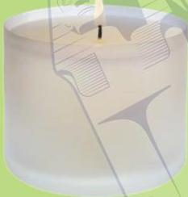

C

يعيش في بيئة مختلفة.
لا يمكن، فكرهما

ماذا يحدث لو التقى
الحوت بالفيل؟

نحن

## الحيتان في الصناعة

استُخدمت مادة العنبرية في
وقت من الأوقات في صناعة
مستحضرات التجميل،
والشموع.

تُعرف هذه المادة باسم «العنبرية». ومنها جاء اسم
«حيتان العنبر»، ولكن العلماء لم يتوصلوا بعد إلى
معرفة الغرض منها.

13