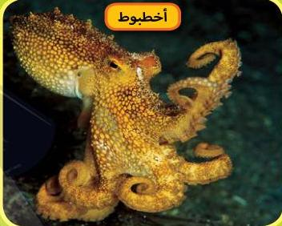
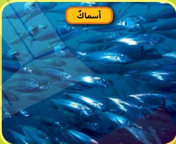
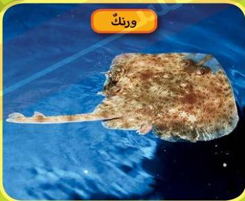

في بعض الأحيان لا يتوافر ما يكفي من الطعام في مكان واحد في المحيط. وفي أثناء بحث الحيتان عن الطعام تعيش على دهنٍ مُخَزَّنٍ في أجسامها يُسَمَّى الشحم.

أخطبوط

أسماك

ورنك

## مصطلحات عن الحيتان

شحم الحوت: هو طبقة من الدهون في جسم الحوت تتحول إلى طاقة لتدفئته.

23