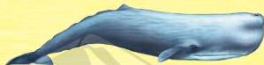

العنوان: الحيتان
السلسلة: اقرأ مع ناشيونال جيوجرافيك
تأليف: لورا مارش
ترجمة: إدارة الترجمة والنشر
إشراف عام: داليا محمد إبراهيم

مارش، لورا
الحيتان/ ترجمة دار نهضة مصر، إدارة الترجمة والنشر. - القاهرة: دار نهضة مصر، 2021
48 ص. 15 * 22.5 سم
المستوى الثالث
تدمك: 978-977-14-6029-9
1 - تعليم الأطفال.
أ - دار نهضة مصر، إدارة الترجمة والنشر
2 - قصص الأطفال.
(مترجم)

372.218

Original English title: Whales (NG Readers)

Copyright © 2010 National Geographic Partners, LLC. All rights reserved.

National Geographic Kids and Yellow Border Design are trademarks of National Geographic Society, used under license.

Published in Arabic by Nahdet Misr Publishing House,
upon agreement with National Geographic Partners, LLC.

All rights reserved.

ترجمة كتاب Whales

تصدرها دار نهضة مصر للنشر بترخيص من شركة National Geographic Partners, LLC.

يحظر طبع أو تصوير أو تخزين أي جزء من هذا الكتاب سواء النص أو الصور
بأية وسيلة من وسائل تسجيل البيانات، إلا بإذن كتابي صريح من الناشر.

الترقيم الدولي: 978-977-14-6029-9
رقم الإيداع: 19144 / 2021
طبعة: إبريل 2025

تليفون: 33466434 - 33472864
فاكس: 02 33462576

خدمة العملاء: 16766
Website: www.nahdetmisr.com
E-mail: publishing@nahdetmisr.com

نهضة مصر
للنشر

أسسها أحمد محمد إبراهيم سنة 1938

21 شارع أحمد عرابي -
المهندسين - الجيزة