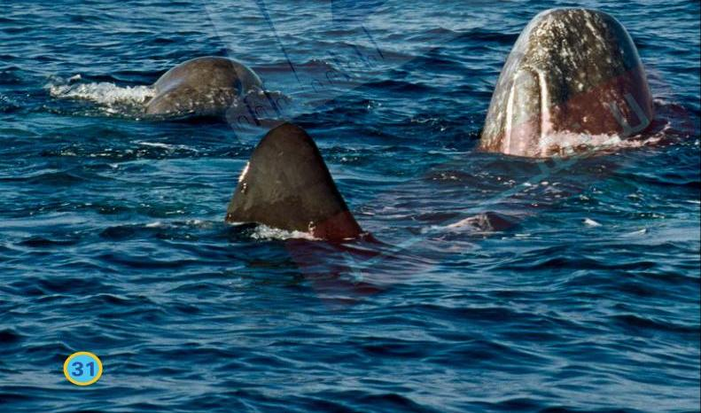

يشبه عجلُ الحوتِ الأطفالَ الصِّغارَ، فهو يحبُّ اللعبَ كثيرًا. تلعبُ العجولُ الصغيرةُ على سطحِ الماءِ في أثناءِ غوصِ الحيتانِ الكبيرةِ لإحضارِ الطعامِ.

لا تتوقفُ ذكورُ حيتانِ العنبرِ عن النموِّ حتى تبلغ 50 سنة تقريبًا. أما إناثُ الحيتانِ فتتوقفُ عن النموِّ عندما تبلغ 30 سنة.

31