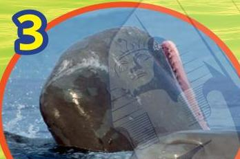

# 10

## أشياء رائعة عن حيتان العنبر

1

يبلغ وزن الحيتان حديثة الولادة طناً واحداً، ويبلغ طولها 13 قدماً.

3

يبلغ طول أسنان حيتان العنبر 10 بوصات، ويبلغ وزن السنّ الواحدة رطلين.

2

يتخفض معدل نبضات قلب الحيتان عند الغوص في الأعماق حتى لا تستهلك كماً كبيراً من الأكسجين.

5

يصدر حوت العنبر صوتاً عاليًا عند ضرب ذيله على سطح الماء. لا نعلم لماذا يفعل هذا، فربما تكون هذه إحدى وسائل التواصل مع الحيتان الأخرى.

4

تتخذ فتحة التنفس عند حوت العنبر شكل حرف S باللغة الإنجليزية.

32