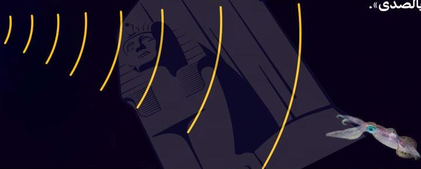

# لغة الحيتان

تتحدثُ حيتانُ العنبر مع بعضها عن طريق إصدار صوت نقرات.
وتُستخدم هذه الأصوات أيضاً فيما يُعرف باسم «تحديد الموقع
بالصدى».

تستخدم حيوانات مثل الدلافين والخفافيش والحيتان ذوات
الأسنان أسلوب تحديد الموقع بالصدى للتحرك في الظلام،
حيث تصدر الحيتان موجات صوتية تصطدم بالأشياء الموجودة
في طريقها وتعود إلى الحوت. بهذه الطريقة يمكن للحوت معرفة
حجم هذه الأشياء ومسافة بعده عنها.

34