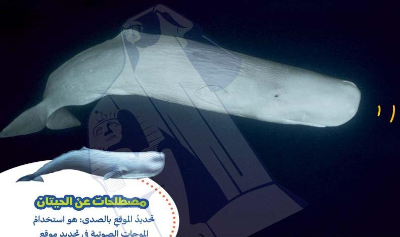

الحيّام

من يصدرُ الضوضاءَ في المحيط؟

نحن

## مصطلحات من الحيتان

تحديدُ الموقعِ بالصدى: هو استخدامُ الموجاتِ الصوتيةِ في تحديدِ موقعِ الأشياء.

تستخدمُ الحيتانُ تحديدَ الموقعِ بالصدى لثلاثةِ أغراضٍ:

1. معرفةِ الطريقِ في أعماقِ المحيطِ المظلمةِ.

2. تحديدِ مكانِ الطعامِ.

3. العثورِ على صغارِها عندَ سطحِ الماءِ.

35