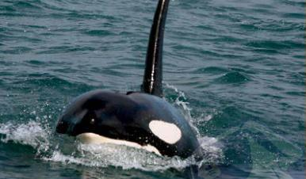
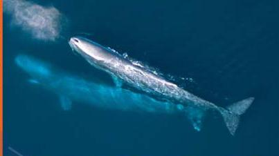
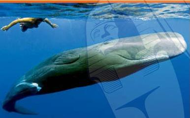
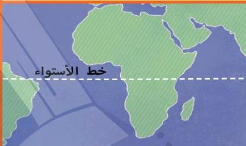
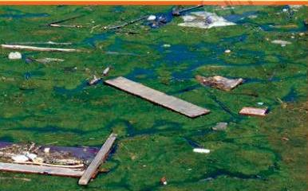
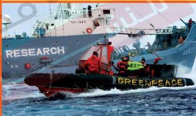

**حيوانٌ مفترشٌ:** حيوانٌ يأكل غيره من الحيوانات الأخرى.

**الزواج:** تحتاج معظم الحيوانات للزواج من أجل إنجاب الأطفال.

**شحْمُ الحوت:** طبقة من الدهون في جسم الحوت تتحول إلى طاقة وتعمل على تدفئته.

**خطُّ الاستواء:** خطٌ وهميٌّ يلتف حول الأرض، ويبعد المسافة نفسها عن القطب الشمالي والقطب الجنوبي.

**التلوث:** تعرض البيئة للضرر بسبب ما يلقيه الإنسان فيها من مخلفات.

**صيدُ الحيتان:** البحث عن الحيتان لقتلها.

47