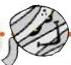
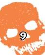

مجمع
موسوعة

بِمَاذَا نَصْفُ الْمُومِيَاءِ الَّتِي
تَأْكُلُ كَثِيرًا مِنَ الْبَسْكُوتِ؟

س

لَا تَنْمُو الْبَكْتِيرِيَا الَّتِي تُحَلِّلُ أَجْسَامَ الْكَائِنَاتِ الْحَيَّةِ نَمُوًّا جَيِّدًا
فِي الْأَمَاكِنِ شَدِيدَةِ الْبُرُودَةِ، أَوْ الْأَمَاكِنِ الْجَافَةِ
وَمُرْتَفِعَةِ الْحَرَارَةِ، أَوْ فِي الْأَمَاكِنِ الَّتِي تُعْرَفُ بِاسْمِ
الْمُسْتَنْقَعَاتِ.

وَلِهَذَا عَثَرَ النَّاسُ عَلَى مُومِيَاوَاتٍ عِنْدَ قِمَمِ الْجِبَالِ
الْمُتَجَمِّدَةِ وَفِي الصَّحَارِي الْحَارَةِ.

الْمُسْتَنْقَعَاتُ هِيَ أَرَاضٍ رَطْبَةٌ تَنْمُو فِيهَا نَبَاتَاتٌ
كَثِيرَةٌ. وَتُحْفَظُ الْمُومِيَاوَاتُ الْمَدْفُونَةُ فِي
الْمُسْتَنْقَعَاتِ حِفْظًا جَيِّدًا، لِدَرَجَةِ أَنَّ الْعُلَمَاءَ
اسْتَطَاعُوا مَعْرِفَةَ أَنَّ أَحَدَ الرِّجَالِ الْبَدَائِيِّينَ كَانَ
يَسْتَخْدِمُ مُثْبَتًا لِلشِّعْرِ!

# المومياوات

# مصطلحات عن

مُسْتَنْقَعٌ: مِنْطَقَةٌ رَطْبَةٌ تَنْمُو فِيهَا أَنْوَاعٌ مُعَيَّنَةٌ
مِنَ الطَّحَالِبِ. وَتَجْعَلُ النَّبَاتَاتِ الْمَوْجُودَةُ فِيهِ
مِنَ الصَّعْبِ عَلَى الْبَكْتِيرِيَا أَنْ تَنْمُوَ وَتَزْدَهِرَ.

