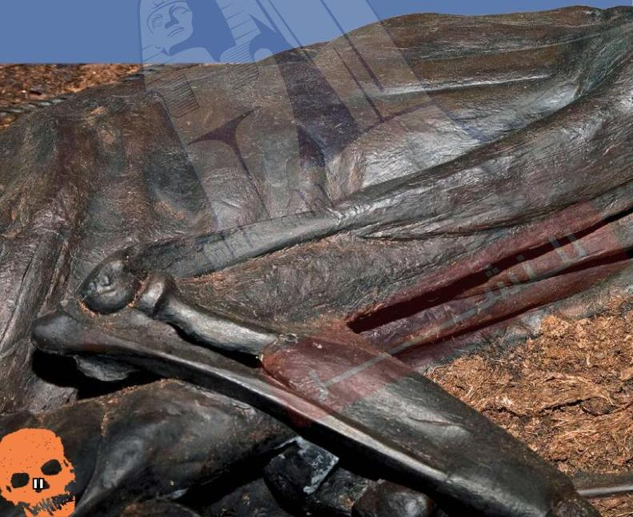

فقد عُثر على مُومياء المستنقع هذه في الدنمارك وقد التَّفَّح  
حبلٌ حولَ عُنقِهِ. ويعتقدُ الخبراءُ أنَّ هذا الرجلَ قد قُتِلَ في  
إطارِ أحدِ الطقوسِ الدينيةِ. ولا تزالُ بقايا آخرِ وجبةِ طعامٍ  
تناولُها منذ 2300 سنةٍ، وهي حساءُ الخضراواتِ، موجودةً  
داخلَ معدتهِ.

11