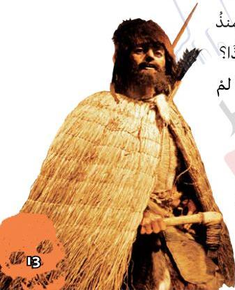

في عام 1991 عثر شخصان يتجولان على الأقدام على جثة رجل متجمد في الجبال الموجودة بين إيطاليا والنمسا. لقد كانت جريمة قتل غامضة حدثت منذ نحو 5300 سنة! إنَّ هذه المومياء، التي عُرفت باسم «أوتزي» هي واحدة من أقدم المومياوات التي عُثر عليها على الإطلاق.

كانت هذه المومياء ترتدي معطفاً، وحذاءً مصنوعاً من الجلد. إلا أنَّ العلماء عندما فحصوا جثة أوتزي بعناية وجدوا مفاجأةً. لقد وجدوا رأس سهم حجرياً مغروزاً في إحدى كتفيه. فلقد أطلق سهم على أوتزي من الخلف فقتله! من الذي قتل أوتزي منذ أكثر من خمسة آلاف سنة؟ ولماذا؟ حتى الآن ما زالت هذه القضية لم يُحلَّ لغزها!

شكل تخيلي
لأوتزي

13