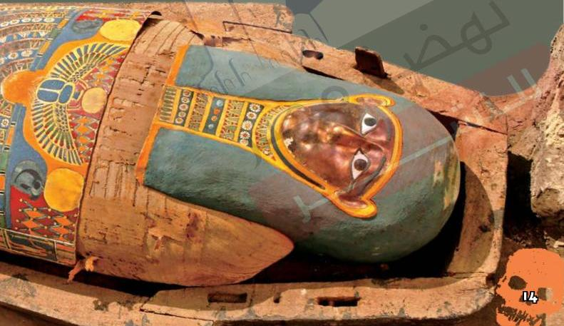

# موصولات من
# تحنيط الإنسان

عرف البشر حفظ الجثث منذ آلاف السنين. فقد
كانت الكثير من الحضارات تؤمن بأن روح الإنسان
لا تفنى بعد الموت. فيما عُرف باسم «التحنيط»
وكان المصريون القدماء أشهر من عرف التحنيط.

نعم.

14