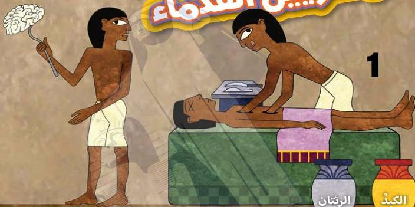
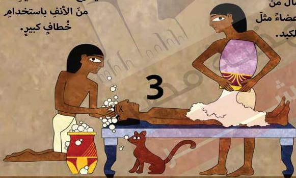

# طريقة التحنيط عند المصريين القدماء

2

1

الرئتان

الكبد

يزيل العمال من
الجسم أعضاء مثل
الرئتين والكبد.

يُخرج عمال التحنيط المخ
من الأنف باستخدام
خطافٍ كبير.

3

يَغْسِلُ العُمَالُ الجُثْمَانَ ويَغْطُونَهُ بالملح.

18