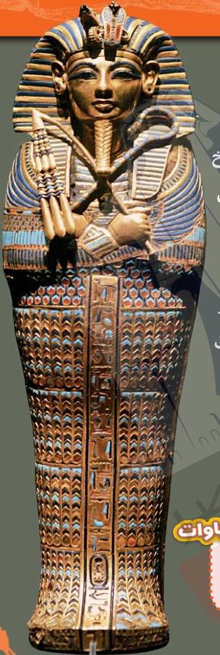

لقد عثرَ كارتر على مقبرة توت عنخ
آمون! توفي الملكُ توت منذ أكثر من
3300 عام، وكان في الثامنة عشرة
فقط من عمره. ومع ذلك، دفن هذا
الملك الشاب ومعه كنوز لا تقدر
بثمن. وقد جعلت هذه المقبرة الملك
توت أشهر مومياء في العالم.

للتأثيث
مصطلحات عن المومياوات

مقبرة: تعني قبراً.. وهي عبارة عن
حجرة أو بناء لدفن المتوفى.

21