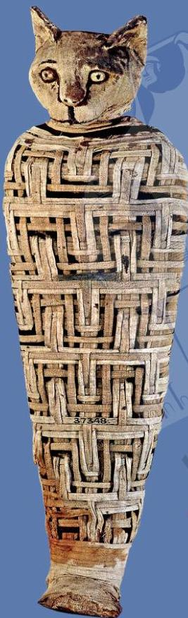

# حيوانات مختلطة

لم يكتفِ المصريون القدماء بتحنيط البشر فقط، ولكنهم حنّطوا الكثير من الحيوانات أيضاً!

ففي بعض الأحيان كانت الحيوانات الأليفة المفضلة تُحنّط وتُدفن مع مالكيها. وكان المصريون القدماء يعتقدون أن القطط حيوانات مميزة للغاية. وأحياناً كانت الأسرة بأكملها تقيم الحداد عند موت قطّة.

24