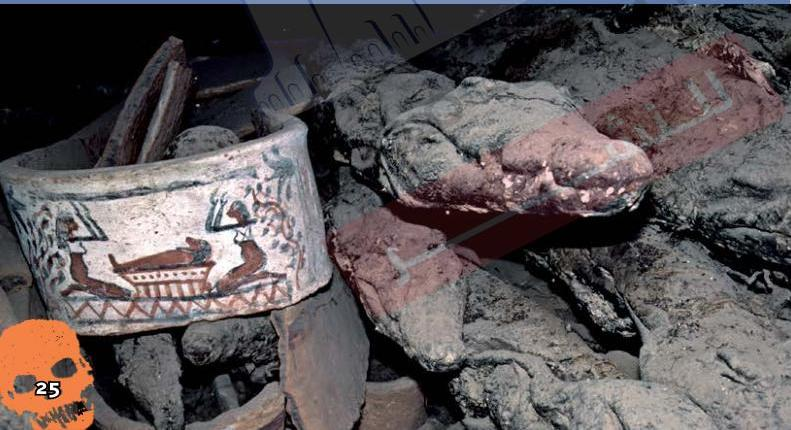

حَنَّطَ الْمِصْرِيُّونَ الْقُدَمَاءُ أَيْضًا
الْكِلَابَ وَالتَّمَاسِيحَ وَالْقُرُودَ
وَالطُّيُورَ، وَكَانُوا يَعْتَقِدُونَ أَنَّ هَذِهِ
الْحَيَوَانَاتِ تُرْضِي الْأَلِهَةَ.

# مصطلحات عن المومياوات

الجداد: هو الشعور بالحزن الشديد
والتعبير عنه.

25