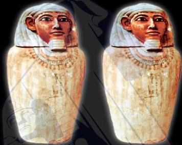

العنوان: المومياوات
السلسلة: اقرأ مع ناشيونال جيوجرافيك
تأليف: إليزابيث كارني
ترجمة: إدارة الترجمة والنشر
إشراف عام: داليا محمد إبراهيم

كارني، إليزابيث
المومياوات/ ترجمة دار نهضة مصر، إدارة الترجمة والنشر. - القاهرة: دار نهضة مصر، 2021
32 ص. 15 * 22.5 سم
المستوى الثاني
تدمك: 978-977-14-6026-8
1 - تعليم الأطفال.
أ - دار نهضة مصر للنشر، إدارة الترجمة والنشر
2 - المومياوات.
(مترجم)

372.218

Original English Title: Mummies (NG Readers)
Copyright © 2010 National Geographic Partners, LLC.
All rights reserved. National Geographic Kids and Yellow Border Design are trademarks of
National Geographic Society, used under license.
Published in Arabic by Nahdet Misr Publishing House
upon agreement with National Geographic Partners, LLC.
All rights reserved.

ترجمة كتاب Mummies
تصدرها دار نهضة مصر للنشر بترخيص من شركة National Geographic Partners, LLC.
يحظر طبع أو تصوير أو تخزين أي جزء من هذا الكتاب سواء النص أو الصور
بأية وسيلة من وسائل تسجيل البيانات، إلا بإذن كتابي صريح من الناشر.

الترقيم الدولي: 978-977-14-6026-8
رقم الإيداع: 2021/19141
طبعة: إبريل 2025

تليفون: 33466434 - 33472864 02
فاكس: 33462576 02

خدمة العملاء: 16766
Website: www.nahdetmisr.com
E-mail: publishing@nahdetmisr.com

نهضة مصر
للنشر
أسسها أحمد محمد إبراهيم سنة 1939

21 شارع أحمد عرابي -
المهندسين - الجيزة