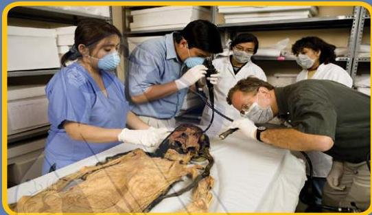

تخبرنا بقايا الطعام الموجودة داخل معدة المومياء عن نوع الطعام الذي كان الناس يتناولونه في ذلك الوقت.

كما تخبرنا العظام المكسورة عن طبيعة حياة هذا الشخص، وأحياناً عن الطريقة التي مات أو ماتت بها. وكذلك يدرس العلماء ملابس المومياء والأشياء المدفونة معها.

فكل هذه الأشياء تحمل أدلة على الطقوس الدينية لهذه الشعوب وطريقة حياتها. فالمومياوات تشبه إلى حد ما آلة الزمن؛ فهي تمكننا من رؤية الماضي والتعرف عليه.

31