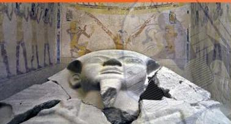
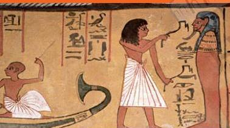

# مصطلحات مصورة

**بكتيريا:** كائنات حية صغيرة الحجم للغاية لا يمكن رؤيتها إلا باستخدام المجهر، وقد تسبب البكتيريا الأمراض للبشر.

**التحلل:** يعني التعفن أو التلف.

**مقبرة:** تعني قبراً.. وهي عبارة عن حجرة أو بناء لدفن المتوفى.

**المستنقع:** منطقة رطبة تنمو فيها أنواع معينة من الطحالب، وتُصعب النباتات الموجودة في هذا المكان على البكتيريا أن تنمو وتزدهر.

**حضارة:** نظام اجتماعي يعين الإنسان على زيادة إنتاجه في كافة المجالات.

**التحنيط:** معالجة جثمان المتوفى بطريقة خاصة تمنعه من التحلل.

32