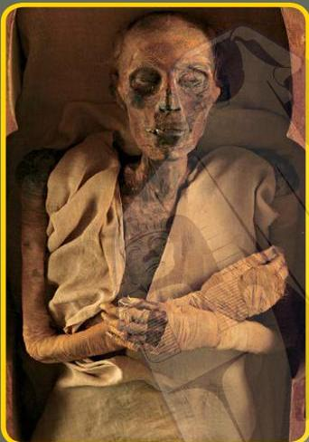

المُومِياءُ هِيَ جَنَّةٌ لَمْ تَتَحَلَّلْ.

وَتُوجَدُ طَرِيقَتَانِ لِتَحْنِيطِ المُومِيَاءِ.

فَيُمْكِنُ أَنْ يَسْتَخْدِمَ الْبَشَرُ مُوَادًّا
كِيمِيَانِيَّةً قَاتِلَةً لِلْبَكْتِيرِيَا فِي
تَحْنِيطِ الْأَجْسَامِ.

كَذَلِكَ قَدْ تَتَحَوَّلُ الْجَنَّةُ إِلَى مُومِيَاءَ
بِطَرِيقَةٍ طَبِيعِيَّةٍ إِذَا وُجِدَتْ فِي
الْمَكَانِ وَالْوَقْتِ الْمُنَاسِبِينَ. وَفِي
مِثْلِ هَذِهِ الْأَمَاكِنِ تَتَحَوَّلُ جَنَّةُ أَيِّ
كَائِنٍ حَيٍّ يَمُوتُ إِلَى مُومِيَاءَ!

**المُومِيَات**

**مُصطلَحَاتٌ عَنْ**

بَكْتِيرِيَا: هِيَ كَائِنَاتٌ حَيَّةٌ صَغِيرَةٌ لِلْغَايَةِ لَا يُمْكِنُ
رُؤْيَتُهَا إِلَّا بِاسْتِخْدَامِ الْمَجْهِرِ.
تَحَلَّلَ: يَعْنِي التَّعَفُّنَ أَوِ التَّلَفَ.

7