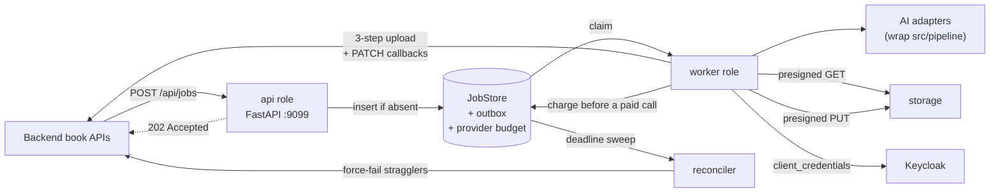
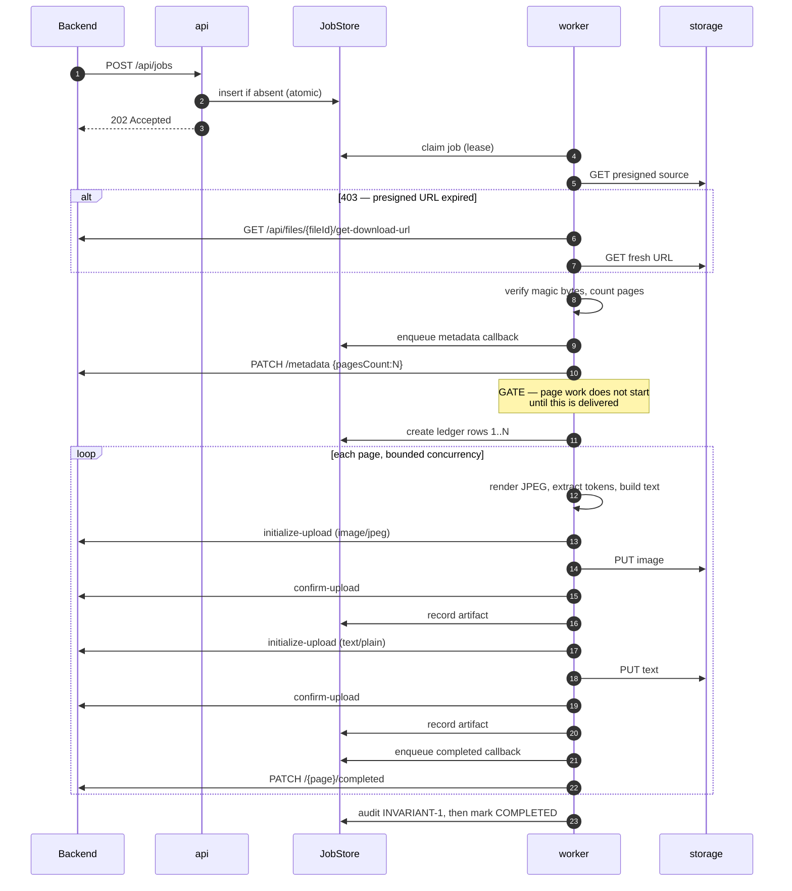

# Architecture

## 1. Two process roles, one codebase



The API does one indexed insert and returns. Everything expensive is in the worker, because
a page of AI work is seconds to minutes of blocking CPU holding hundreds of megabytes of
model weights — it must never be reachable from an HTTP handler.

That is not a convention here. It is a test:
`tests/unit/test_domain_purity.py::test_api_layer_never_imports_adapters_or_legacy_pipelines`.

## 2. Layers, and what each may import

```
api/          HTTP only. Routers, schemas, auth, the error envelope.
  ↓
application/  Use cases: accept, Job A, Job B, page task, outbox, reconcile, loop.
              Transaction boundaries. Knows ports, not adapters.
  ↓
domain/       Entities, enums, errors, invariants. STDLIB ONLY.
  ↑
ports/        Protocols. Specifications with contracts, no implementations.
  ↑
adapters/     The only layer that may import an SDK or the legacy pipelines.
```

| Layer | May import | Must **not** import |
|---|---|---|
| `api/` | `application/`, `domain/`, `api/schemas` | any adapter, any SDK, `pipeline`, `walidapro` |
| `application/` | `domain/`, `ports/` | concrete adapters (they arrive by injection) |
| `domain/` | **the standard library, and nothing else** | pydantic, sqlalchemy, httpx, everything |
| `ports/` | `domain/` | any implementation |
| `adapters/` | `ports/`, `domain/`, SDKs, `pipeline` | `api/`, `application/` |

`domain/` being stdlib-only is the test of whether the layering is real. If the business
rules could only be imported alongside pydantic and a database driver, the INVARIANT-1
predicates could not be tested in isolation — and those are the rules that matter most.
Enforced by `test_domain_imports_only_stdlib_and_itself`.

## 3. Module map

**8,738 lines across 65 files.**

| Module | Lines | What it is |
|---|---:|---|
| `domain/enums.py` | 125 | Wire-exact enums. `ArtifactType` is `Image`/`Text`/`Audio`/`JSON`, capitalised as the Backend expects. |
| `domain/errors.py` | 256 | The 15-code taxonomy, HTTP mapping, retryable classification, and `FailureReason` — which redacts at construction so an unsafe reason cannot be built. |
| `domain/tokens.py` | 193 | `Token`, `TimedToken`, `BindReport`, `AudioFormat`, `PageProvenance`. Mirrors the real on-disk page records. |
| `domain/job.py` | 157 | `Job`, `PageTask`, `Artifact`, `ArtifactDescriptor`, canonical payload hash. |
| `domain/invariants.py` | 106 | INVARIANT-1 as pure predicates: `audit_pages`, `audit_completion`, `pages_awaiting_report`. |
| `domain/budget.py` | 142 | Provider budget policy: fixed epoch-aligned windows, the allow/refuse decision, and spec parsing. No I/O. |
| `domain/callbacks.py` | 122 | `CallbackEnvelope` — the four progress calls, with exact paths and bodies. |
| `ports/*.py` | 386 | 12 Protocols: OCR, diacritizer, TTS, aligner, renderer, verifier, source fetcher, uploader, callbacks, token provider, job store, rate budget. |
| `application/accept_job.py` | 150 | Idempotent accept. The only business logic in the request path. |
| `application/run_extraction_job.py` | 242 | Job A: fetch → count → **gate on metadata delivery** → fan out → verify INVARIANT-1. |
| `application/run_audio_job.py` | 288 | Job B: fetch text → tokenize → synthesize → align → build → upload → report. |
| `application/run_page_task.py` | 288 | One page to exactly one terminal report, under a wall-clock deadline. |
| `application/worker_loop.py` | 184 | Claim, run, drain, reconcile. Survives store, drain and runner failures. |
| `application/outbox.py` | 92 | Delivers callback intents, at-least-once, parks after the cap. |
| `application/reconcile.py` | 144 | The deadline enforcer, correct for both job types. |
| `adapters/ai/renderer_pymupdf.py` | 99 | Streaming page render, page count, PDF verification. |
| `adapters/ai/ocr_textlayer.py` | 88 | The free, exact OCR path. Wraps `pipeline.extract`. |
| `adapters/ai/ocr_providers.py` | 403 | `GeminiVisionOcr`, `LightOnOcr`, and `build_ocr_engine` — which resolves `auto` per document and prefers the free path. |
| `adapters/ai/tts.py` | 195 | `GeminiTts` (paid, with a duration sanity gate) and `SyntheticTts` (free, real WAV). |
| `adapters/ai/aligner_whisper.py` | 169 | Forced transcription plus `speak.bind` **verbatim**. Injectable transcriber. |
| `adapters/ai/legacy.py` | 58 | The single module that knows `src/pipeline` resolves via `sys.path`. |
| `adapters/auth/jwks_verifier.py` | 252 | Inbound JWT validation. RS256 only, rotation-aware, fails closed. |
| `adapters/backend/token_provider.py` | 129 | Keycloak `client_credentials`, in-memory, single-flight. |
| `adapters/backend/files_client.py` | 226 | The three-step upload cycle and download-URL refresh. |
| `adapters/backend/jobs_client.py` | 83 | The four progress callbacks. |
| `adapters/http/retry.py` | 309 | The one retry policy. `classify` is pure and directly tested. |
| `adapters/storage/source_fetcher.py` | 201 | Presigned GET, 403-as-expiry, SSRF controls, magic bytes. |
| `adapters/persistence/memory.py` | 280 | In-memory `JobStore` with real atomicity. Fast, non-durable, single process. |
| `adapters/persistence/sql.py` | 889 | The durable `JobStore`: SQLite in Postgres shape. WAL, `BEGIN IMMEDIATE` claims, partial unique indexes, versioned schema, `POSTGRES_DELTA` in the module. |
| `adapters/persistence/rate_budget.py` | 269 | Three budget counters — unlimited, per-process, and the fleet-wide one that shares the store's database. |
| `adapters/persistence/factory.py` | 48 | Choosing a store from configuration. Its own module so `api` need not import `main`. |
| `artifacts/*` | 217 | The deterministic tokenizer and the two artifact projections. |
| `api/*` | 778 | App factory, routers, schemas, dependencies, error handlers. |
| `observability/*` | 429 | Structured logging with redaction, metric registry, correlation contextvars. |
| `config/settings.py` | 302 | Every setting, validated at startup. |
| `worker.py` | 248 | Composition root. The only module that knows the concrete types. |

## 4. Job A, step by step



Every ordering rule in that diagram is asserted by a test in `tests/e2e/`.

## 5. The five INVARIANT-1 mechanisms

Each covers a failure the others cannot. That is why there are five and not one.

### Page ledger, created before any page work

`fan_out_pages` inserts one row per page in `1..pagesCount` *before* the first page runs.
Afterwards the only question is whether each row reached a terminal state — never whether
it exists. That is the direct fix for the legacy `break`, which leaves later pages not
merely unreported but *unknown*.

### Callback outbox

Callbacks are written to the store as *intents*, then delivered by
`application/outbox.py`. Consider *upload image → upload text → send completed*: if the
callback were an in-line HTTP call and the process died just before it, the artifacts would
exist in the Backend's storage, the page would genuinely be done, and nothing would ever
say so. That window is milliseconds and it occurs on every deploy.

Uniqueness is enforced on a **collapsed terminal key**, not on `(job, page, kind)`:
`page_completed` and `page_failed` share one slot per page. Per-kind uniqueness was the
original design and it was wrong — it permitted a `failed` *and* a `completed` for the same
page, which is worse than a duplicate because the two reports contradict each other. A
resumed job found exactly that (`page 3 reported twice: failed then completed`). Now the
domain refuses it in `CallbackEnvelope.dedupe_key`, the store refuses to reset a terminal
page (`TerminalPageError`), and a partial unique index refuses it in SQL. Three layers,
because this one has already happened.

### Leases

A claim sets `lease_until`. An expired lease means the worker is presumed dead and the row
becomes claimable again, with `attempt` already incremented. No distributed lock — just a
timestamp and a sweep.

### Reconciler

The scope is narrower than "INVARIANT-1 enforcer", and being precise matters: lease expiry
already causes a retry, so a page *will* be retried without it. The reconciler is the
**deadline enforcer** — it converts "retried forever" into "reported failed exactly once",
and it is the only thing that can report a page for a worker that died before forming any
intent at all.

`ai_engine_pages_total{outcome="force_failed"}` should be **zero** in normal operation. Any
non-zero value means a worker died mid-page, which is why it is alerted on.

### Parking, and why it is not a violation

One path ends a page attempt with **no terminal report at all**: an exhausted provider
budget. That is safe precisely because it does not *end* the page. The ledger row stays
`PENDING`, so a terminal report is still owed and still enforced — the job's lease is held
until the allowance returns, and if it never does, the reconciler's deadline fails the job
for real.

The alternative was reporting those pages `failed`. That would be a lie: nothing was
attempted. The Backend would mark real pages as failed for a reason that resolves itself in
a few hours. See
[03-configuration.md](03-configuration.md#fleet-wide-provider-budget).

## 6. The Job A → Job B hinge

Job B receives a per-page *text file* and a page number, and must produce timings bound to
the same token ids Job A produced. There is no shared state between the two jobs, so the
correlation has to be reproducible from the artifact alone.

It is, because of one property: the `Text` artifact is built as
`" ".join(token.text for token in tokens)`, and `Token` **rejects any text containing
whitespace**. That makes the join losslessly invertible by `str.split()`, so
`tokenize(text, page_number)` reproduces the exact ids.

```python
tokens = ocr.extract_page(pdf_path=..., page_number=3)  # p003w000, p003w001, ...
text = build_text(tokens).decode()  # "الأَبُ فِي هَذِهِ ..."
assert tokenize(text, 3) == tokens  # ids AND text
```

Asserted by `test_text_artifact_round_trips_through_the_tokenizer` and verified against the
real corpus in the README.

The timing artifact is *also* made self-contained — it carries `txt` per token — so a
reader never has to correlate at all. Belt and braces, for ~1.5 KB per page.

## 7. Error handling

One taxonomy, used identically in API responses, log records, metric labels and the
`reason` strings sent to the Backend. Four rules, each written against a specific defect in
the legacy code:

| Rule | The defect it prevents |
|---|---|
| Never swallow with a blanket `except Exception` | `word_diacritics.py:1296` turns a provider outage into a page of 100% `REVIEW` that still **reports success** |
| Never raise `SystemExit` from library code | 19 sites in the legacy tree; `SystemExit` is a `BaseException`, so it escapes `except Exception` and kills a worker instead of failing a page |
| Always attach `error_code`, `job_id`, `page_number` | makes filter-by-`job_id` actually work |
| **Never let an error escape a page task** | an unhandled exception there strands a book |

The last one is why `PageTaskExecutor.run` catches `BaseException`. It is the most
safety-critical `try` block in the service, and it is deliberate rather than sloppy.

## 8. Redaction

A presigned URL is a bearer credential: the signature grants access to the object. Logging
one is equivalent to logging a password with a long expiry.

Two layers:

- **By key** — `authorization`, `client_secret`, `source_download_url`, `url` and friends
  are replaced wholesale.
- **By pattern** — URLs, `Bearer` headers, JWTs, `key=value` secrets and absolute
  filesystem paths are scrubbed from free text.

Route-ish keys (`path`, `event`, `stage`) are **exempt** from pattern scrubbing.
Over-redaction is a real cost, not a free safety margin: a log line that cannot tell you
which endpoint failed is close to worthless. That balance is asserted by
`test_our_own_url_routes_survive_redaction` and
`test_filesystem_paths_are_still_redacted`.
